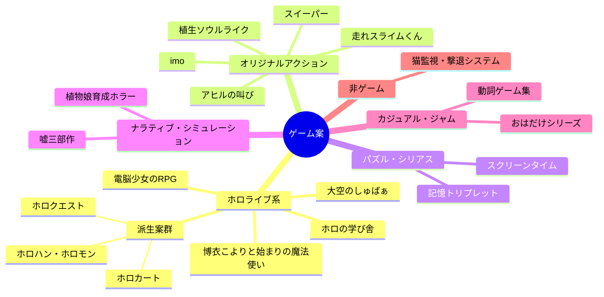

# 🎮 ゲーム設計書 INDEX

> 出典: `D:\個人\ゲーム案.txt`（全案網羅）
> 参照資料: 『レベルデザインの教科書』（Christopher Totten 著／本山博文 訳）、和風配色パレット集『kotonoha_sai』
> テーマカラー: kotonoha_sai「東雲（しののめ）」 &nbsp;#ebcfd2&nbsp; &nbsp;#d996c0&nbsp; &nbsp;#898bbe&nbsp; &nbsp;#6d9bcc&nbsp; &nbsp;#126cb1&nbsp; &nbsp;#09397a&nbsp;

---

## 📚 設計書一覧

| # | ファイル | タイトル | ジャンル | 推奨環境 | 元ネタ行 |
|---|---|---|---|---|---|
| 01 | [01_oozora-no-shuba.md](01_oozora-no-shuba.md) | 大空のしゅばぁ | 2Dコピー能力アクション | Unity | L183-321 |
| 02 | [02_koyori-chemistry-rpg.md](02_koyori-chemistry-rpg.md) | 博衣こよりと始まりの魔法使い | 化学式魔法RPG | Unity | L129-141, L1126-1132 |
| 03 | [03_holo-no-manabiya.md](03_holo-no-manabiya.md) | ホロの学び舎 | 教科別クイズ型ダンジョン | Unity / WPF | L29-78, L176-181 |
| 04 | [04_dennou-shoujo-rpg.md](04_dennou-shoujo-rpg.md) | 電脳少女のRPG | 収集型2D RPG＋ミニゲーム | Unity | L341-451 |
| 05 | [05_hashire-slime-kun.md](05_hashire-slime-kun.md) | 走れスライムくん | 三態変化・謎解きアクション | Unity | L468-493 |
| 06 | [06_sweeper.md](06_sweeper.md) | スイーパー | 蜘蛛ステルス捕食アクション | Unity | L459-466 |
| 07 | [07_imo.md](07_imo.md) | imo | 調理形態変化アクションRPG | Unity | L859-887 |
| 08 | [08_plant-girl-horror.md](08_plant-girl-horror.md) | 植物娘育成ホラー | 育成シミュレーション×ホラー | Unity | L1194-1206 |
| 09 | [09_uso-trilogy.md](09_uso-trilogy.md) | 嘘三部作 | ADV／ライフシム／パズル | HTML5 | L894-941 |
| 10 | [10_ohadake-minigames.md](10_ohadake-minigames.md) | おはだけ＆ミニゲーム集 | カジュアルミニゲーム | HTML5 / WPF | L620-731, L1002-1005 |
| 11 | [11_ahiru-no-sakebi.md](11_ahiru-no-sakebi.md) | アヒルの叫び | 音声認識メトロイドヴァニア | Unity＋Python | L448-449, L663-832 |
| 12 | [12_verb-games.md](12_verb-games.md) | 動詞ゲーム集（12本） | ゲームジャム規模の小品 | HTML5 / Unity | L845-1043 |
| 13 | [13_cat-guard-system.md](13_cat-guard-system.md) | 猫監視・撃退システム | IoT（非ゲーム） | Raspberry Pi＋Qt | L1-27 |
| 14 | [14_misc-concepts.md](14_misc-concepts.md) | その他構想集 | コンセプト集 | 案件別 | 散在 |
| 15 | [15_plant-soulslike.md](15_plant-soulslike.md) | 植生ソウルライク（仮題: VERDANT） | ソウルライク×5派閥 | Unity（PoC: three.js） | 追加案 |
| 16 | [16_memory-triplet.md](16_memory-triplet.md) | 記憶トリプレット | 錯視×錯聴パズル | HTML5（pixi.js） | 追加案 |
| 17 | [17_screen-time-family.md](17_screen-time-family.md) | スクリーンタイム | シリアスADV（依存×親子） | HTML5（React/Next.js） | 追加案 |
| 99 | [99_overview_marp.md](99_overview_marp.md) | 全体概要デッキ（Marp） | プレゼン資料 | — | — |

## 🧪 PoC（プロトタイプ）

**01〜13および15〜17の全案に、ブラウザで開くだけで動く単一HTMLのPoC**を [poc/](../poc/README.md) に用意（pixi.js / three.js / React / SVG / WebAudio）。全PoCにビジュアル強化（パーティクル・スカッシュ&ストレッチ・画面揺れ・彩度フィルタ・トレイル）を実装済み。検証ポイントと操作方法は poc/README.md 参照。14（構想台帳）のみPoC対象外。

---

## 🗺️ 全案の系統マップ

---

## 🏛️ 共通レベルデザイン方針（Totten理論の適用）

『レベルデザインの教科書』から、全設計書で共通に参照する原則:

| 概念 | 章 | 適用方針 |
|---|---|---|
| 分子構造図・隣接関係図 | Ch4 | 各ステージ構成はまずノード図（Mermaid）で設計してからグレーボックス化 |
| 環境アートのティーチング | Ch5 | 同一アセットの象徴的な反復で認知的結びつきを作り、UIテキストに頼らない |
| 眺望と避難（Prospect & Refuge） | Ch6 | 危険地帯の前に必ず「見晴らせる安全地帯」を置き、緊張と緩和を交互に配置 |
| 報酬の空間と拒絶 | Ch7 | 報酬は「見せてから否定する」。一貫した報酬スケジュールで探索を動機付け |
| Level 1-1 チュートリアル理論 | Ch8 | 1面は「安全に失敗できる」構造で全コアメカニクスを言葉なしで教える |
| ペーシングとナラティブ | Ch9 | ドラマティックアークをステージ進行のペーシング調整に使う |
| サウンドとリズム | Ch13 | 3Dサウンドを「道標」として使い、報酬取得のフィードバック音を統一 |

## 🎨 共通配色方針（kotonoha_sai の運用）

- 各ゲームに **世界観に合う名前付きパレット** を割当て（章: 情景／天文／感情／季節／自然／時間）
- 用途を4役に固定: **背景（低彩度）／ UI（高明度）／敵・危険（対比色）／報酬（最高彩度）**
- Totten Ch5「色彩理論やコントラストで重要情報を際立たせる」に従い、**報酬色は背景と補色関係**になるパレットを選ぶ

## 👥 ターゲット分析の共通ソース（txt末尾のペルソナ）

| ペルソナ | 嗜好 | 設計への反映 |
|---|---|---|
| 松浦 | 単純操作×プレイヤースキル、収集、自由度、疾走感 | 収集要素・スピード感のある操作 |
| そめりん | 3D酔いする、頭脳系（麻雀・タワーディフェンス） | 2D固定カメラ・思考型モード |
| やっさん | エルデン・スト6等の刺激、アチーブ、破壊の爽快感 | 実績システム・破壊表現 |
| ベンティ | 音ゲー好き、ホラー苦手、二次元ビジュアル重視 | サウンド演出・キャラビジュアル |

> カイヨワの遊び分類（アゴン=競争／アレア=運／ミミクリ=模倣／イリンクス=眩暈）を各設計書のコンセプト整理に使用。
