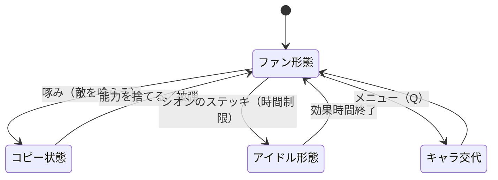
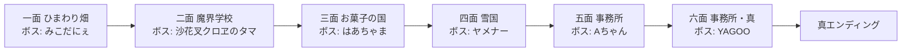
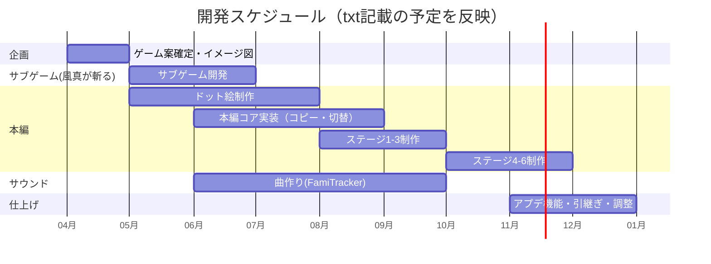

# 🦆 大空のしゅばぁ — ゲーム設計書

2Dアクション コピー能力 ドット絵×チップチューン

> 🧪 PoC: [poc/01_oozora-no-shuba/index.html](../poc/01_oozora-no-shuba/index.html)（pixi.js — 啄みコピー・吸い込み演出・パララックスの検証）

## 1. コンセプト

**「ある日目が覚めると、体がそれぞれのファンの姿になっていた。真の姿を取り戻すべく、スバルたちは旅に出た」**

星のカービィ・スマブラSP灯火の星・マリオ＆ルイージRPG4をイメージソースとする、ホロライブ二次創作の2D横スクロールアクション。敵を「啄む」ことで能力をコピーし、シオンのステッキで一時的にアイドルの姿（本来の能力）へ戻れる**二段変身システム**が核。現実とネットの二つの世界を行き来してルーナ姫を救い出す。

- カイヨワ分類: **ミミクリ（模倣）× アゴン（競争）** — コピー＝模倣そのものを遊びの中心に置く
- ターゲット: ホロライブファン層 ＋ カービィライクを好むライトアクション層（ペルソナ「松浦」の収集嗜好、「ベンティ」の二次元ビジュアル嗜好に対応）
- 配布: itch.io（アップデート機能＋セーブデータ引継ぎを前提に設計）

## 2. 他ゲームとの差別化

| 比較対象 | 共通点 | 本作の差別化 |
|---|---|---|
| 星のカービィ | 吸収＝コピー能力、5ステージ×複数ワールド | コピー元が「敵の知識」であり、**偏った知識を吸収しすぎると現実世界に影響が出る**リスク管理を追加 |
| スマブラSP 灯火の星 | キャラの魂／姿を奪われた世界観 | 4人の操作キャラを**ファン形態⇔アイドル形態**で切替え、ギミック解法が形態依存 |
| マリオ＆ルイージRPG4 | 2世界（現実／夢）の行き来 | 現実とネットの二層世界。**追跡者（アヒージョ化したノエル）**による強制スクロール的緊張を挿入 |
| しょぼんのるきみん | 2Dと3Dの活用 | ドット絵を基調に、演出のみ3D的レイヤーを使う低コスト構成 |

> **一言差別化**: 「コピー能力ゲーに“誰でコピーするか（4キャラ×2形態）”という縦軸を足した、キャラクター切替型カービィライク」

## 3. キャラクター設計

### 操作キャラ（ファン形態 → アイドル形態）

| キャラ | ファン形態 | 役割（ファン時） | アイドル形態の能力 | 固有技 |
|---|---|---|---|---|
| 大空スバル | アヒル | 敵を啄み能力模倣のオールラウンダー | バッファー兼マイク。「応援」で仲間強化＋タメあり広範囲攻撃（116dB）※連発で自傷 | **啄み**: 相手を喰らい能力コピー |
| 姫森ルーナ | ルーナイト | タンク兼近距離アタッカー | ルーナイト大量召喚でオブジェクト操作・人数ギミック | **武器交換**: 剣（斬撃・攻撃UP・ガード不可）⇔盾（打撃・ガード・カウンター）。耐久値制、非使用側が回復 |
| 癒月ちょこ | ちょこめいと | ヒーラー（カワサキ枠） | 誘惑デバフ。敵を一時操作し鍵運搬・隠し部屋解放 | **クッキング**: 敵味方を吸引し回復アイテム生成（クールタイム制） |
| 獅白ぼたん | SSRB | 遠距離（物理） | 強化版。破壊不能オブジェクト破壊＋暗視ゴーグル＋近距離化 | **自爆**: 高火力・1ステージ3回制限・使用後デバフ |

### コピー能力一覧（コピー元＝ファンキャラ）

| 能力 | コピー元 | 能力 | コピー元 |
|---|---|---|---|
| ボマー | SSRB | ファイアー | まぐち |
| ホラー | ムメイの絵 | ブリザード | 雪民 |
| ストーン | いしまち | ウォーター | イヌ |
| ファイター | 35P | プラズマ | ロボサー |
| ロボ | ココロ | デビル | 常闇眷属 |
| ソード | ルーナイト | ヴァンパイア | かぷ民 |
| マッスル | ハトタウロス | コック | ぽこべぇ |
| マジシャン | 座員 | リーフ | ファウナのファン |
| PON（パルプンテ・3回制限） | みこちのあほ毛 | アイドル（1回限定） | あんきも |
| シープ（スリープ枠） | わためいと | エンジェル（地雷・即死） | うぱお |

## 4. コアメカニクス

### 操作系

| キー | 機能 |
|---|---|
| アローキー | 移動・ジャンプ・しゃがみ |
| Z | 攻撃・決定 |
| X | ダッシュ |
| C | ガード |
| V | 固有技（吸い込み／武器交換／クッキング／自爆） |
| Q | メニュー |

### キャラ別ギミック（形態パズルの核）

- **スバル**: マイク設置ステージで音波攻撃→マイク破壊→振動の余波で新ルート開通
- **ルーナ**: ルーナイト複数召喚で重量物移動・「人数カウント」スイッチ起動
- **ちょこ**: 敵に鍵を運ばせる・敵を動かして隠し部屋へ
- **ぼたん**: 暗視ゴーグルで透明扉・暗所を可視化、銃弾で遠隔破壊

## 5. レベルデザイン方針（Totten理論の適用）

全6面 × 各5ステージ。**分子構造図（Ch4）でステージ骨格を先に設計**し、以下を守る:

1. **Level 1-1理論（Ch8）**: 一面「ひまわり畑」は安全に失敗できる平地で「啄み→コピー→吐き出し」を言葉なしで教える。最初の敵は攻撃しない35P（ファイターコピー）を配置し、コピーの成功体験を保証
2. **眺望と避難（Ch6）**: 各ステージ中間に「見晴らし台＋回復（ちょこのクッキング栄えする安全地帯）」を置き、ボス扉前は必ず避難所化
3. **報酬の拒絶（Ch7)**: コピー能力の「見えているのに届かない」レア敵（おかにゃん・YAGOO＝レアキャラ）を柵の向こうに見せ、形態切替パズルで到達させる
4. **環境アートのティーチング（Ch5）**: 「ぼたんで壊せる壁」はヒビ＋緑発光、「ルーナの人数スイッチ」は月マーク、と象徴アセットを全面で統一
5. **サウンド道標（Ch13）**: 隠し部屋近くではチップチューンの音数を1トラック減らし、3D風パン振りで方向を示唆

### ステージ構成

各面テーマは「チュートリアル→応用→転覆（Ch8: 既存トロープの逆転）」の3段構成。五面と六面は同マップ再訪だが、Ch5『Dishonored』式に**ビジュアル・ランゲージを書き換えて**別レベルとして機能させる。

## 6. 配色計画（kotonoha_sai）

メインパレット: **花鳥風月（情景）** — ポップかつ和的な明色

| 用途 | 色 | HEX |
|---|---|---|
| UI・報酬 | &nbsp;&nbsp;&nbsp; 黄 | `#ffe46d` |
| アクセント・警告 | &nbsp;&nbsp;&nbsp; 橙 | `#d08907` |
| キャラ肌・回復 | &nbsp;&nbsp;&nbsp; 桜 | `#f8ccd1` |
| 敵・被弾 | &nbsp;&nbsp;&nbsp; 紅梅 | `#e4969e` |
| 背景（近景） | &nbsp;&nbsp;&nbsp; 青磁 | `#95c0b9` |
| 背景（遠景） | &nbsp;&nbsp;&nbsp; 青碧 | `#2e9ea2` |

面ごとのサブパレット（背景トーンを面単位で切替え、Ch9のペーシングを色で補強）:

| 面 | パレット（章） | キーカラー |
|---|---|---|
| ひまわり畑 | 麗か（季節） | &nbsp;#ffdf5e&nbsp;&nbsp;#81b727&nbsp; |
| 魔界学校 | 逢魔が時（時間） | &nbsp;#ac306c&nbsp;&nbsp;#362654&nbsp; |
| お菓子の国 | 桃源郷（情景） | &nbsp;#fbe0e4&nbsp;&nbsp;#d64565&nbsp; |
| 雪国 | 銀嶺（季節） | &nbsp;#96bfd2&nbsp;&nbsp;#296fa9&nbsp; |
| 事務所 | 依怙地（感情） | &nbsp;#beb8b4&nbsp;&nbsp;#475a61&nbsp; |
| 事務所・真 | 終夜（時間） | &nbsp;#487589&nbsp;&nbsp;#0a224b&nbsp; |

> ドット絵は1面あたり6色±2に制限（パレット＝そのままカラーランプ）。報酬アイテムは常に「花鳥風月の黄 #ffe46d」で全面共通（Ch7: 報酬スケジュールの一貫性）。

## 7. 技術的要素の羅列

- 敵AI・味方AI（追跡・徘徊アルゴリズム、移動攻撃範囲の設計）
- コピー能力のコンポーネント化（能力＝ScriptableObjectで20種をデータ駆動）
- キャラ切替システム（4キャラ×2形態のステートマシン、カメラ切替を条件にした操作キャラ切替）
- 武器耐久値・クールタイム・回数制限（ルーナ／ちょこ／ぼたん固有技）
- ドット絵アニメーション（Photoshop/Adobe: 大学付与ライセンス。またはBlenderモデリング→ドット化）
- チップチューン制作（FamiTracker — 英語資料のため学習コスト込みで計画）
- セーブ／ロード＋**強くてニューゲーム**
- **アップデート配信＋データ引継ぎ**（itch.io配布、セーブのバージョンマイグレーション）
- Cinemachine: カメラ追従ではなく見下ろし・場所ごとのカメラ優先度切替
- 効果音: 序盤はフリー素材、後半自作に差替え
- サブゲーム「風真が斬る」: カービィの刹那の見斬りオマージュ（あやめ×いろは）。入力精度計測のみの小規模実装で**最初の垂直スライス**を兼ねる

## 8. 適した制作環境

| 環境 | 適性 | 評価理由 |
|---|---|---|
| **Unity** | ◎ | txt指定の既定方針。2Dツール（Tilemap/Animator/Cinemachine）が揃い、itch.io向けWin/WebGL両出力可 |
| HTML5 | ○ | 配布は楽だがセーブ引継ぎ・アプデ管理が弱い。サブゲーム単体の試作には可 |
| UE | △ | 2Dドット絵（Paper2D）は機能が薄く、本作規模ではオーバースペック |
| Qt | × | ゲームループ・アニメーションを自作する必要があり不適 |
| exe (WPF/WinForms) | × | リアルタイムアクションのフレーム制御に不向き |

**推奨: Unity 2022.3 LTS（Built-in RP）**。配布 itch.io、Windows exe ＋ 体験版WebGL の二段構え。

## 9. 開発ロードマップ

