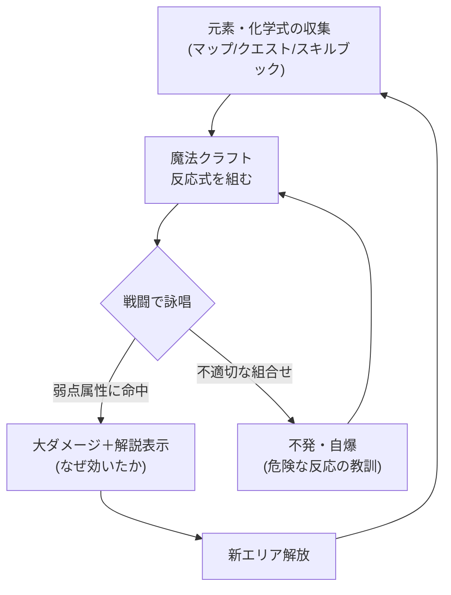
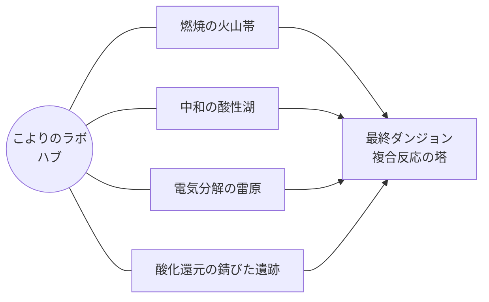
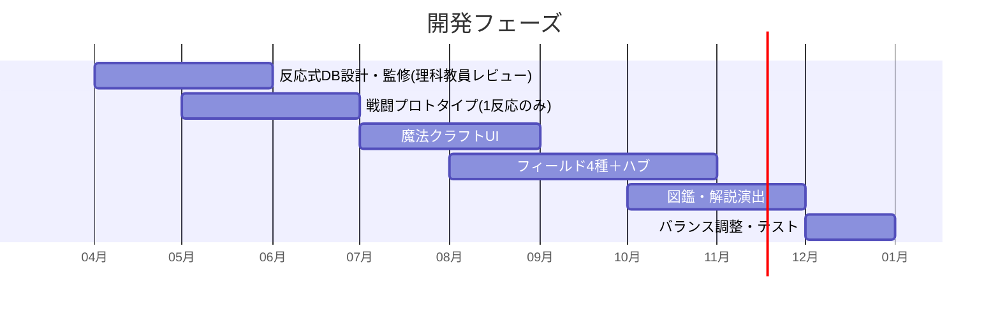

# ⚗️ 博衣こよりと始まりの魔法使い — ゲーム設計書

RPG 化学式＝呪文 教育×エンタメ

> 🧪 PoC: [poc/02_koyori-chemistry-rpg/index.html](../poc/02_koyori-chemistry-rpg/index.html)（pixi.js — 反応式DB・弱点判定・炎色反応エフェクトの検証）

## 1. コンセプト

**化学式・化学反応式を「呪文」と見立て、魔法を作ってモンスターを攻撃するRPG。**
イメージソースはドラクエ、テイルズ オブ シンフォニア ラタトスクの騎士。

> 例: 「マグネシウム＋水＝爆発」
> 原因: マグネシウムが水に含まれる酸素を奪って激しく反応するから → 消火は乾燥砂で。

企画の原点（txt L1126-1132）:
- 元素記号自体にコレクション要素がある
- 化学式は魔法の呪文に似ている
- 化学を学べる**カジュアル**ゲームが欲しい
- 「化学実験＝非現実的なことが起きてかっこいい」という原体験

- カイヨワ分類: **アゴン（戦闘）× ミミクリ（魔法使いロールプレイ）**。収集は松浦ペルソナ、思考型戦闘はそめりんペルソナに刺さる
- 化学式の入手: マップ収集／NPCクエスト報酬／アイテム（スキルブック）

## 2. 他ゲームとの差別化

| 比較対象 | 共通点 | 本作の差別化 |
|---|---|---|
| ドラクエ | コマンドRPG、呪文体系 | 呪文が実在の化学反応。**「なぜ効くか」の解説が攻略情報そのもの** |
| ラタトスクの騎士 | 収集・仲間システム | 収集対象が元素・化学式で、**周期表＝図鑑UI** |
| 既存の教育ゲーム | 化学を学べる | 「問題を解かせる」のではなく**戦闘の最適解を探すと自然に化学を使っている**構造 |
| Opus Magnum等のパズル | 化学モチーフ | パズル特化ではなくRPGの文脈（物語・成長・ボス）に化学を埋め込む |

> **一言差別化**: 「教科書の反応式が、そのまま攻略Wikiになる RPG」

## 3. コアメカニクス

- **属性系**: 燃焼／酸化還元／中和／electrolysis（電気分解）などの反応カテゴリ＝属性
- **失敗も教材**: 危険な組合せ（水素＋酸素＋火気等）は自爆技として実装し、「実験の安全」も裏テーマに
- 敵の弱点は見た目＋素材ヒントで提示（例: マグネシウム鎧の敵→水で爆発）＝ Totten Ch5 の象徴アセット理論をモンスターデザインに適用

## 4. レベルデザイン方針（Totten理論の適用)

- **ハブ型空間（Ch4）**: 研究所（こよりのラボ）をハブに、反応カテゴリ別のフィールドが放射状に接続。分子構造図をそのまま「分子」モチーフのワールドマップにする
- **報酬の拒絶（Ch7）**: 新元素の鉱脈は「見えるが採れない」状態で先に見せ、対応する反応（酸で溶かす等）を覚えて戻ると採れる — メトロイドヴァニア的な鍵と扉を化学知識で置換
- **Level 1-1（Ch8）**: 最初のダンジョンは「水＋アルカリ金属」1反応だけで攻略でき、看板ではなく濡れた床・火気厳禁マークなど環境で教える
- **物語の舞台（Ch7 報酬空間）**: ボス撃破後に「反応の原理をこよりが解説する研究室シーン」を瞑想的な報酬空間として配置

## 5. 配色計画（kotonoha_sai）

メイン: **天弓（天文）** — 虹＝スペクトルで「魔法×科学」を象徴

| 用途 | 色 | HEX |
|---|---|---|
| 回復・支援魔法 | &nbsp;&nbsp;&nbsp; | `#f4afa4` |
| キャラ（こより） | &nbsp;&nbsp;&nbsp; | `#ec759e` |
| 報酬・レア元素 | &nbsp;&nbsp;&nbsp; | `#fdda83` |
| 自然フィールド | &nbsp;&nbsp;&nbsp; | `#67c1af` |
| 水系・UI | &nbsp;&nbsp;&nbsp; | `#18a5d3` |
| 基調・文字 | &nbsp;&nbsp;&nbsp; | `#156fb3` |

サブ: **光炎（自然）** — 燃焼反応エフェクト用 &nbsp;#f7dc41&nbsp;&nbsp;#e56322&nbsp;&nbsp;#b33033&nbsp;&nbsp;#24252d&nbsp;

> 炎色反応（Li=赤、Na=黄、Cu=青緑…）をエフェクト色に忠実反映し、**色自体を教材化**する。

## 6. 技術的要素の羅列

- 反応式データベース（元素×元素×条件 → 結果）: ScriptableObject／JSONによるデータ駆動設計
- 魔法クラフトUI（周期表インターフェース、ドラッグ＆ドロップ合成）
- ターン制戦闘システム（弱点判定・属性相性マトリクス）
- 図鑑・コレクションシステム（元素収集率、反応式発見率）
- 解説演出（反応の理由をリッチテキスト＋簡易アニメで表示）
- クエストシステム（NPC依頼→スキルブック報酬）
- セーブ／強くてニューゲーム
- パーティクルエフェクト（炎色反応、沈殿、気体発生の表現）— シェーダー（ブルーム: 川瀬式、HDRレンダリング前提）
- サウンド: 反応カテゴリ別のジングル（Ch13 報酬フィードバック）

## 7. 適した制作環境

| 環境 | 適性 | 評価理由 |
|---|---|---|
| **Unity** | ◎ | データ駆動RPGの定番。ScriptableObjectで反応DB管理、エフェクトも強い |
| HTML5 | ○ | ブラウザで教育現場に配りやすい。ただし演出・データ量が増えると管理が辛い |
| UE | △ | 2D中心のコマンドRPGにはツールが過剰 |
| Qt | △ | 図鑑・周期表UIだけなら得意だが戦闘演出が弱い |
| exe (WPF) | △ | UI主体なら可能だがエフェクト表現に限界 |

**推奨: Unity**。教育利用を見据えるならWebGL出力を併用。

## 8. 開発ロードマップ

