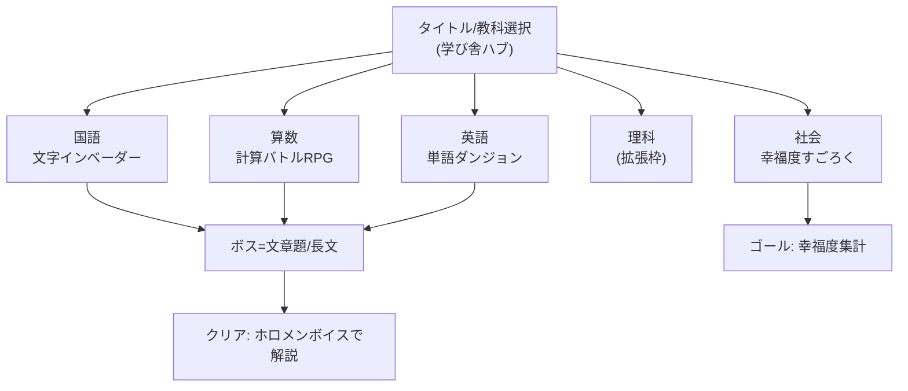
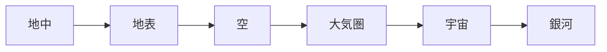
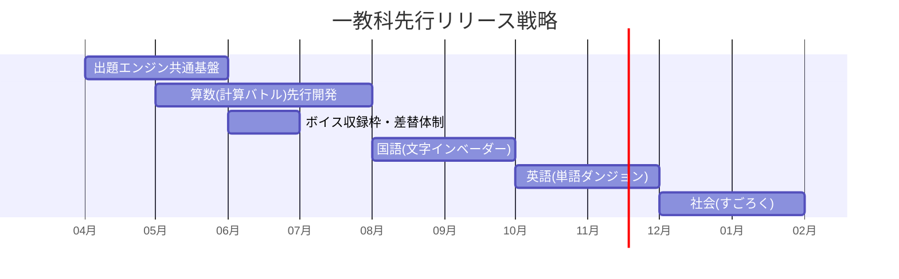

# 🏫 ホロの学び舎 — ゲーム設計書

教育ゲーム 全教科クイズ型ダンジョン 対象: 小学生

> 🧪 PoC: [poc/03_holo-no-manabiya/index.html](../poc/03_holo-no-manabiya/index.html)（pixi.js — 算数インベーダー・高度背景遷移の検証）

## 1. コンセプト

**ホロライブ（ドット絵）のキャラと一緒に、教科ごとに異なるゲームジャンルで学ぶ教育ゲーム集。**
ホロメンボイスによる発音・問題・解説・操作説明。全教科を作る必要はなく、**最悪一教科からのリリースでも成立**するモジュール構成にする。

| 教科 | ジャンル（イメージ） | ルール概要 |
|---|---|---|
| 国語 | インベーダー | 落ちてくる文字に対し、意味が通るように文字を入力／選択して消す。ライフ制、ボス撃破or一定フェーズでクリア |
| 社会 | 桃鉄・ボードゲーム・Wiiパーティ | すごろくで各地を移動し、ゴール時の幸福度（お宝＞満腹度＞金）を競う。道中クイズ正解でお宝 |
| 算数 | ドラクエ×インベーダー | モンスターの計算式の（　）に当てはまる数・語・答えを入力して撃破。雑魚=計算、ボス=文章問題 |
| 理科 | （未定・拡張枠） | 担当: 博衣こより → [02_koyori-chemistry-rpg.md](02_koyori-chemistry-rpg.md) の簡易版を充当可能 |
| 英語 | パズル「ダンジョン」 | 敵を画像/イラストで表現し、該当する英名を選択/入力。宝物庫到達でクリア |

担当講師: アニメ学=白上フブキ／体育=大空スバル／理科=博衣こより

- カイヨワ分類: **アゴン（成績・スコア）× アレア（すごろく）**
- 演出方針: 難易度が上がるごとに背景を **地中→地表→空→大気圏→宇宙→銀河** と変化。ロボ感・メカニカル風の装飾

## 2. 他ゲームとの差別化

| 比較対象 | 共通点 | 本作の差別化 |
|---|---|---|
| 桃鉄 | すごろく×地理 | 勝利条件が金でなく**幸福度（お宝＞満腹度＞金）の重み付き合成**。拝金でない価値観を教える |
| 一般の学習アプリ | ドリル型出題 | 教科ごとに**ジャンル自体を変える**（STG/ボード/RPG/パズル）ため飽きない |
| インベーダー系タイピング教材 | 落下物を打つ | 単なる文字消しでなく「**意味が成立する語**を作る」国語的判断を要求 |
| VTuber系ファンゲーム | キャラ人気 | **ホロメンボイスで発音・解説**まで担う＝キャラが教師として機能 |

> **一言差別化**: 「教科ごとに最適なゲームジャンルを割り当てた、モジュール式VTuber学習ゲーム」

## 3. 全体構造

難易度進行と背景演出:

## 4. レベルデザイン方針（Totten理論の適用）

- **Level 1-1（Ch8）**: 各教科の初回は「間違えてもライフが減らない練習フェーズ」から。操作説明はホロメンボイス＋実演デモで、テキスト依存を避ける（小学生対象のため特に重要）
- **報酬スケジュール（Ch7）**: 「n問正解ごとにお宝／ボイス解放」の一貫したスケジュールで継続動機を作る。レア報酬（限定ボイス）は先に一覧で「見せて拒絶」
- **環境アートのティーチング（Ch5）**: 正解=青系フラッシュ、不正解=赤系、お宝=金色、と色の文法を全教科で統一し教科間の学習転移を作る
- **ペーシング（Ch9）**: 背景の高度上昇（地中→銀河）がそのままドラマティックアーク。ボス戦は「宇宙」以降に配置し、視覚的高揚と難易度を同期させる

## 5. 配色計画（kotonoha_sai）

メイン: **麗か（季節）** — 明るく健全な学習トーン

| 用途 | 色 | HEX |
|---|---|---|
| 正解・報酬 | &nbsp;&nbsp;&nbsp; | `#ffdf5e` |
| UI基調 | &nbsp;&nbsp;&nbsp; | `#a1c6ea` |
| 進行・決定 | &nbsp;&nbsp;&nbsp; | `#5baedb` |
| 成長・経験値 | &nbsp;&nbsp;&nbsp; | `#81b727` |
| 不正解・敵 | &nbsp;&nbsp;&nbsp; | `#e57da9` |
| サブ | &nbsp;&nbsp;&nbsp; | `#bccf30` |

背景高度別パレット:

| 高度 | パレット | キーカラー |
|---|---|---|
| 地中 | 朝寒（季節） | &nbsp;#885f3e&nbsp;&nbsp;#34455c&nbsp; |
| 地表 | 若草（季節） | &nbsp;#94c58b&nbsp;&nbsp;#5dbf4e&nbsp; |
| 空 | 霞の空（天文） | &nbsp;#889cab&nbsp;&nbsp;#486783&nbsp; |
| 大気圏 | 霹靂（天文） | &nbsp;#49afd3&nbsp;&nbsp;#1169a3&nbsp; |
| 宇宙 | 星合いの空（季節） | &nbsp;#004492&nbsp;&nbsp;#0f1d3e&nbsp; |
| 銀河 | 綺羅星（天文） | &nbsp;#7b4d95&nbsp;&nbsp;#142664&nbsp; |

## 6. 技術的要素の羅列

- 問題データベース（教科×学年×難易度のCSV/JSON、差し替え可能な出題エンジン）
- 文字落下・当たり判定（国語インベーダー）、かな/ローマ字入力判定
- すごろくエンジン（マス効果、双六AI対戦、幸福度の重み付き集計）
- 数式パーサ（穴埋め計算式の生成と検証）
- ボイス再生管理（発音・問題読み上げ・解説・操作説明の4カテゴリ）
- ドット絵キャラアニメーション
- 背景レイヤーのパララックス＋高度遷移演出
- 成績記録・苦手分野の出題重み付け（アダプティブ出題）
- ロボ/メカニカルUIのスキンシステム

## 7. 適した制作環境

txt記載の検討三択は「ASP.NET／WPF／Windows Forms」。評価:

| 環境 | 適性 | 評価理由 |
|---|---|---|
| **Unity** | ◎ | 5ジャンルを1プロジェクトで共通基盤化でき、音声・アニメ演出も容易 |
| WPF (exe) | ○ | txt検討案。データバインディングでクイズUIは速く作れる。国語インベーダー程度のアクションまでなら可 |
| HTML5 | ○ | 学校・家庭のブラウザで動く配布性は最強。音声資産の保護が課題 |
| ASP.NET | △ | 成績管理サーバとしては有用だがゲーム本体には不向き（txt三択中では非推奨） |
| Windows Forms | △ | 描画性能・アニメーションが弱い |
| UE / Qt | × | 対象規模に不釣合い |

**推奨: Unity（本命）／ WPF（C#学習を兼ねた小規模構成の場合の次点）**

## 8. 開発ロードマップ

