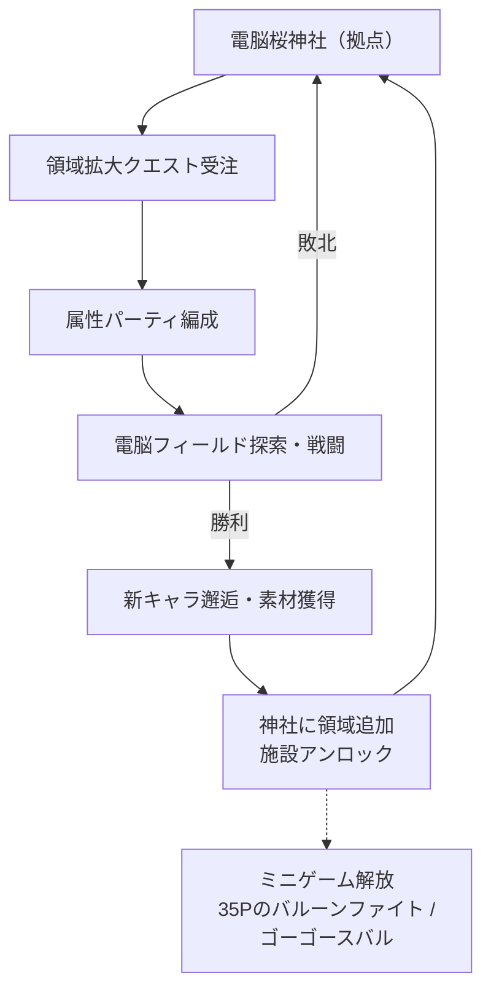
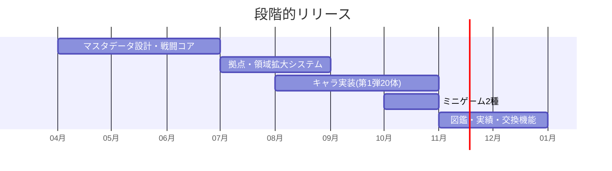

# 🌐 電脳少女のRPG — ゲーム設計書

収集型2D RPG 電波人間のRPGオマージュ 属性パーティ構築

> 🧪 PoC: [poc/04_dennou-shoujo-rpg/index.html](../poc/04_dennou-shoujo-rpg/index.html)（pixi.js — 属性相性・領域拡大・グリッチ演出の検証）

## 1. コンセプト

**電脳桜神社を拠点に、自身の領域を拡大していく収集型RPG。**『電波人間のRPG』のオマージュ。ホロメンを属性付きユニットとして収集・編成し、敵キャラ（ファンメイドモンスター）と戦いながら電脳世界の版図を広げる。

- カイヨワ分類: **アレア（収集ガチャ的邂逅）× アゴン（編成戦闘）**
- ペルソナ適合: 松浦（収集大好き・並べて眺める・成長実感）がド本命ターゲット
- 参考にしたい派生: すれ違い伝説／すれ違いシューティング等の「すれ違い」系ミニループ、顔シューティング、マリオvsドンキーコング みんなでミニランド、チャリ走、チンクルのバルーンファイト（→ 付属ミニゲームとして再解釈）

## 2. 他ゲームとの差別化

| 比較対象 | 共通点 | 本作の差別化 |
|---|---|---|
| 電波人間のRPG | 捕獲・収集・お任せ感バトル | キャラが**既知のVTuber**であり、属性はキャラの配信ネタ由来（例: スバル=音/土、沙花叉=麻痺キノコ）。ファン知識が攻略知識になる |
| ポケモン系収集RPG | 属性相性 | **拠点（電脳桜神社）の領域拡大**がマップ解放と育成資源を兼ねるシムライト要素 |
| 放置系ソシャゲ | キャラコレクション | 買い切り・オフライン。すれ違い系の**非同期ゆる対戦**を任意要素として搭載 |

> **一言差別化**: 「“推し知識”がそのまま属性表になる、電波人間系収集RPG」

## 3. キャラクター＆属性設計（txt記載の割当）

| 属性 | キャラ |
|---|---|
| 火 | みこち、ぼたん |
| 水 | あくあ、ぐら |
| 氷 | フブキ、ラミィ |
| 電気 | シオン、こより |
| 土 | まつり、スバル（アヒルパーカー限定・音/ノックダウン） |
| 風 | いろは、クレイジー・オリー |
| 光 | ムーナ、かなで |
| 闇 | ポルカ、ラプラス |
| 毒/麻痺/弱体 | はあちゃま（毒）、沙花叉（キノコ=麻痺）、わため（弱体化） |
| 支援/復活 | ルーナ（強化）、おかゆ（復活）、のどか（復活）、メル（吸血） |
| 複合 | ココ=ブレス（火＋風）、さな=重力（電気＋土）、アイリス=混沌（光＋闇）、ムメイ=ランダム状態異常 |

特技例: にえたぎるマグマ（みこち）／ダークネス（ラプラス）／112dB（スバル）／お絵描き（ムメイ）／ジャキンジャキンでござる（いろは）／ビッグさなー（さな）

敵キャラ（ファンメイド軍団・抜粋）: ヤメナー(ボス)、ポチ(ボス)、マグチ(ボス)、ムメイの絵(ボス)、シュバルドダック(ボス)、あんきも(ボス)、フブラ(ボス)、かなごり(ボス)、あくたんの猫(ボス)、おかにゃん(レア)、YAGOO(レア)、ぽこべぇ、ハトタウロス、ルーナイト、ちょこめいと、かぷ民、35P、きんとき、しおっこ、飼育員、カラス、スバとも、団員、座員、バンペン、すこんぶ、ロボサー、はあとん、まつりす、おにぎりゃー、ころねすきー、ミオファ、野兎、眷属、ねっこ、ゆきみん、だいふく、SSRB、こよのロボット

## 4. コアループ

### 付属ミニゲーム

| ミニゲーム | オマージュ元 | ルール |
|---|---|---|
| 35Pのバルーンファイト | チンクルのバルーンファイト | アイテムを取り切ったらみこちをマグマに沈める。みこちが取得を妨害してくる |
| ゴーゴースバル | チャリ走 | ワンボタンラン&ジャンプ |

## 5. レベルデザイン方針（Totten理論の適用）

- **ハブ型空間＋クエストハブ（Ch4/Ch12）**: 電脳桜神社はスポーンポイント・クエストハブ・「家（ホームタウン）」を兼ねる。領域拡大＝ハブから伸びる辺の成長として分子構造図で管理
- **記憶の宮殿（Ch5）**: 属性フィールドごとにビジュアル・ランゲージ（色・形状・素材）を固定し、再訪時に位置を環境の"個性"で把握させる
- **敵も建築（Ch4-8）**: ボス級（ヤメナー等）は地形と一体の配置で、雑魚（35P・座員等）は誘導用の「動く矢印」として置く
- **報酬スケジュール（Ch7）**: 「一定歩数ごとの邂逅」「箱を壊すと素材」の一貫パターンで探索を習慣化

## 6. 配色計画（kotonoha_sai）

メイン: **星合いの空（季節）** — 電脳世界の夜空

| 用途 | 色 | HEX |
|---|---|---|
| 報酬・通知 | &nbsp;&nbsp;&nbsp; | `#fff2ad` |
| 支援・レア | &nbsp;&nbsp;&nbsp; | `#b9a0cb` |
| UI基調 | &nbsp;&nbsp;&nbsp; | `#5391c8` |
| 敵領域 | &nbsp;&nbsp;&nbsp; | `#8a5fa5` |
| 深部背景 | &nbsp;&nbsp;&nbsp; | `#004492` |
| 最深部 | &nbsp;&nbsp;&nbsp; | `#0f1d3e` |

サブ: **綺羅星（天文）** — 邂逅・ガチャ演出 &nbsp;#81cde0&nbsp;&nbsp;#f3aecc&nbsp;&nbsp;#7b4d95&nbsp;&nbsp;#142664&nbsp;

> 属性色はUI基調と衝突しないよう彩度を1段落とし、レア演出のみ綺羅星のピンク`#f3aecc`で跳ねさせる（Ch5 コントラスト原則）。

## 7. 技術的要素の羅列

- キャラ／敵マスタデータ（属性・特技・ドロップ）のデータ駆動設計
- 属性相性・状態異常エンジン（毒/麻痺/弱体/吸血/復活/重力/混沌/ランダム）
- 領域拡大メタゲーム（神社施設のアンロックツリー）
- オートバトル＋介入コマンド（電波人間式）
- ミニゲーム2種（バルーンファイト系物理、ラン系）
- 図鑑・実績（やっさんペルソナ向けアチーブ）
- すれ違い代替: ローカルフレンドコード／QRでパーティ交換（非同期対戦）
- ドット絵アニメ・パララックス電脳背景（ざらつきエフェクト、グリッチシェーダー）
- セーブ・強くてニューゲーム・データ引継ぎ

## 8. 適した制作環境

| 環境 | 適性 | 評価理由 |
|---|---|---|
| **Unity** | ◎ | データ駆動RPG＋ミニゲーム集の共存が容易。2Dツールが充実 |
| HTML5 | ○ | ゆる対戦のQR交換とは好相性だが、コンテンツ量的に管理が辛い |
| UE | △ | 2DコレクションRPGには過剰 |
| Qt / exe (WPF) | × | 戦闘演出・アニメーション量に不向き |

**推奨: Unity 2022.3 LTS**（モバイル展開も視野に入る設計にする）。

## 9. 開発ロードマップ

