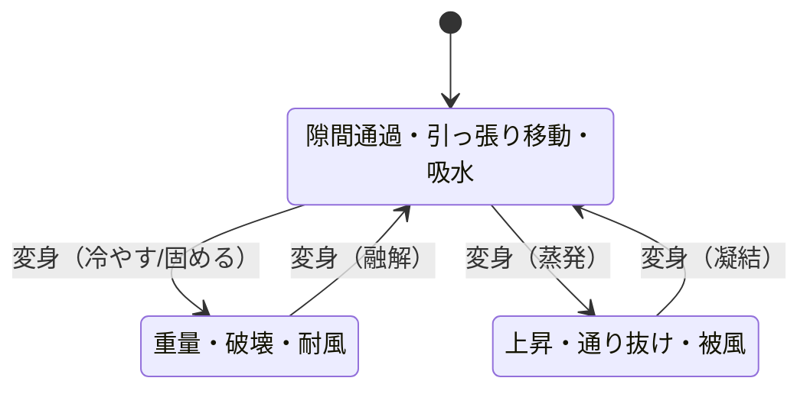
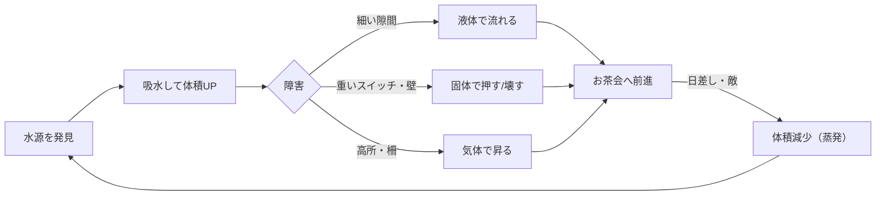
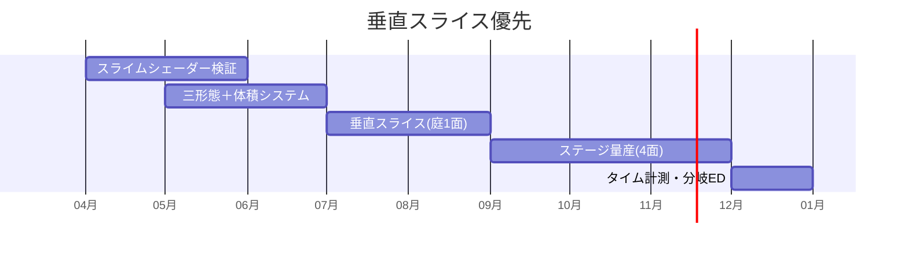

# 💧 走れスライムくん — ゲーム設計書

時間制限型 謎解きアクション 三態変化 3D

> 🧪 PoC: [poc/05_hashire-slime-kun/index.html](../poc/05_hashire-slime-kun/index.html)（pixi.js — 2Dメタボールシェーダー・三態の物理切替の検証）

## 1. コンセプト

**フランス人形のアケミちゃんが主催するお茶会に、水を忘れた！ 友達のスライム「アクア」が水を届けるために走る、時間制限型の謎解きアクション。**

アクアは体を水に変化させられるため、**気体・液体・固体の三形態**に自在に変身できる。ドラクエのスライムではなくメタモン寄りの柔らかい造形。

| 形態 | 表現 | できること |
|---|---|---|
| 液体（スーパースライムモード） | 複数の球体＋メタボールシェーダー | 隙間を流れる、引っ張りアクション（自身を飛ばして移動）、水を取り込んで体積増加 |
| 固体 | 四角形をベベルした形状 | 重い、スイッチを押す、風に飛ばされない、壊す |
| 気体 | 雲っぽい形状（マリオギャラクシー2の蜘蛛マリオ参考） | 上昇気流に乗る、柵を通り抜ける、軽い |

- カイヨワ分類: **アゴン（タイムアタック）× イリンクス（流体移動の気持ちよさ）**
- ペルソナ適合: 松浦（疾走感・スピード）、やっさん（物理での破壊爽快感）

## 2. 他ゲームとの差別化

| 比較対象 | 共通点 | 本作の差別化 |
|---|---|---|
| マリオギャラクシー2 | 形態ギミック | 形態が**相の変化（物理現象）**で統一されており、謎解きの答えが直感的に予想できる |
| Slime Rancher / World of Goo | スライム物理 | 「体積＝リソース」。水を取ると大きくなり、**大きさと形態の掛け算**でルートが変わる |
| ピクミン等のお使い系 | 目的地への運搬 | 運ぶものが**自分自身（体＝水）**。被弾・蒸発で体積が減る＝HPと運搬量が同一 |
| 一般タイムアタックACT | 時間制限 | 制限が「お茶会に間に合う」という**物語的締切**で、遅刻エンドも愛嬌ある分岐に |

> **一言差別化**: 「HP・運搬物・移動能力のすべてが“自分の体積”に統一された三態変化アクション」

## 3. コアメカニクス

## 4. レベルデザイン方針（Totten理論の適用）

- **Level 1-1（Ch8）**: 庭のステージで「水たまり→吸水→隙間→液体通過」を一本道で体験。最初の水たまりは失っても戻れば無限に回復する安全設計
- **狭小・快適・眺望空間（Ch4）**: 三形態がそれぞれ得意な空間サイズに対応 — 狭小=液体、快適=固体、眺望（高所）=気体。空間サイズの読み替えがそのまま形態選択のヒントになる
- **危険な建築（Ch6）**: 日なた（蒸発リスク）と日陰（安全）で眺望/避難を構成。木漏れ日の下を縫って走るルート設計
- **報酬の拒絶（Ch7）**: ゴールのお茶会テーブルは序盤から遠景に見えている（見せて拒絶）。ショートカットは大体積時のみ破壊開通できる壁の先に
- **サウンド（Ch13）**: 形態ごとに移動音の材質を変え（ぷるぷる/ゴトゴト/ふわー）、残り時間はBGMテンポで提示

## 5. 配色計画（kotonoha_sai)

メイン: **泡沫（うたかた・自然）** — 水の透明感

| 用途 | 色 | HEX |
|---|---|---|
| ハイライト | &nbsp;&nbsp;&nbsp; | `#fff4d1` |
| アケミちゃん・お茶会 | &nbsp;&nbsp;&nbsp; | `#fad7d2` |
| 背景（近） | &nbsp;&nbsp;&nbsp; | `#bad4d7` |
| スライム本体（浅） | &nbsp;&nbsp;&nbsp; | `#9aced8` |
| スライム本体（深） | &nbsp;&nbsp;&nbsp; | `#5db3c9` |
| 水深部・文字 | &nbsp;&nbsp;&nbsp; | `#1572a3` |

サブ: **玉響（時間）** — お茶会シーンの柔らかい多幸感 &nbsp;#f1d7e7&nbsp;&nbsp;#ffefc8&nbsp;&nbsp;#e9a3c0&nbsp;&nbsp;#a7dae1&nbsp;

> 体積の残量をスライムの透明度と彩度で表現（減るほど薄く）— UIゲージなしで状態を伝える（Ch5）。

## 6. 技術的要素の羅列

- メタボール／SDFベースのスライムシェーダー（複数球体の融合表現）
- 三形態のステートマシンと物理特性切替（Rigidbodyの質量・摩擦・浮力）
- 引っ張りアクション（スリングショット式の自己射出、軌道予測線）
- 体積システム（吸水・蒸発・分裂、体積→サイズ/HP/破壊力への変換）
- 流体風パーティクル、屈折・半透明表現（透過シェーダー、デプスソート）
- タイムアタック計測・ランク・リプレイゴースト
- チェックポイント／リスタート
- 環境ギミック: 上昇気流、日なた/日陰の蒸発判定、風、傾斜
- カメラ: Cinemachineで場所ごとの優先度切替（酔い対策に固定角も用意 — そめりんペルソナ対応）

## 7. 適した制作環境

| 環境 | 適性 | 評価理由 |
|---|---|---|
| **Unity** | ◎ | メタボールシェーダー実装例が豊富、物理・Cinemachineが揃う。個人規模で現実的 |
| UE | ○ | 流体表現の絵力は最強だが、シェーダー学習と物量が個人開発には重い |
| HTML5 | △ | WebGLで3D流体表現は性能的に厳しい |
| Qt / exe (WPF) | × | 3D物理アクションに不向き |

**推奨: Unity（Built-in RP＋カスタムシェーダー）**。シェーダー学習素材（座標変換・法線マップ・ブルーム等、txt L1318-1344の学習項目）の実践課題としても最適。

## 8. 開発ロードマップ

