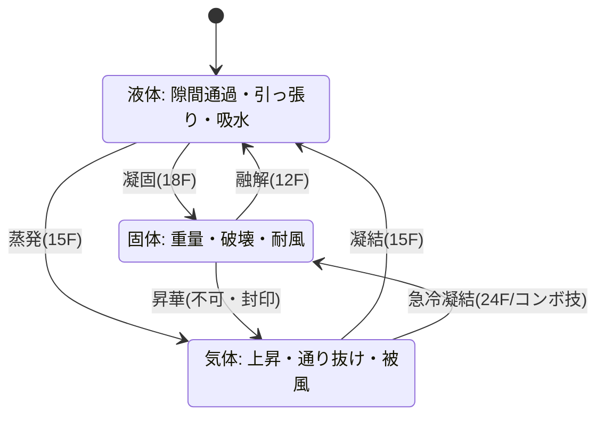
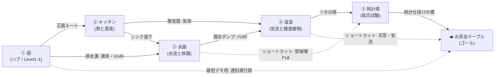
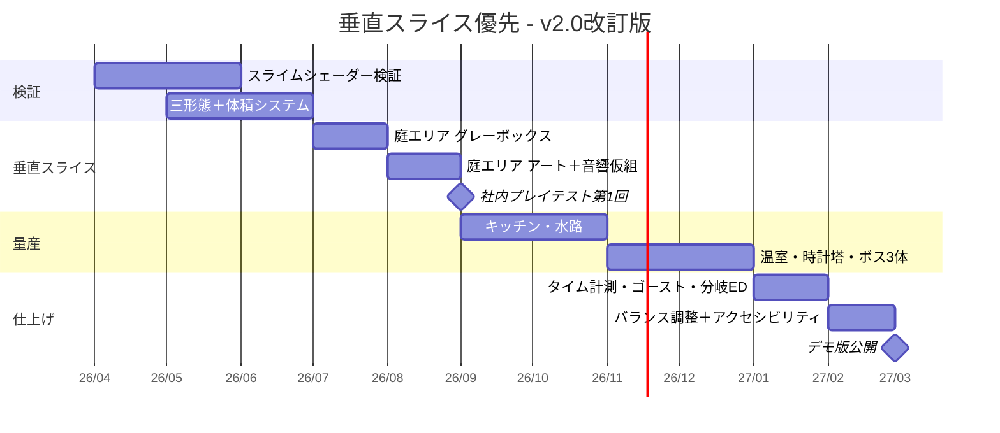

# 💧 走れスライムくん — ゲーム設計書 v2.0

時間制限型 謎解きアクション 三態変化 3D

> 🧪 PoC: [poc/05_hashire-slime-kun/index.html](../poc/05_hashire-slime-kun/index.html)（pixi.js — 2Dメタボールシェーダー・三態の物理切替・プロシージャルBGM/SFXの検証）

| 版 | 日付 | 変更 |
|---|---|---|
| v1.0 | 2026-02 | 初版（コンセプト・差別化・技術羅列） |
| v2.0 | 2026-07 | 全面改訂: コアピラー／数値パラメータ／ムーブセット／ワールド構造／敵図鑑／経済／音響／運用 |

## 1. コンセプト

**フランス人形のアケミちゃんが主催するお茶会に、水を忘れた！ 友達のスライム「アクア」が水を届けるために走る、時間制限型の謎解きアクション。**

アクアは体を水に変化させられるため、**気体・液体・固体の三形態**に自在に変身できる。ドラクエのスライムではなくメタモン寄りの柔らかい造形。

| 形態 | 表現 | できること |
|---|---|---|
| 液体（スーパースライムモード） | 複数の球体＋メタボールシェーダー | 隙間を流れる、引っ張りアクション（自身を飛ばして移動）、水を取り込んで体積増加 |
| 固体 | 四角形をベベルした形状 | 重い、スイッチを押す、風に飛ばされない、壊す |
| 気体 | 雲っぽい形状（マリオギャラクシー2の蜘蛛マリオ参考） | 上昇気流に乗る、柵を通り抜ける、軽い |

- カイヨワ分類: **アゴン（タイムアタック）× イリンクス（流体移動の気持ちよさ）**
- ペルソナ適合: 松浦（疾走感・スピード）、やっさん（物理での破壊爽快感）、そめりん（固定カメラモード）

### 1.1 コアピラー（3本柱）

| # | ピラー | 定義 | 判断基準（Yes/Noテスト） |
|---|---|---|---|
| P1 | **体はぜんぶ水** | HP・運搬物・サイズ・破壊力のすべてが単一リソース「体積」に統一される | 新要素が体積以外の第2リソース（マナ等）を要求するなら不採用 |
| P2 | **相の変化＝答え** | 謎解きの解が現実の物理（蒸発・凝結・凝固・融解）から直感的に予想できる | 攻略法を文章で説明しないと分からないギミックは不採用 |
| P3 | **締切のある疾走** | 常に「お茶会に間に合うか」という前向きな時間圧があり、リトライが速い | プレイヤーを3秒以上停止させる演出・会話は不採用 |

### 1.2 何を削るか（Non-Goals）

- **戦闘の深化はしない**: 敵は「動く障害物」。コンボ・ロックオン・武器は作らない（P1違反の第2リソースを生みやすい）
- **オープンワールド化しない**: エリアは相互接続するが、探索より「ルート構築→走破」を優先（P3）
- **形態を4つ以上に増やさない**: プラズマ等のSF形態は不採用。三態＋組合せ技で深さを出す（P2）
- **ストーリーカットシーンは各30秒以内**: 遅刻エンドも含め、テキストはお茶会での一枚絵＋数行のみ
- **対人マルチは作らない**: 非同期ゴースト対戦のみ（§9）

## 2. 他ゲームとの差別化

| 比較対象 | 共通点 | 本作の差別化 |
|---|---|---|
| マリオギャラクシー2 | 形態ギミック | 形態が**相の変化（物理現象）**で統一されており、謎解きの答えが直感的に予想できる |
| Slime Rancher / World of Goo | スライム物理 | 「体積＝リソース」。水を取ると大きくなり、**大きさと形態の掛け算**でルートが変わる |
| ピクミン等のお使い系 | 目的地への運搬 | 運ぶものが**自分自身（体＝水）**。被弾・蒸発で体積が減る＝HPと運搬量が同一 |
| 一般タイムアタックACT | 時間制限 | 制限が「お茶会に間に合う」という**物語的締切**で、遅刻エンドも愛嬌ある分岐に |

> **一言差別化**: 「HP・運搬物・移動能力のすべてが"自分の体積"に統一された三態変化アクション」

## 3. コアメカニクス — 状態遷移

- 変身は**液体を中心としたハブ構造**。固体⇔気体の直接変身は原則不可（昇華は物理的に馴染みが薄くP2違反）だが、**気体→固体のみコンボ技「急冷凝結ドロップ」として解放**（§5）
- 変身中は無敵ではない。**変身硬直中の被弾は損失1.5倍**（変身連打の逃げを抑止）

## 4. 詳細パラメータ

数値は 60fps・Unity単位（1u=1m）基準。**体積100（最大）時**の値。太字はチューニング最優先項目。

### 4.1 三形態の物理パラメータ

| パラメータ | 液体 | 固体 | 気体 | 備考 |
|---|---|---|---|---|
| 最高速度 (m/s) | **6.5** | 4.0 | 5.0 | 液体が最速＝走りの基本形態 |
| 加速度 (m/s²) | 28 | 14 | 18 | 固体は「重い」を加速の鈍さで表現 |
| 摩擦（減速度 m/s²） | 12 | **30** | 4 | 気体は滑る（風の影響を残す） |
| ジャンプ初速 (m/s) | 7.5 | 5.0 | —（浮遊） | 気体はジャンプ不可・浮遊のみ |
| 浮遊上昇速度 (m/s) | — | — | 2.5（気流中 **6.0**） | 上昇気流コライダー内で加算 |
| 重力スケール | 1.0 | 1.6 | 0.25 | 固体は落下が速く着地が硬い |
| 当たり判定 | 扁平カプセル r0.50×h0.60 | 立方体 0.45³ | 球 r0.70 | 気体は見た目より判定を10%小さく（理不尽被弾防止） |
| 変身所要フレーム | →固18F / →気15F | →液12F | →液15F | 融解が最速＝液体へ逃げやすい |
| 変身クールダウン | 30F（0.5s）共通 | 同左 | 同左 | しずく飾り「保冷」で15Fに短縮 |
| 風の影響係数 | 0.4 | **0.0** | 1.5 | 気体は追い風ブーストにも使える |
| 水面 | 沈む（泳ぎ4.5m/s） | 沈んで底歩き | 水面上を漂う | 三態で水の意味が変わる |
| 蒸発率補正 | ×1.0 | ×0.25 | ×2.0 | §4.2の基礎値に乗算 |

### 4.2 体積システム

| 項目 | 値 | 備考 |
|---|---|---|
| 最大体積 Vmax | 100 | 初期値100でエリア開始 |
| ゲームオーバー閾値 | V < 10 | 「干からび」演出→直前チェックポイントへ（−5秒ペナルティ） |
| 吸水（水たまり接触） | +20/秒 | 水たまりは容量あり（小40・中80・大∞） |
| 吸水（水滴アイテム） | +5/個 | 通貨「しずくコイン」とは別物。青い滴 |
| 日なた蒸発（基礎） | −2.0/秒 | 形態補正: 液×1.0 / 固×0.25 / 気×2.0。日陰は0 |
| 熱源近傍（コンロ等） | −6.0/秒 | 半径2m。警告としてゆらぎエフェクト表示 |
| 被弾損失 | 小−8 / 中−15 / 大−25 | 変身硬直中は×1.5。無敵時間45F |
| 引っ張り射出コスト | −2/回 | 着地時に飛沫として散る演出 |

**換算式**（すべて V=現在体積）:

| 導出値 | 式 | V=100 | V=50 | V=20 |
|---|---|---|---|---|
| 表示スケール s | s = (V/100)^(1/3) | 1.00 | 0.79 | 0.58 |
| 破壊力 | P = 10 × (V/100)^1.5 | 10.0 | 3.5 | 0.9 |
| 通過可能な最小隙間幅 (m) | Wmin = 0.12 × s（液体時） | 0.12 | 0.095 | 0.070 |
| 踏破可能な最大水流 (m/s) | F = 3.0 × (V/100) | 3.0 | 1.5 | 0.6 |
| 押せるスイッチ荷重 | L = 8 × (V/100)^1.5（固体時） | 8.0 | 2.8 | 0.7 |

> 設計意図: **大きいほど強く・壊せるが、隙間は通りにくい**（Wminはsに比例して逆に広がる＝小さいほど狭所に有利）。「吸うか、絞るか」のルート選択がタイムアタックの核になる。

### 4.3 引っ張りアクション（スリングショット自己射出・液体限定）

| 項目 | 値 |
|---|---|
| タメ入力 | ボタン長押し 0〜45F（45F以上は最大で頭打ち） |
| 射出距離 (m) | D = 2.0 + 8.0 × (タメF/45)^1.2 → 最大10.0m |
| 射出初速角 | スティック方向。デフォルト45°、上下±80°まで可変 |
| 軌道 | 放物線（重力スケール1.0）。**予測線を20点の破線**で常時表示 |
| 体積補正 | D × (V/100)^(−0.25) — 小さいほどよく飛ぶ（最大+50%） |
| コスト | 体積−2/回、着地硬直8F |
| キャンセル | タメ中に変身ボタンでノーコスト解除 |
| 空中使用 | 1回のみ（着地でリセット）。気流中はリセットしない |

## 5. ムーブセット拡張 — 形態コンボ技

基本動作（走る・ジャンプ・変身・引っ張り・吸水）に加え、**形態遷移そのものを技にする**6種。すべて既存入力の組合せで発動し、新規ボタンは追加しない（P2）。

| # | 技名 | 入力 | フレーム | 効果 | リスク / リターン |
|---|---|---|---|---|---|
| C1 | **急冷凝結ドロップ** | 気体で空中→固体ボタン長押し10F | 変身24F→落下→着地硬直20F | 氷塊化して20m/sで落下。着地点の破壊力×2.0、着地衝撃波r1.5m | 落下中操作不能・被弾判定大 ⇔ 木箱の一撃破壊、真下の敵を一掃 |
| C2 | **融解スライド** | 固体で坂を下り中→液体ボタン | 変身12F、摩擦0が30F持続 | 斜面加速で最大9.0m/s（通常最高速超え） | 制動不能・日なたでは蒸発×1.5 ⇔ 区間最速の移動手段 |
| C3 | **ウォータージェット** | 液体でタメ30F→気体ボタン | 変身15F＋噴射12F | 下方に水を噴射し垂直に10m/s上昇（気流なしで高所へ） | 体積−5消費 ⇔ 気流のない場所での唯一の大ジャンプ |
| C4 | **蒸気爆発** | 熱源半径2m内で液体→気体ボタン | 変身15F（爆発は変身完了時） | 周囲2mの敵に中ダメージ＋ノックバック | 体積−10と大コスト ⇔ 囲まれ時の緊急脱出、耐熱敵にも有効 |
| C5 | **アイスブレーカー転がり** | 固体でタメ20F→移動方向 | 突進36F＋壁ヒット時反動12F | 8.0m/sの転がり突進。経路上の木箱を連続破壊 | 壁激突で自傷−5 ⇔ 破壊対象が並ぶ区間の時短 |
| C6 | **分裂デコイ** | 液体・V≥60でタメ45F→下入力 | 分離18F | 体積の30%を分離し囮を設置。敵のヘイトを10秒間吸う | 分離分は即時損失、囮まで戻れば回収（−5の手数料） ⇔ 追尾敵の多い区間を無傷通過 |

> チュートリアル方針: C1〜C3は温室までに**環境が自然に誘発する形**で教える（例: 気流の真下に木箱を置く→気体で昇った先で固体にしたくなる＝C1）。C4〜C6は看板の「絵だけのヒント」で提示し、未使用でもクリア可能にする。

## 6. ワールド構造 — 5エリア相互接続

### 6.1 全体マップ

### 6.2 エリア詳細

| エリア | 支配ギミック | 主に要る形態 | ショートカット | 想定通過タイム |
|---|---|---|---|---|
| ① 庭 | 水たまり・狭い柵・日なた/日陰 | 液体中心（三態を1回ずつ体験） | 排水溝（液体・V≤40に絞ると直で水路へ） | 90秒 |
| ② キッチン | 熱源（コンロ・トースター）・塩害エリア | 固体で耐熱、気体で換気扇 | シンクから水路へ落下（吸水し放題だが遠回り） | 150秒 |
| ③ 水路 | 水流（F値との比較）・水位スイッチ | 大体積の液体・沈む固体 | 壁破壊（P≥8＝V≥87の固体）で時計塔へ直通 | 150秒 |
| ④ 温室 | 上昇気流・捕食植物・スプリンクラー | 気体中心、固体で捕食回避 | 天窓から気流でお茶会庭へ滑空 | 180秒 |
| ⑤ 時計塔 | 振り子・歯車・時限扉（全ギミック複合） | 三態すべて高速切替 | なし（実力試験のため封鎖） | 210秒 |

### 6.3 Totten理論の適用（エリア別）

| 原則 | 適用 |
|---|---|
| **Level 1-1（Ch8）** | 庭は「水たまり→吸水→柵の隙間→液体通過→日なたで減る→日陰へ」を一本道で体験。最初の水たまりは大（∞）で、失っても戻れば無限回復する安全設計。遅刻直行路で「時間切れの結末」も安全に1度見せる |
| **狭小・快適・眺望（Ch4）** | 空間サイズ＝形態ヒント。狭小（排水溝・柵）=液体、快適（床・通路）=固体、眺望（吹き抜け・塔）=気体。プレイヤーは空間を読むだけで正解形態を予想できる（P2） |
| **眺望と避難（Ch6）** | 日なた（蒸発・敵）と日陰（安全・回復）で緊張と緩和を交互配置。各エリア入口は必ず「日陰の高台」で、次の危険地帯を見晴らしてから降りる |
| **報酬の拒絶（Ch7）** | お茶会テーブルは庭の開始10秒で遠景に見える（見せて拒絶）。水路→時計塔の破壊ショートカットは、初回訪問時は体積不足で必ず開かない＝再訪の動機 |
| **環境ティーチング（Ch5）** | 「青いタイル＝水がある」「ひび割れ模様＝壊せる」「揺れるカーテン＝気流」を全エリアで同一アセット反復。テキスト説明ゼロを目標 |
| **ペーシング（Ch9）** | 通過タイム90→150→150→180→210秒と漸増。中間の水路/温室は並列で順序自由にし、中だるみを選択で回避 |

## 7. 敵図鑑

敵は「動く障害物」（§1.2）。**倒す必要はなく、正しい形態で"無効化"できる**のが基本。

### 7.1 通常敵（14体）

| # | 名前 | 挙動 | 対処形態 | 被弾損失 | 配置エリア |
|---|---|---|---|---|---|
| E01 | ハネアリ兵 | 地上を直進・体当たり | 固体で踏む／液体で跳び越え | −8 | 庭 |
| E02 | トゲイモムシ | 地面を往復。踏み不可 | 気体で上を越える | −8 | 庭 |
| E03 | スズメ | 上空から液体形態のみを狙い急降下 | 固体化でキャンセルさせる | −15 | 庭 |
| E04 | アリジゴク | すり鉢中心へ吸引 | 引っ張りアクションで脱出 | −15（中心到達） | 庭 |
| E05 | コック蟻 | 塩を撒く。塩は液体特効 | 気体で頭上通過／固体で無効 | −20（塩・液体時） | キッチン |
| E06 | トースターゴーレム | 周期的に熱波（蒸発×3） | 固体で耐えて通過 | −6/秒（熱波中） | キッチン |
| E07 | ゴキ・ランナー | 高速追尾（5.5m/s） | 融解スライド(C2)で振り切る／分裂デコイ(C6) | −15 | キッチン |
| E08 | 油スライム | 床に油膜（摩擦0の罠） | 固体は滑らない | 転倒−5 | キッチン |
| E09 | アメンボ剣士 | 水面を滑走し突き | 固体で沈んで底を歩く | −15 | 水路 |
| E10 | コケシューター | 3秒周期で胞子弾 | 固体で受ける（気体は被弾×2） | −8（気体−16） | 水路 |
| E11 | 排水口のヌシ稚魚 | 水中で押し返してくる | V≥70の液体で押し勝つ | 押し負け＝スタート戻し | 水路 |
| E12 | ハエトリソウ | 接近で捕食（大ダメージ） | 固体は噛めず吐き出す | −25 | 温室 |
| E13 | 歯車ネズミ | 歯車を投げる（放物線） | 液体で低姿勢／隙間へ | −15 | 時計塔 |
| E14 | 振り子コウモリ | 振り子軌道で往復 | タイミング読み（全形態共通） | −15 | 時計塔 |

### 7.2 中ボス① 鍋奉行コックロウチ（キッチン）

体力=鍋のフタ耐久30（破壊力の累積で減少）。**アリーナ: コンロ上の巨大鍋。常時 蒸発−1/秒**。

| フェーズ | 閾値 | 技 | 安全地帯 | 学習させたい事 |
|---|---|---|---|---|
| P1 | 30〜20 | 塩振り（扇状・液体特効） | 鍋の取っ手の裏（日陰扱い） | 固体で近づき体当たり＝破壊力の使い方 |
| P2 | 20〜10 | 塩＋コンロ点火（床の1/3が熱源化） | 点火していないコンロ | 熱源上での蒸気爆発(C4)が有効だと気付かせる |
| P3 | 10〜0 | お玉なぎ払い（全域・ジャンプ回避） | なし（回避必須） | タメ転がり(C5)での一気呵成 |

### 7.3 中ボス② 水路の主オオサンショウ（水路）

体力=吸い付いた汚泥100（**吸水で剥がす**＝攻撃しない珍しいボス）。

| フェーズ | 閾値 | 技 | 安全地帯 | 学習させたい事 |
|---|---|---|---|---|
| P1 | 100〜60 | 水流ブレス（F=2.5、押し流し） | 柱の裏 | V≥84あれば水流に踏み込める（F式の体感） |
| P2 | 60〜30 | 尻尾たたき＋水位上昇 | 浮き足場の上 | 水位が上がる＝液体の泳ぎと気体の漂いの使い分け |
| P3 | 30〜0 | 暴れ回り（ランダム） | 主の背中（乗ると安全） | 敵に乗る発想。剥がし切ると友好化し水路が安全に |

### 7.4 ラスボス 日照りの精カラカラ（時計塔屋上）

「お茶会を乾かしに来た」乾燥の精。体力90。**アリーナ全体が日なた（蒸発−2/秒）で、体積管理そのものがボス戦**。屋上の四隅に小水たまり（各40）。

| フェーズ | 閾値 | 技 | 安全地帯 | 学習させたい事 |
|---|---|---|---|---|
| P1 | 90〜60 | 熱風（風係数で気体を場外へ）＋日差しレンズ（追尾スポット、蒸発×3） | カラカラ自身の影 | 「敵の影が唯一の日陰」という逆転。固体で熱風に耐えて接近 |
| P2 | 60〜30 | 四隅の水たまりを1つずつ蒸発させる＋乾いた地割れ（狭所） | 地割れの中（液体） | 残す水たまりの選択＝資源計画。地割れは液体の避難路 |
| P3 | 30〜0 | 大干ばつ（全域蒸発×2）＋自身が竜巻化 | なし。竜巻の上昇気流を利用 | 敵の技を移動に転用: 竜巻気流→気体上昇→急冷凝結ドロップ(C1)で頭部へ |

撃破後: カラカラは「喉が渇いていただけ」と判明し、お茶会に同席する（敵の人間化・世界観の統一）。

## 8. 経済と収集

### 8.1 通貨「しずくコイン」

- ステージ配置・敵無効化ボーナス・タイムランク報酬で獲得。**体積（水）とは完全に別物**（P1の体積に混ぜない: 通貨はあくまでメタ進行用）
- 用途: しずく飾りの購入（庭の「雨宿りカタツムリ商店」）、ギャラリー・BGMプレイヤー解放

### 8.2 しずく飾り（チャーム式アップグレード）

装備スロット**3**。付け替えはチェックポイントでのみ可能。

| # | 名前 | 効果 | スロット | コスト |
|---|---|---|---|---|
| A1 | 朝露のしずく | 蒸発率−30% | 1 | 120 |
| A2 | 鉄さびのしずく | 固体の破壊力＋25% | 1 | 150 |
| A3 | 綿毛のしずく | 気体の浮遊上昇＋20%（風係数も＋10%の諸刃） | 1 | 100 |
| A4 | 弾みのしずく | 引っ張り射出距離＋15%・着地硬直半減 | 1 | 130 |
| A5 | 保冷のしずく | 変身クールダウン 30F→15F | 2 | 180 |
| A6 | 縁側のしずく | チェックポイント通過で体積全回復 | 2 | 200 |
| A7 | 韋駄天のしずく | 液体最高速＋10%、ただし被弾損失＋20% | 1 | 160 |
| A8 | 招き猫のしずく | しずくコイン獲得＋50% | 2 | 90 |

> バランス指針: タイムアタック向け（A5+A7）と安定攻略向け（A1+A6）で**ビルドが割れる**構成。合計スロットを3に絞り全部盛りを禁止。

### 8.3 実績（抜粋10）

| 実績 | 条件 |
|---|---|
| はじめてのお茶 | 初クリア |
| ぎりぎりセーフ | 残り3秒以内にクリア |
| 遅刻の名人 | 遅刻エンドを見る（愛嬌ある分岐の誘導） |
| 一滴の奇跡 | V<15の状態で1エリアを通過 |
| 満水御礼 | V=100を5分間維持 |
| 三面六臂 | 10秒以内に三形態すべてを使う |
| 壊し屋 | 木箱を累計100個破壊（やっさん向け） |
| 乾杯 | カラカラをノーダメージ撃破 |
| 皆勤賞 | デイリーシードを7日連続クリア |
| 音水鑑賞 | BGMプレイヤーで全曲再生（ベンティ向け） |

## 9. タイムアタック設計

### 9.1 ランク閾値

各エリアの基準タイム T*（§6.2の想定通過タイム）に対する比率で判定。

| ランク | 条件 | 報酬 |
|---|---|---|
| S | ≤ T* × 0.80 | しずくコイン×100、金の湯気エフェクト |
| A | ≤ T* × 1.00 | コイン×50 |
| B | ≤ T* × 1.25 | コイン×20 |
| C | それ以上（クリアはクリア） | コイン×5 |
| 開発ランク★ | ≤ T* × 0.70（隠し） | スタッフゴースト解放 |

### 9.2 リプレイゴースト

- 記録データ: 位置(x,y,z)・形態・スケールsを**10Hzでサンプリング**（1分≒600フレーム×20byte ≒ 12KB、補間はエルミート）
- 自己ベスト／スタッフ／フレンド（コード共有）の3種を半透明メタボールで併走表示
- 変身の瞬間はゴースト側にもリング波紋を出し、**「どこで変身したか」が攻略情報**として読めるようにする

### 9.3 デイリーシード

- 日付（JST）をシードに、水たまり容量（±25%）・木箱配置（候補点から抽選）・敵の初期位相を微変動
- コースの解法自体は変えない（P2）。**「同じ地形・違う資源配置」**でルート再計画だけを要求
- ランキングはローカル＋シード値付きゴーストのエクスポートで非同期共有

## 10. 音響設計 ⭐

### 10.1 BGM — エリア×状態のインタラクティブ切替

**縦（レイヤー加減算）×横（セクション遷移）のハイブリッド**。基礎曲はエリアごと、状態はレイヤーとテンポで表現。

| 状態 | 挙動 | PoC対応（FXA API） |
|---|---|---|
| 通常走行 | エリア基礎曲（下表） | `FXA.play('field')` ほか |
| 残り時間30秒 | **テンポ＋8%**・ハット倍化（Totten Ch13: 残り時間をBGMで提示） | `FXA.play('tension')` に切替 |
| 日なた滞在3秒以上 | 高域レイヤーを減衰（乾いていく音像） | `FXA.duck(1.5)` で代用 |
| ボス戦 | ボス曲へクロスフェード2秒 | `FXA.play('boss')` |
| クリア（お茶会） | 玉響パレットの多幸感ワルツ | `FXA.play('calm')` |
| タイムアップ | BGM停止→下降フレーズ | `FXA.stop()`＋`FXA.sfx('gameover')` |

| エリア | 曲調 | 拍子/BPM | PoCスタイル |
|---|---|---|---|
| 庭 | 陽だまりのスキップ | 4/4・116 | `field` |
| キッチン | 打楽器多め・swing | 4/4・126 | `field`＋`tension`交互 |
| 水路 | 残響深いアンビエント | 6/8・84 | `cave` |
| 温室 | 木管風・浮遊感 | 3/4・96 | `calm` |
| 時計塔 | 時計の刻みをリズムに | 4/4・100 | `tension` |
| ボス共通 | 変拍子で焦燥 | 7/8・144 | `boss` |
| お茶会/リザルト | ワルツ | 3/4・72 | `calm` |

### 10.2 SFX一覧 — イベント→FXA APIマッピング

形態ごとに移動音の**材質**を変える（液体=ぷるぷる／固体=ゴトゴト／気体=ふわー）。PoCではFXAプリセットで代用し、本実装で差し替える。

| イベント | PoC: FXA呼び出し | 本実装の音案 |
|---|---|---|
| BGM開始（タイトル→プレイ） | `FXA.play('field')`（FX.attachのonStart） | エリア曲イントロから |
| 変身（全種） | `FXA.sfx('powerup')` | 相ごとに差替（凝固=結晶音/蒸発=シュワ/融解=とろけ） |
| 吸水 | `FXA.sfx('splash')` | 体積に応じピッチ低下（大きいほど低い） |
| 水滴アイテム取得 | `FXA.sfx('pickup')` | 水琴窟風の一滴 |
| しずくコイン | `FXA.sfx('coin')` | 高い硝子音 |
| ジャンプ / ツタ・足場で跳ねる | `FXA.sfx('jump')` | 形態別3種 |
| 着地 | `FXA.sfx('land')` | 固体のみ重低音を加算 |
| 移動足音 | `FXA.sfx('step')`（固体時のみ間引き再生） | 材質3種ループ |
| 木箱ヒット（未破壊） | `FXA.sfx('hit')` | 鈍い木音 |
| 木箱破壊 | `FXA.duck()`＋`FXA.sfx('break')` | 破片数連動の砕け音 |
| 引っ張りタメ | `FXA.sfx('charge')` | タメ量でピッチ上昇 |
| 被弾・蒸発警告 | `FXA.sfx('hit')` / `FXA.sfx('alarm')` | 蒸発は持続ノイズ |
| 回復（日陰・水源） | `FXA.sfx('heal')` | 柔らかいグリス |
| ボス登場 | `FXA.duck()`＋`FXA.sfx('evil')` | 専用ジングル |
| ゴール（お茶会） | `FXA.play('calm')`＋`FXA.sfx('clear')` | ティーカップの音を混ぜたファンファーレ |
| タイムアップ | `FXA.stop()`＋`FXA.sfx('gameover')` | 湯気が消える音→静寂 |
| UI操作 | `FXA.sfx('ui')` | 水泡ポップ |

> **duck運用**: `break`・`clear`・`evil` などの大きめSFX時は直前に `FXA.duck()` を打ち、BGMを0.5〜1秒沈めてSFXを立たせる。連打イベント（step/pickup）ではduckしない。

### 10.3 本実装方針

- 作曲: **FamiTracker**でチップチューン基礎を作り、DAWで水系レイヤー（グラス・ウォーターフォン）を重ねる2段構成
- 実装: Unity AudioMixerでレイヤー4系統（Bass/Lead/Pad/Perc）をスナップショット遷移。テンポ変化は同曲の116/126BPM2テイクをビート同期クロスフェード
- 3Dサウンド=道標（Totten Ch13）: 水源は常に環境音（せせらぎ）を発し、**耳で水を探せる**。ゴールのお茶会は遠距離からオルゴールが微かに聞こえる
- 報酬音の統一: 取得系はすべて同一の倍音構造（水琴窟系）で「良いことが起きた」を一貫させる

## 11. セーブ・難易度・アクセシビリティ

### 11.1 セーブ

- チェックポイント（日陰の水たまり型）通過でオートセーブ。スロット3・クラウド不要のJSON1ファイル（<50KB）
- 保存内容: 進行フラグ／コイン／飾り／各エリアベスト＋ゴースト／実績／設定

### 11.2 難易度

| モード | 変更点 | 想定 |
|---|---|---|
| おつかい | **時間制限なし**・蒸発半減 | 謎解きだけ楽しみたい層・そめりん |
| ふつう | 本設計の基準値 | 既定 |
| からから | 蒸発×2・水たまり容量−25%・ランク閾値そのまま | やっさん・RTA層 |

### 11.3 アクセシビリティ

| 区分 | 対応 |
|---|---|
| 3D酔い対策 | 固定角カメラモード（Cinemachine優先度切替）、FOV 55〜75、画面揺れ/ブラーOFF、カメラ追従の鈍化スライダー（そめりんペルソナ必須要件） |
| 色覚 | 形態を色だけでなく**シルエット＋頭上アイコン（滴/角/雲）**で区別。日なた/日陰は明度差＋地面パターンで二重符号化。パレット全体をCVDシミュレータで検証 |
| 入力 | フルリマップ、片手モード（変身をホールド循環に）、長押し→トグル切替、連打不要設計、ゲームパッド/キーボード/マウスのみ全対応 |
| その他 | 字幕（効果音キャプション「ゴゴゴ…（水流）」）、UIスケール80〜150%、点滅演出の強度制限 |

## 12. テレメトリとバランス調整手順

### 12.1 計測イベント（ローカル収集・オプトイン）

| イベント | ペイロード |
|---|---|
| death | 位置・原因（干からび/落下/時間切れ）・その時の形態とV |
| form_change | 遷移ペア・位置・直前の障害ID |
| area_clear | 所要タイム・ランク・平均V・形態別滞在時間比 |
| pull_shot | タメ時間・成功着地か |
| shop | 購入した飾り・付替頻度 |

### 12.2 調整手順（2週間サイクル）

1. デスヒートマップをエリア図に重ね、**同一地点デス率>15%** の箇所を抽出
2. 原因分類: (a)伝達不足→環境ティーチング追加（Ch5）、(b)数値→§4のパラメータ表のみ変更（コードに数値を埋めない、全数値をScriptableObject化）
3. 形態別滞在時間比が **20%未満の形態**があるエリアは、そのエリアのギミック配分を再設計（三態の等価値がP2の根幹）
4. ランク分布目標: 初回クリア時 C40/B35/A20/S5%。乖離したらT*を±10%調整
5. プレイテストは毎ビルド5人以上・**発話思考法**で「今どの形態が正解だと思ったか」を記録

## 13. 配色計画（kotonoha_sai）

メイン: **泡沫（うたかた・自然）** — 水の透明感

| 用途 | 色 | HEX |
|---|---|---|
| ハイライト | &nbsp;&nbsp;&nbsp; | `#fff4d1` |
| アケミちゃん・お茶会 | &nbsp;&nbsp;&nbsp; | `#fad7d2` |
| 背景（近） | &nbsp;&nbsp;&nbsp; | `#bad4d7` |
| スライム本体（浅） | &nbsp;&nbsp;&nbsp; | `#9aced8` |
| スライム本体（深） | &nbsp;&nbsp;&nbsp; | `#5db3c9` |
| 水深部・文字 | &nbsp;&nbsp;&nbsp; | `#1572a3` |

サブ: **玉響（時間）** — お茶会シーンの柔らかい多幸感 &nbsp;#f1d7e7&nbsp;&nbsp;#ffefc8&nbsp;&nbsp;#e9a3c0&nbsp;&nbsp;#a7dae1&nbsp;

> 体積の残量をスライムの透明度と彩度で表現（減るほど薄く）— UIゲージなしで状態を伝える（Ch5）。敵・危険はパレット外の暖色（`#e86a52`系）を対比使用し、報酬（しずくコイン）は背景と補色の高彩度に。

## 14. 技術的要素

- メタボール／SDFベースのスライムシェーダー（複数球体の融合表現、体積→スケールsの反映）
- 三形態のステートマシンと物理特性切替（§4.1の表をScriptableObjectで一元管理）
- 引っ張りアクション（スリングショット式の自己射出、20点破線の軌道予測）
- 体積システム（吸水・蒸発・分裂、§4.2の換算式）
- 流体風パーティクル、屈折・半透明表現（透過シェーダー、デプスソート）
- タイムアタック計測・ランク・10Hzリプレイゴースト・デイリーシード生成
- チェックポイント／高速リスタート（1秒以内、P3）
- 環境ギミック: 上昇気流、日なた/日陰の蒸発判定（ライトプローブ流用）、風、傾斜、水流
- AudioMixerレイヤーBGM＋ビート同期クロスフェード（§10.3）
- カメラ: Cinemachineで場所ごとの優先度切替（酔い対策の固定角モード併設）

## 15. 適した制作環境

| 環境 | 適性 | 評価理由 |
|---|---|---|
| **Unity** | ◎ | メタボールシェーダー実装例が豊富、物理・Cinemachine・AudioMixerが揃う。個人規模で現実的 |
| UE | ○ | 流体表現の絵力は最強だが、シェーダー学習と物量が個人開発には重い |
| HTML5 | △ | WebGLで3D流体表現は性能的に厳しい（2D検証はPoCで完了） |
| Qt / exe (WPF) | × | 3D物理アクションに不向き |

**推奨: Unity（Built-in RP＋カスタムシェーダー）**。シェーダー学習素材（座標変換・法線マップ・ブルーム等、txt L1318-1344の学習項目）の実践課題としても最適。

## 16. 開発マイルストーン

**垂直スライスの完成定義（2026-09マイルストーン）**: 庭エリアを§4の数値どおりに実装し、初見プレイヤー5人中4人が説明なしで三形態を使い分けてクリアできること。BGM状態遷移（通常→残30秒）とSFX 10種が鳴っていること。
