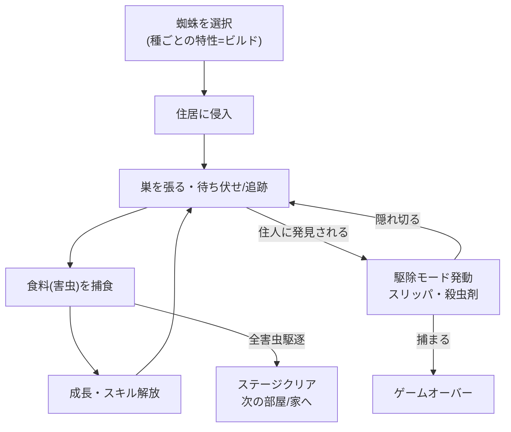
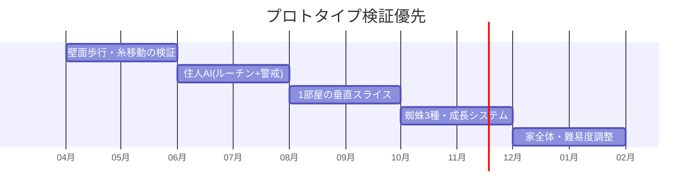

# 🕷️ スイーパー — ゲーム設計書

ステルスアクション 捕食 非人間主人公

> 🧪 PoC: [poc/06_sweeper/index.html](../poc/06_sweeper/index.html)（pixi.js — 視界コーン・警戒AI・Boids羽虫の検証）

## 1. コンセプト

**蜘蛛が主人公。住居に侵入し、そこに巣食う「食料」たち（害虫）を駆逐して血肉とする。ただし住居人に見つかると始末されに来るため、攻撃を避けながら捕食を続けるアクションゲーム。**

様々な種類の蜘蛛から選び、それぞれの特性を生かして捕食せよ。

- カイヨワ分類: **ミミクリ（捕食者ロールプレイ）× アゴン（ステルス攻防）**
- ペルソナ適合: やっさん（刺激・スリル）、松浦（限られた制限下で工夫する遊び）
- プレイヤーは「害虫駆除者（Sweeper）」であり住人の味方でもある — **見つかれば殺される益虫**という皮肉が世界観の軸

## 2. 他ゲームとの差別化

| 比較対象 | 共通点 | 本作の差別化 |
|---|---|---|
| メタルギア等ステルス | 見つかったら危険 | 敵（住人）は**倒せない絶対強者**。隠れる場所が「天井・壁・家具の裏」と立体的 |
| 山谷モノ捕食ゲーム(Maneater等) | 捕食で成長 | 舞台が**一軒の住居**という超密度な箱庭。生活リズム（住人のルーチン）が攻略情報 |
| Untitled Goose Game | 人間の生活を掻き回す小動物 | いたずらではなく**生態系シミュレーション**寄り。糸・巣という設置型トラップ戦術 |
| Hollow Knight（虫世界） | 虫モチーフ | リアル寄りの家屋スケール感。蜘蛛の種類＝ビルド選択 |

> **一言差別化**: 「一軒家を丸ごとダンジョン化した、“益虫vs住人”の非対称ステルス」

## 3. コアメカニクス

### 蜘蛛の種類（ビルド案）

| 種 | 特性 | プレイスタイル |
|---|---|---|
| ハエトリグモ | 小型・高機動・跳躍 | スピードラン型。巣は張れない |
| ジョロウグモ | 大型・巣特化 | トラップ設置型。移動は遅いが巣が強力 |
| アシダカグモ | 高速・大型・強攻撃 | 強襲型。ただし目立ちやすく発見率UP |

## 4. レベルデザイン方針（Totten理論の適用）

- **眺望と避難（Ch6）の全面適用**: 本作の核。天井コーナー・家具の隙間＝避難所、シーリングライト上・カーテンレール＝眺望点。**住人の視線が届く床は常に危険地帯**として、床を「嫌悪される低所」に反転させる（通常ゲームの高所恐怖の逆転 — Ch6『Arkham Asylum』の眺望反転の応用）
- **薄暗がり・影・曖昧さ（Ch6）**: 夜間は自由に動けるが獲物も少ない。昼は獲物が多いが住人が活動 — 光量そのものを難易度ダイヤルにする
- **分子構造図（Ch4）**: 家の間取り＝隣接関係図。通気口・配線穴が蜘蛛専用エッジとなり、人間の動線と二層のグラフを重ねて設計
- **敵は建築（Ch4）**: 住人は「動く壁」。ルーチン（テレビ→キッチン→就寝）が時限ドアとして機能
- **サウンド（Ch13）**: 足音・テレビ音で住人の位置を3Dサウンド提示。捕食成功時の咀嚼音は報酬フィードバック

## 5. 配色計画（kotonoha_sai）

メイン: **終夜（よもすがら・時間）** — 夜の住居

| 用途 | 色 | HEX |
|---|---|---|
| 照明・安全圏の光 | &nbsp;&nbsp;&nbsp; | `#e2d0c6` |
| 家具・中間影 | &nbsp;&nbsp;&nbsp; | `#72818c` |
| 壁面・基調 | &nbsp;&nbsp;&nbsp; | `#487589` |
| 深い影（隠れ場所） | &nbsp;&nbsp;&nbsp; | `#00516c` |
| 夜の窓外 | &nbsp;&nbsp;&nbsp; | `#2d366a` |
| 最暗部 | &nbsp;&nbsp;&nbsp; | `#0a224b` |

アクセント: **傷心（感情）**の赤 &nbsp;#c65244&nbsp; = 発見時の警戒表示・住人の攻撃。獲物のシルエットは高彩度の暖色で、暗所でも視認可能に（Ch5 コントラスト）。

## 6. 技術的要素の羅列

- 壁・天井歩行（法線に沿った重力方向切替、キャラコントローラ自作）
- 糸アクション（射出・ぶら下がり・巣の設置と物理シミュレーション）→ ワイヤーアクション技術（txt: 停止可能/不可能、振り子アクション）の転用
- 住人AI（日課ルーチン＋視覚/聴覚センサー＋警戒状態機械: 平常→違和感→捜索→駆除）
- ナビゲーションAI・徘徊アルゴリズム（NavMesh、蜘蛛用は壁面グラフ）
- 獲物AI（Boidsアルゴリズム — 羽虫の群れ表現）
- 視界・光量判定（ステルスメーター、ライトプローブベース）
- 捕食・成長システム（サイズ/能力ツリー）
- 3Dサウンド定位（住人足音、テレビ、獲物の羽音）
- カメラ: 狭所での貫通対策、酔い対策の感度設定（そめりんペルソナ考慮）

## 7. 適した制作環境

| 環境 | 適性 | 評価理由 |
|---|---|---|
| **Unity** | ◎ | NavMesh・物理・3Dサウンドが標準装備。壁面歩行の実装例も多い |
| UE | ○ | 家屋のリアル表現は魅力だが、個人規模では物量過多 |
| HTML5 | △ | 3Dステルスの物量・ライティングに不向き |
| Qt / exe (WPF) | × | 3Dアクション不適 |

**推奨: Unity（3D・Built-in RP）**。ローポリ＋ライティング重視で絵作りする。

## 8. 開発ロードマップ

