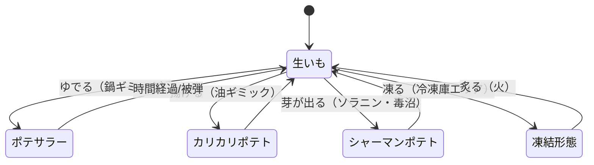
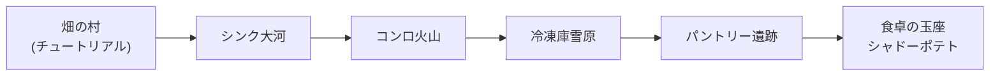
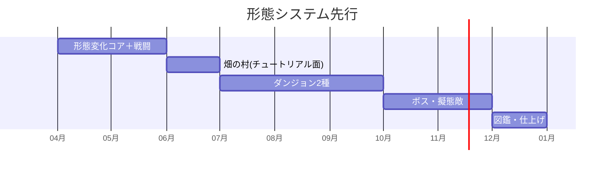

# 🥔 imo — ゲーム設計書

アクションRPG 調理＝形態変化 コミカルファンタジー

> 🧪 PoC: [poc/07_imo/index.html](../poc/07_imo/index.html)（pixi.js — 器具トリガー変身・調理法相性の検証）

## 1. コンセプト

**ジャガイモが主人公の冒険。ポテトプリンスが、シャドーポテトに囚われたポテトクイーンを助け出す。**

主人公候補は品種で性格分け: 男爵いも（ほくほく系）／メークイン（煮崩れしにくいねっとり系）。
スキル**「ポテトの目覚め」**でポテトプリンスが形態変化する。変化の軸は**調理法**: ゆでる・焼く・揚げる・煮る・凍る・炙る。

| 形態 | 調理法由来 | 戦闘スタイル |
|---|---|---|
| シャーマンポテト | ソラニン（芽・毒） | デバフ系 |
| ポテサラー | ゆで＋和える | 回復・バフ系 |
| カリカリポテト | 揚げる | 近接特化 |

- カイヨワ分類: **アゴン × ミミクリ**。食べ物擬人化のユーモアが最大の武器
- ペルソナ適合: ベンティ（かわいいビジュアル）、松浦（形態収集）

## 2. 他ゲームとの差別化

| 比較対象 | 共通点 | 本作の差別化 |
|---|---|---|
| カービィ／しゅばぁ型コピーACT | 形態変化 | 変化の語彙が**調理法**で統一され、フィールドギミック（油・鍋・冷凍庫）が変身装置を兼ねる |
| 数多の野菜キャラゲーム | 食べ物擬人化 | **芋科縛り**の敵設計（さつまいも・長芋・自然薯・キャッサバ・こんにゃく芋・じゃがアリゴ=擬態系）で世界観に一貫性 |
| ペーパーマリオ系コミカルRPG | ユーモアRPG | ボスが紅芋・紫芋・クズイモ・**トリュフ（芋界の王侯貴族気取り）**と食材ヒエラルキーの風刺 |

> **一言差別化**: 「調理法＝ジョブチェンジ。台所器具がダンジョンギミックになる芋の王子様RPG」

## 3. コアメカニクス

- フィールドの調理器具に触れると変身（変身アイテムを持ち歩くのではなく**地形が変身装置**）
- 敵芋も同じルールに従う: 揚げ攻撃でこんにゃく芋は無効、自然薯は粘りで拘束してくる等、**食材の性質＝バトル仕様**

## 4. レベルデザイン方針（Totten理論の適用）

- **分子構造図（Ch4）**: 各ダンジョン=「キッチンの一区画」をスケールアップした空間（コンロ火山、シンク大河、冷凍庫氷雪地帯、パントリー遺跡）。調理器具ノードの配置が形態パズルの骨格
- **環境アートのティーチング（Ch5）**: 「油の池=揚げ変身」等、器具の見た目と変身結果を1面で1対1対応させてから、後半で複合（凍らせてから炙る）に発展
- **報酬の拒絶（Ch7）**: ポテトクイーンの幽閉塔は全マップから見える位置に。中ボス（紅芋・紫芋）撃破ごとに一段近づく演出でゴールと報酬のスケジュールを可視化
- **英雄の旅（Ch9）**: 「畑（日常）→台所（試練）→食卓（最深部）」という**食材の一生**をそのままナラティブ空間に写像する

## 5. 配色計画（kotonoha_sai）

メイン: **最中の月（季節）** — 粉ふきいもの温かみと夜の冒険

| 用途 | 色 | HEX |
|---|---|---|
| ハイライト | &nbsp;&nbsp;&nbsp; | `#fcfdf3` |
| 主人公・ポテト肌 | &nbsp;&nbsp;&nbsp; | `#fee59f` |
| 土・フィールド | &nbsp;&nbsp;&nbsp; | `#c8b5b3` |
| UI基調 | &nbsp;&nbsp;&nbsp; | `#445c8d` |
| 影・夜 | &nbsp;&nbsp;&nbsp; | `#212557` |
| シャドーポテト | &nbsp;&nbsp;&nbsp; | `#091139` |

サブ: **朝寒（季節）** — 土・料理の焦げ色 &nbsp;#e0b286&nbsp;&nbsp;#b1585b&nbsp;&nbsp;#885f3e&nbsp;&nbsp;#70675e&nbsp;

> 形態ごとにアウトライン色を変更（ポテサラー=クリーム、カリカリ=狐色、シャーマン=毒緑）し、現在の形態を一目で識別（Ch5）。

## 6. 技術的要素の羅列

- 形態ステートマシン（調理法×効果時間×被弾解除）
- 地形トリガー式変身（器具ギミックのインタラクション設計)
- 敵AI: 食材特性テーブル（粘着・擬態・硬化）によるデータ駆動
- 擬態敵（じゃがアリゴ）: アイテム擬態→接近で正体を現す演出
- 属性相性（調理法 vs 食材）マトリクス
- 2.5D or トップダウンのアクション戦闘（攻撃判定、ノックバック）
- ボスAI（多段フェーズ: トリュフは取り巻き召喚等）
- セーブ・図鑑（芋類・料理コレクション）
- コミカルアニメーション（スカッシュ&ストレッチ強め）

## 7. 適した制作環境

| 環境 | 適性 | 評価理由 |
|---|---|---|
| **Unity** | ◎ | 2.5DアクションRPGの標準環境。形態システムのプレハブ設計が容易 |
| HTML5 | ○ | トップダウン2D構成に落とすなら可 |
| UE | △ | コミカル2.5Dにはオーバースペック |
| Qt / exe (WPF) | × | アクション不適 |

**推奨: Unity**。

## 8. 開発ロードマップ

