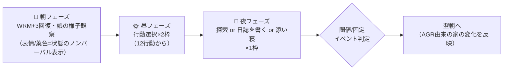
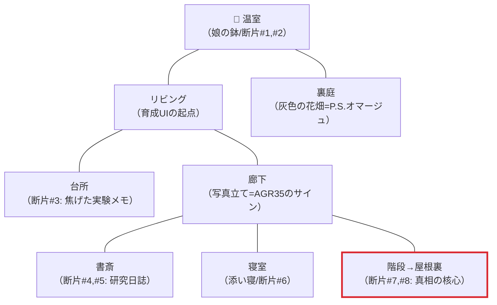
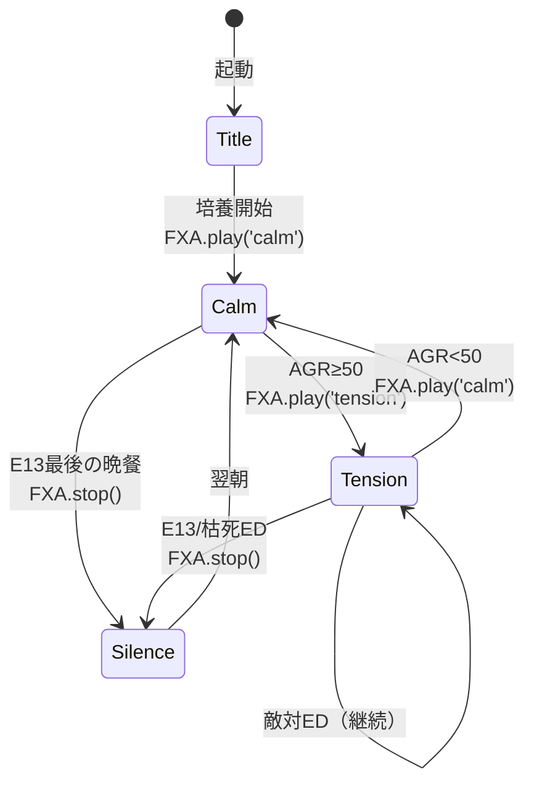
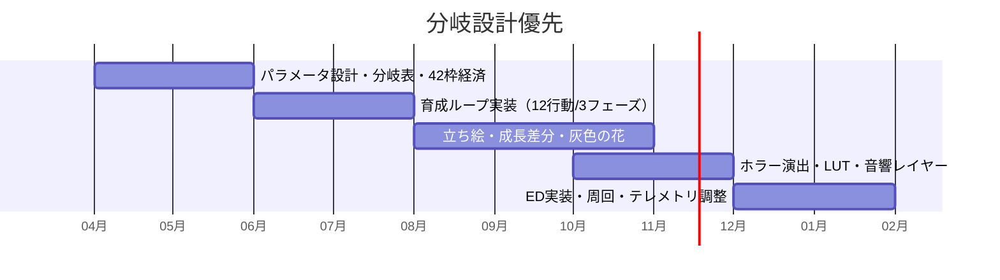

# 🌱 植物娘育成ホラー（仮題: SEEDLING）— ゲーム設計書 v2.0

育成シミュレーション ホラー マルチエンディング

> 🧪 PoC: [poc/08_plant-girl-horror/index.html](../poc/08_plant-girl-horror/index.html)（SVG+CSS — パラメータ→成長描画・攻撃性→LUT遷移・FXAプロシージャル音源の検証）

## 1. コンセプト

**「きっかけ一つで、あなたの味方にも敵にもなります」**

探検中に手に入れた種子を培養器で育てたら、女の子になった。彼女を**自立できるように育てる**のがあなたの目的。どう育てるかは自由 — しかし育て方次第では、あなたに牙を剥くかもしれない。植物娘は無事に巣立っていけるのか？

- カイヨワ分類: **ミミクリ（保護者ロール）× アレア（成長の不確定性）**
- 関連する自作コンセプト（txt）を統合:
  - 「話の進み方で同じEDでも意味が変わるゲーム」（L553）
  - 「ゲーム内進捗率によって分岐するエンディング」— 進捗率が低いままクリアすると**ハッピーに見えるが何も解決していないノーマルエンド**＋不穏なカットイン（L582-586）
  - 「ダブルミーニングのタイトル」（L588 例: V-Girl = ヴァルキリーとビクティム）→ 英題 **SEEDLING**〈苗／潜伏する脅威〉の二重含意

### 1.1 コアピラー（すべての仕様判断はこの3本に還元する）

| # | ピラー | 意味 | 仕様判断の例 |
|---|---|---|---|
| P1 | **手放すことがゴール** | 「死なせない」でも「懐かせる」でもなく、自分の元から巣立たせるのが勝利条件。過保護は敗北の一形態 | 好感度MAX＝ベストEDにしない。依存を助長する行動ほど短期報酬を大きくする（罠としての快感） |
| P2 | **ホラーはパラメータの帰結** | 恐怖演出はスクリプトの脅かしではなく、プレイヤー自身の育成の偏りが数値経由で顕在化したもの | 全ホラーイベントに発生条件（閾値）を明記。乱数のみで起こる恐怖は禁止 |
| P3 | **家が最大のUI** | 数値バーではなく、部屋の光・音・間取り・娘の姿が状態表示器。UIテキストは最終手段 | 攻撃性はゲージ非表示（隠し）。LUT・根の侵食・BGM遷移で体感させる |

> 迷ったら「この仕様は P1〜P3 のどれを強くするか？」を必ず問う。どれも強くしないなら削る。

## 2. 他ゲームとの差別化

| 比較対象 | 共通点 | 本作の差別化 |
|---|---|---|
| プリンセスメーカー系 | スケジュール育成・分岐ED | 育成対象が**人外（植物）**で、愛情の注ぎ方が生態管理（水・光・土・剪定）とコミュニケーションの二層 |
| DDLC等のメタホラー | かわいい見た目からの落差 | ホラーが演出ギミックでなく**育成パラメータの帰結**として起こる（偏った育成→歪んだ自我） |
| たまごっち系 | 世話ループ | 「死なせない」でなく**「自立させて手放す」**が目標。過保護もバッドエンド要因 |
| Growth系放置ゲー | 植物育成 | 植物パラメータと精神パラメータが相互作用（日照不足→内向化、農薬過多→攻撃性） |
| 852wa「P.S.」 | 資源を注いで無彩色の存在に色を取り戻させる | 「近づくと灰色の花が咲く」を**ぬくもり資源**として定量化し、消費と回復のサイクルを日次ループに組み込む（§3.3） |

> **一言差別化**: 「過保護も放任も等しく破滅に向かう、"手放すこと"がゴールの育成ホラー」

## 3. パラメータ設計（完全定義）

### 3.1 パラメータ一覧

| 区分 | 名称 | 記号 | 初期値 | 範囲 | 表示 | 説明 |
|---|---|---|---|---|---|---|
| 表 | 成長 | GRW | 5 | 0–100 | バー表示 | 植物としての生育度。ED到達の前提条件（GRW≥60でED判定資格） |
| 表 | 信頼 | TRS | 50 | 0–100 | バー表示 | あなたへの信頼。会話・添い寝で上昇、放置・農薬で低下 |
| 表 | 自我 | EGO | 10 | 0–100 | バー表示 | 「じぶん」の確立度。教育・日光で上昇。自立EDの鍵 |
| 表 | 攻撃性 | AGR | 0 | 0–100 | **非表示**（家の変化で体感） | 歪みの蓄積。閾値35/50/70で家が変化（§3.5） |
| 裏 | 本音の距離 | DST | 60 | 0–100 | 完全隠し | 娘が本心を明かすまでの心理的距離。低いほど近い。会話の内容・日誌発見で減少。**DST≤20でのみ真相会話が解禁** |

- 補助カウンタ: 連続同一行動数 `streak`、真相解明度（進捗率）`LORE`（0–100%、日誌断片1つ＝+12.5%、全8断片）
- 丸め: すべて整数。範囲外はクランプ。

### 3.2 コア5行動 × 14日 効果マトリクス

日次フェーズで効果が変動する（発芽期 Day1–4 ×1.0 / 成長期 Day5–9 ×1.5 / 開花期 Day10–14 ×0.5、GRWのみ倍率適用・小数切り捨て）。基礎効果:

| 行動 | GRW | TRS | EGO | AGR | 備考 |
|---|---|---|---|---|---|
| 💧 水をやる | +6 | +1 | 0 | 0 | 3連続超で AGR+6・GRW半減（根腐れ） |
| ☀ 日に当てる | +6 | 0 | +3 | 0 | 開花期はEGO+5に強化（外界への興味） |
| 💬 話しかける | 0 | +7 | +2 | −1 | DST−3。TRS≥70時は追加でDST−2 |
| 📖 教育する | +3 | 0 | +7 | 0 | **TRS<40なら AGR+8**（§3.4 相互作用I1） |
| 🚪 放置する | +2 | −9 | +4 | +7 | 唯一EGOが「独りで」伸びる。連続2回でAGR+12 |

14日×5行動の全効果（GRW値のみフェーズ倍率で変動。他は全日共通のため代表値）:

| Day | 水:GRW | 日光:GRW | 会話:TRS | 教育:EGO | 放置:AGR | フェーズ |
|---|---|---|---|---|---|---|
| 1 | +6 | +6 | +7 | +7 | +7 | 発芽期 |
| 2 | +6 | +6 | +7 | +7 | +7 | 発芽期 |
| 3 | +6 | +6 | +7 | +7 | +7 | 発芽期 |
| 4 | +6 | +6 | +7 | +7 | +7 | 発芽期 |
| 5 | +9 | +9 | +7 | +7 | +7 | 成長期 |
| 6 | +9 | +9 | +7 | +7 | +7 | 成長期 |
| 7 | +9 | +9 | +7 | +7 | +7 | 成長期（固定E7で全行動ロック→§6） |
| 8 | +9 | +9 | +7 | +7 | +7 | 成長期 |
| 9 | +9 | +9 | +7 | +7 | +7 | 成長期 |
| 10 | +3 | +3 | +7 | +7 | +7 | 開花期（日光はEGO+5） |
| 11 | +3 | +3 | +7 | +7 | +7 | 開花期 |
| 12 | +3 | +3 | +7 | +7 | +7 | 開花期 |
| 13 | +3 | +3 | +7 | +7 | +7 | 開花期 |
| 14 | +3 | +3 | +7 | +7 | +7 | 開花期（夜にED判定） |

> 設計意図: 成長期に「水と日光だけ」で数値効率が最大になるよう倍率を置く。**効率プレイ＝会話不足＝TRS低下**という罠がP2（ホラーは帰結）を駆動する。

### 3.3 ぬくもり資源（852wa「P.S.」の翻案)

「P.S.」の**灰色の花が、近づくと咲く**——プレイヤーの接近＝ぬくもりの供与で世界に色が戻り、離れると再び灰色に戻る循環——を、育成の基礎資源として翻案する。

| 項目 | 値 | 説明 |
|---|---|---|
| ぬくもり WRM | 初期3 / 上限10 | プレイヤー側の資源。**全行動は WRM を消費**（水1/日光1/会話2/教育2/放置0/添い寝3…§4参照） |
| 回復 | 朝フェーズで+3 | さらに「娘が咲かせた花1輪につき+1」——注いだぬくもりが花として返ってくる**円環**（P.S.の消費⇄回復サイクル） |
| 枯渇時 | WRM=0 | 「放置」しか選べない。**放置は資源切れの帰結としても発生する**（プレイヤーの怠慢だけが原因ではない、という免罪と恐怖の両立） |
| 灰色の花 | AGR≥50で娘の花が灰色化 | 会話・添い寝（接近行動）を行ったターンのみ、その場で彩色が戻る（LUT一時回復2秒）。**離れれば灰色に戻る**ことで「そばに居続けたい」誘惑＝共依存ルートへの引力を作る |

> P.S.が「触れれば咲くが、触れ続けることはできない」で切なさを作ったように、本作では**灰色の花を咲かせ続けたい欲求そのものを共依存EDへの誘導装置**にする。

### 3.4 相互作用式

| # | 条件 | 効果 | 意図 |
|---|---|---|---|
| I1 | TRS<40 で「教育」 | AGR+8 | 信頼なき知識は牙になる |
| I2 | 同一行動 streak≥3 | 主効果50%・AGR+6 | 単調な世話への抗議 |
| I3 | GRW≥50 かつ EGO<20 | 毎晩 AGR+3 | 体だけ育ち心が置き去り |
| I4 | TRS≥70 で「会話」 | DST−5（通常−3） | 信頼が本音の扉を開く |
| I5 | 「放置」連続2回 | AGR+12・TRS−15 | 見捨てられ不安の臨界 |
| I6 | EGO≥60 かつ TRS≥60 | 「巣立ちの相談」会話が解禁 | 自立EDの入口 |
| I7 | WRM=0 で夜を迎える | TRS−5 | ぬくもり切れは娘にも伝わる |
| I8 | LORE≥50% | 教育のEGO効果+2 | 真相を知る者の言葉は届く |
| I9 | AGR≥70 で「剪定」 | AGR−20・TRS−25 | 力で抑えれば静かになるが、心は離れる |
| I10 | 添い寝を Day10 以降に実行 | DST−8・依存フラグ+1（3以上で共依存ED資格） | 終盤の密着は檻になる |

### 3.5 攻撃性の閾値イベント（家の変化）

| AGR | 家の変化（P3: 家が最大のUI） | LUT | 音響 |
|---|---|---|---|
| 35 | 鉢の位置が夜ごとに数cmずれる。廊下の写真立てが1枚だけ裏返る。根が床板の隙間から1本 | 彩度−15% | 環境音に低周波レイヤー追加 |
| 50 | **BGMがcalm→tensionへ遷移**。窓の外の緑が枯れ色に。娘の花が灰色化（§3.3）。ドアの開閉に1秒の遅延 | 彩度−35%・色相−17° | FXA.play('tension') |
| 70 | 温室のガラスに内側から手形。セーブ画面のサムネイルが「こちらを見ている」差分に置換（メタ演出）。2階への階段が「今日は使えない」 | 焦がれる系パレットへ完全遷移（#da2730→#4e0003） | tension＋心拍レイヤー、SFX 'evil' スティンガー |

閾値は**上抜けた瞬間に1回だけ**演出発火。下回った場合、家は戻るが**写真立てだけは裏返ったまま**（不可逆の爪痕を1つ残す）。

## 4. 行動の拡張（5→12行動）

| # | 行動 | WRM | 主効果 | リスク | 解禁条件 |
|---|---|---|---|---|---|
| 1 | 💧 水をやる | 1 | GRW+6 | 3連続超で根腐れ（AGR+6） | 初期 |
| 2 | ☀ 日に当てる | 1 | GRW+6 / EGO+3 | 開花期は葉焼け判定（GRW−3が20%） | 初期 |
| 3 | 💬 話しかける | 2 | TRS+7 / EGO+2 / DST−3 | なし（ただし数値効率は最低） | 初期 |
| 4 | 📖 教育する | 2 | EGO+7 / GRW+3 | I1: TRS<40でAGR+8 | 初期 |
| 5 | 🚪 放置する | 0 | EGO+4 / GRW+2 | TRS−9 / AGR+7、連続でI5 | 初期 |
| 6 | ✂ 剪定する | 2 | AGR−10 / GRW+4 | TRS−8。AGR≥70時はI9（−20/−25） | Day4〜 |
| 7 | 🪴 植え替える | 3 | GRW+10 / EGO+5 | 実行日から2日間TRS−2/日（環境ストレス） | Day5〜・GRW≥30 |
| 8 | 🛏 一緒に寝る | 3 | TRS+10 / DST−6 / WRM回復+1（翌朝） | I10: Day10以降は依存フラグ+1 | TRS≥55 |
| 9 | 📛 名前を呼ぶ | 1 | TRS+4 / EGO+6 / DST−4 | 名付け以前は不発。**命名イベント（E5）後のみ** | Day5固定イベント後 |
| 10 | 🚪🔔 来客対応 | 2 | LORE+12.5%（研究者の断片情報） | 娘を隠すか見せるかの選択。見せるとEGO+8/AGR+5 | Day6・Day11の来客日のみ |
| 11 | 🌸 花を摘む | 1 | WRM+2（ぬくもり回収） | TRS−6 / AGR+4（体の一部を奪う行為） | GRW≥60・開花後 |
| 12 | 📓 日誌を探す | 2 | LORE+12.5% / DST−2 | その日の育成行動を1枠消費（機会費用） | 夜フェーズ常時（§5） |

> リスクリターン設計則: **数値効率が高い行動ほど関係性コスト（TRS/AGR/依存）を払う**。安全な行動は遅い。12行動すべてがこの一次関数上に乗っているかをバランス調整の検収条件とする。

## 5. 1日ループの詳細（朝・昼・夜の3フェーズ制）

- 昼2枠＋夜1枠 = **1日3枠 × 14日 = 42枠**が総リソース。全EDの必要枠数を42以下で設計する（到達不能ED禁止）。
- 夜の探索は**家の中で日誌断片を見つける**パート。移動はポイントクリック、怖さはP2に従い「AGRが高い日ほど同じ家が暗い」だけで作る。

### 5.1 家の間取り（探索パート）

### 5.2 Totten理論の適用箇所

| 概念（章） | 適用 |
|---|---|
| 記憶の宮殿（Ch5/Ch12） | 家＝記憶の宮殿。断片#nは必ず「その内容に対応する部屋」に置く（実験の記憶→台所、出自→屋根裏）。周回時、プレイヤーは間取りの記憶だけで真相の位置を再訪できる |
| ナラティブのセット構成（Ch9） | 「急いで立ち去った痕跡」（書斎の倒れた椅子）「生活感」（台所の二人分の食器）「見かけによらない」（可愛い子供部屋にだけ鍵）で言葉なしの前史を語る |
| 瞑想的空間（Ch7） | 裏庭の灰色の花畑と屋根裏の天窓は敵も数値もない無音の空間。育成の緊張の**呼吸継ぎ**として配置し、報酬（断片）はその奥に置く |
| 薄暗がりと曖昧さ（Ch6） | ホラー段階では新規アセットを足さず、同じ間取りの照明・影・LUTだけを転覆させる |
| 眺望と避難（Ch6） | 廊下（見晴らし）→各部屋（袋小路）の構造で、AGR高進行時の探索に自然な緊張勾配を作る |

## 6. イベントスクリプト表

### 6.1 固定イベント（14日間）

| ID | 日 | イベント | 演出/分岐 |
|---|---|---|---|
| E1 | 1 | 発芽 —「めが、でた」 | チュートリアル。娘の第一声 |
| E2 | 2 | 初めての夜泣き（葉が震える） | 添い寝の存在を示唆（未解禁） |
| E3 | 3 | 双葉が手のかたちに | GRWバーの意味が「植物」から「体」へすり替わる違和感の種 |
| E4 | 4 | 剪定バサミを見つける | 行動「剪定」解禁。娘がハサミを凝視するカット |
| E5 | 5 | 命名イベント | 名前入力。行動「名前を呼ぶ」解禁。**セーブデータ名にも反映**（メタ演出の布石） |
| E6 | 6 | 来客①（元研究員） | 対応選択→LORE or EGO/AGR（§4 #10） |
| E7 | 7 | 嵐の夜（全行動ロック） | 強制添い寝 or 独りにする選択。TRS±12の大振れ日 |
| E8 | 8 | 「そと、みたい」 | 日光行動が窓辺→庭に変化。EGO成長の可視化 |
| E9 | 9 | 灰色の花が一輪咲く | §3.3の仕様開示。近づくと色づくのを見せる |
| E10 | 10 | 来客②（役所の査察） | 隠す→AGR+5／見せる→LORE+12.5%・保護観察フラグ |
| E11 | 11 | 娘が「日誌」を読んでいた | DST−10。ただしLORE<25%なら逆にAGR+10（無知のまま知られる恐怖） |
| E12 | 12 | 蕾（つぼみ）の夜 | ED分岐の事前通知: 現ルートの暗示演出（花の色で示す） |
| E13 | 13 | 最後の晩餐 | 全パラメータ表示が消える（P3徹底）。会話のみで状態を読む日 |
| E14 | 14 | 開花 → ED判定 | §7のマトリクスで分岐 |

### 6.2 条件イベント（20本）

| ID | 発生条件 | 内容 | 分岐/演出 |
|---|---|---|---|
| C1 | AGR≥35初到達 | 鉢の位置がずれる | §3.5 閾値1。SFX 'evil'弱 |
| C2 | AGR≥50初到達 | BGM tension遷移・灰色化 | §3.5 閾値2 |
| C3 | AGR≥70初到達 | 温室の手形・セーブ画面変化 | §3.5 閾値3 |
| C4 | TRS≥70初到達 | 「てをつないでいい？」 | 選択→受ける: 依存+1／断る: EGO+5 |
| C5 | EGO≥50初到達 | 娘が自分で水を汲む | 以後「水をやる」の効果−2（自立の予兆） |
| C6 | TRS≤20 | 呼んでも顔を上げない | 会話効果半減デバフ（2日間） |
| C7 | GRW≥50 & EGO<20 | 夜、無表情で立っている | I3の可視化。LUT一時暗転 |
| C8 | 根腐れ発生（水4連続） | 「くるしい」 | GRW−10。剪定で回復可の導線 |
| C9 | streak≥3（任意行動） | ため息の擬音（葉ずれ） | I2の可視化 |
| C10 | WRM=0で夜 | 娘が毛布を持ってくる | TRS−5だがDST−3（気遣いの切なさ） |
| C11 | LORE=25% | 断片から「前の栽培者」の存在 | 書斎に新調査ポイント出現 |
| C12 | LORE=50% | 娘の種子は人為的な品種と判明 | I8解禁。教育の台詞が変化 |
| C13 | LORE=75% | 前の栽培者の失踪の真相 | 屋根裏の鍵が開く |
| C14 | LORE=100% | 真相全開示: 娘は「手放されるために作られた」 | 真EDの資格。タイトル画面の種アイコンが発芽差分に |
| C15 | DST≤40 | 片言が文章になる | 会話UIの選択肢が2→3に増加 |
| C16 | DST≤20 | 本音の告白「わたしは、なに？」 | 回答選択が全EDの意味を反転させる（L553仕様） |
| C17 | 依存フラグ≥3 | 「どこにもいかないで」 | 共依存ED資格。玄関の探索が選べなくなる |
| C18 | 剪定をAGR≥50で実行 | 切った枝が翌朝、枕元に | AGR−20の代償演出。SFX 'alarm' |
| C19 | 来客を2回とも隠した | 役所の再訪（強制） | AGR+10・保護観察フラグ→敵対ED変調 |
| C20 | 花を摘む×3回 | 「それ、いたいの」 | 以後この行動でTRS−12に悪化（学習する痛み） |

## 7. エンディングマトリクス

### 7.1 到達条件表（4系統×バリエーション=8種）

判定はDay14夜。優先度は上から（複数条件成立時は先勝ち）。全EDの前提: GRW≥60（未満は強制的にED-D系）。

| ID | 系統 | 名称 | 条件 | 演出概要 |
|---|---|---|---|---|
| A1 | 自立 | 🌸 巣立ち | TRS≥75 / EGO≥50 / AGR<35 / LORE≥75% | 空の鉢に花一輪。真相を知った上での「いってきます」 |
| A2 | 自立 | 🌷 未熟な旅立ち | TRS≥75 / EGO≥50 / AGR<35 / LORE<75% | 同じ映像に**不穏なカットイン**（L582-586: 解決していないノーマル）。「彼女は自分が何かを知らないまま、世界へ出た」 |
| B1 | 共依存 | 🌿 幸福な檻 | TRS≥60 / 依存フラグ≥3 / AGR<50 | 二人の穏やかな朝の無限ループ演出。窓の外だけが季節を進む |
| B2 | 共依存 | 🥀 根の褥（しとね） | TRS≥60 / 依存フラグ≥3 / AGR≥50 | 根があなたのベッドを包む。「これで、ずっといっしょ」——恐怖と安堵が不可分のED |
| C1e | 敵対 | 🩸 収穫 | AGR≥70 | 家が温室に呑まれる。あなたは「育てた通り」に刈り取られる |
| C2e | 敵対 | 🍃 静かな乗っ取り | AGR 50–69 / EGO≥50 | 直接の加害なし。ある朝、家の名義札があなたの名前ではなくなっている（驚かせない恐怖の極致） |
| D1 | 枯死 | 🍂 沈黙 | TRS<60 かつ他条件不成立 | 葉が全て落ちる。最後まで言葉を聞けなかった |
| D2 | 枯死 | 🌫 灰色のまま | GRW<60 でDay14到達 | 咲かないまま灰色の蕾で終わる。P.S.オマージュ: EDの一枚絵にだけ、プレイヤーカーソルを近づけると一瞬色が戻る |

### 7.2 周回引継ぎ（強くてニューゲーム）

| 引継ぎ要素 | 内容 |
|---|---|
| LORE | 解明済み断片は既読のまま保持。2周目は探索枠を関係構築に回せる |
| 解放会話 | 各ED到達で娘の新規会話が解禁: A系→「まえのわたしの、ゆめをみた」／B系→添い寝時の独白追加／C系→教育時に「こんどは、まちがえないでね」（**メタ台詞**）／D系→命名時に前周の名前を娘が先に呟く |
| 真ED | 全4系統到達＋LORE100%の周のみ、C16の回答に第4の選択肢が出現→**ED0「種の還る場所」** |
| 引継がないもの | パラメータ・WRM・依存フラグ（毎周ゼロから。育成の手触りを守る） |

## 8. ホラー演出設計

### 8.1 恐怖の段階表

| 段階 | トリガー目安 | 手法 | 具体例 |
|---|---|---|---|
| 違和感 | AGR 20–34 / Day3以降 | 「昨日と1つだけ違う」 | 鉢の向き・食器の数・BGMの1音欠け |
| 不穏 | AGR 35–49 | 環境の応答遅延・色の喪失 | ドア開閉ラグ、彩度低下、娘の瞬きが減る |
| 恐怖 | AGR 50+ | 空間の所有権の逆転 | 根の侵食、立入不能な部屋、セーブ画面差分、tension BGM |

### 8.2 「驚かせない恐怖」の原則

1. **ジャンプスケア禁止**。音量スパイクは alarm スティンガー1種のみ、かつ使用は全編で最大3回
2. 恐怖の主語は常に「変化した家」。娘自身は最終盤まで**一度も襲ってこない**
3. すべての恐怖は翌朝に「確認できる痕跡」を残す（夢オチ・幻覚オチ禁止 — P2）
4. プレイヤーが立ち止まれば恐怖も止まる。**追いかける恐怖は作らない**（育成ゲームのテンポを守る）

### 8.3 演出対応表（LUT×SE×メタ)

| 状態 | LUT | SE/BGM | メタ演出 |
|---|---|---|---|
| 健全（AGR<35） | 草青む基調（§9） | calm / 'heal','ui' | なし |
| 違和感 | 彩度−15% | calmのまま1音欠け | ウィンドウタイトルに空白1つ混入 |
| 不穏 | 彩度−35%・色相−17° | 低周波環境音レイヤー | オートセーブ表記が「記録シテイマス」に |
| 恐怖 | 焦がれる遷移 #da2730→#9a2226→#4e0003→#473545 | tension＋心拍 / 'evil' | セーブサムネイル差分・タイトル画面の種が脈動 |
| ED後 | 系統別固定 | §9.1参照 | クリアデータのアイコンがED系統で変化 |

## 9. 配色計画（kotonoha_sai）

メイン: **草青む（季節）** — 健全な成長の緑

| 用途 | 色 | HEX |
|---|---|---|
| 日常UI | &nbsp;&nbsp;&nbsp; | `#fff3d4` |
| 娘（健全） | &nbsp;&nbsp;&nbsp; | `#c8e3bd` |
| 植物・温室 | &nbsp;&nbsp;&nbsp; | `#a1c9a8` |
| 成長・基調 | &nbsp;&nbsp;&nbsp; | `#5ea589` |
| 頬・花 | &nbsp;&nbsp;&nbsp; | `#f6bfbb` |
| 実り | &nbsp;&nbsp;&nbsp; | `#f6b371` |

ホラールート移行時: **焦がれる（感情）**へ段階的にLUT遷移 &nbsp;#da2730&nbsp;&nbsp;#9a2226&nbsp;&nbsp;#4e0003&nbsp;&nbsp;#473545&nbsp;

> 攻撃性パラメータを画面全体のカラーグレーディングに直結させ、**プレイヤーが数値を見なくても危険水域を体感**できるようにする（Ch5 色彩コミュニケーション）。灰色の花（§3.3）は彩度0の `#c8e3bd` →接近時のみ本来色へ2秒補間。

## 10. 音響設計

### 10.1 BGM状態遷移（FXA APIマッピング）

- 遷移はすべて**閾値の跨ぎ検知**で1回だけ発火（毎フレーム再生呼び出し禁止。FXA.playは同名再指定を無視するが設計としても保証する）
- 無音は「第3のBGM」。E13・瞑想的空間（裏庭/屋根裏）・枯死EDで意図的に使用

### 10.2 SFX表（FXAプリセットへの割当）

| ゲーム内音 | FXA | 使用場面 |
|---|---|---|
| 水やり | `splash` | 行動: 水をやる |
| 成長・回復 | `heal` | 行動: 日に当てる／GRW段階アップ |
| 会話・UI操作 | `ui` | 行動: 話しかける／メニュー全般／タイトル決定 |
| 学習 | `pickup` | 行動: 教育する／断片発見 |
| 不穏 | `evil` | 行動: 放置する／C1・C3・敵対ED |
| 事件スティンガー | `alarm` | C18枕元の枝 等、全編最大3回（§8.2） |
| 剪定 | `hit` | 行動: 剪定する |
| 命名・解禁 | `powerup` | E5命名／新行動解禁 |
| ED（自立/共依存） | `clear` | A系・B系ED確定時 |
| ED（枯死） | `gameover` | D系ED確定時（BGMはstop） |
| 足音（探索） | `step` | 夜フェーズ移動 |

### 10.3 本実装（Unity）方針

- **環境音レイヤー**: ベースアンビエンス（家鳴り/温室の水滴）＋AGR連動レイヤー（低周波ドローン、AGR35/50/70で1枚ずつ加算）。クロスフェード2秒
- **心拍**: AGR≥50で60bpm開始、AGR値に比例して最大90bpmまで。プレイヤー操作停止中は減速（§8.2「立ち止まれば恐怖も止まる」を音でも実装）
- **1音欠け演出**: calmのシーケンスから特定ステップをAGR20以降ミュート（PoCのFXAでも `S.calm.lead` の一音を−1化するだけで再現可能）
- ダッキング: 会話ボイス的SE再生時 `FXA.duck(0.4)` 相当のサイドチェイン

## 11. セーブ・アクセシビリティ・テレメトリ

### 11.1 セーブ

- オートセーブ（各フェーズ末）＋手動1枠。**手動セーブ画面はメタ演出の舞台**（§8.3）のため、周回済みプレイヤー向けに「演出オフでも実データは安全」であることをオプション画面に明記
- セーブデータに記録: 全パラメータ・LORE・依存フラグ・ED到達履歴・命名文字列

### 11.2 アクセシビリティ

| 設定 | 内容 |
|---|---|
| ホラー強度 | 3段階。低: メタ演出/手形/心拍オフ・LUT遷移を50%に緩和（ベンティ・ペルソナ対応）／中: 標準／高: 違和感演出の頻度+50% |
| 音量 | BGM/SFX/環境音の個別スライダー（FXA.volume準拠） |
| 文字 | フォントサイズ3段階・片言テキストのふりがな表示 |
| 色覚 | AGR警告を色相依存にしない（根の侵食・音で冗長化済み — P3が本質的に色覚対応） |

### 11.3 テレメトリ（バランス調整用）

| 計測点 | 目的 |
|---|---|
| 行動選択の分布（日次） | 効率プレイ率とI2発火率の確認。「会話」選択率が15%を切ったら罠が強すぎ |
| ED到達分布 | 初周でA2:B1:C系:D系 ≒ 3:3:2:2 を目標。C系が10%未満なら閾値を下げる |
| AGR閾値の初到達日 | 恐怖のペーシング検証（AGR35はDay5±2に初到達が理想） |
| 離脱ポイント | E7嵐の夜・C3での離脱率を重点監視 |
| LORE到達率 | 初周75%到達が30%前後になるよう断片の隠し難度を調整 |

## 12. 技術的要素の羅列

- パラメータシミュレーション（植物系×精神系の相互作用行列 §3.4）
- スケジュール式育成ループ（3フェーズ×14日、42枠経済）
- 会話システム（好感度・記憶フラグ、選択肢の遅効性、DST連動の選択肢増減）
- マルチエンディング管理（進捗率×パラメータ×選択の3軸分岐表 §7）
- カラーグレーディング／LUT遷移（AGR直結ポストプロセス）
- 娘の外見モーフィング（成長段階×ルート別の差分システム: Live2D or スプライト差分）
- ホラー演出（音響のstinger、視線検知風の演出、セーブ画面の改変等のメタ演出）
- 周回システム（強くてニューゲーム: 解明済み真相＋解放会話の引継ぎ §7.2）
- 実績（やっさんペルソナ向け・ED回収率）

## 13. 適した制作環境

| 環境 | 適性 | 評価理由 |
|---|---|---|
| **Unity** | ◎ | Live2D連携・ポストプロセス・音響演出が揃う。ADV系アセットも豊富 |
| HTML5 | ○ | テキスト主体構成なら可。ただしホラー演出（音響・画面制御）の自由度が下がる |
| exe (WPF) | △ | UI主体の育成部分だけなら組めるが演出に限界 |
| UE / Qt | × | 規模・目的に不適合 |

**推奨: Unity**（メタ演出のためフルスクリーン制御・ファイルI/O演出がしやすいスタンドアロンexe配布）。

## 14. 開発マイルストーン

- 各マイルストーンの検収条件: M1=全EDが42枠内で机上到達可能／M2=I1〜I10が自動テストで再現／M3=灰色の花の接近彩色が実機60fps／M4=ホラー強度「低」で全メタ演出が無効化されること／M5=テレメトリ目標比（§11.3）の初回計測
