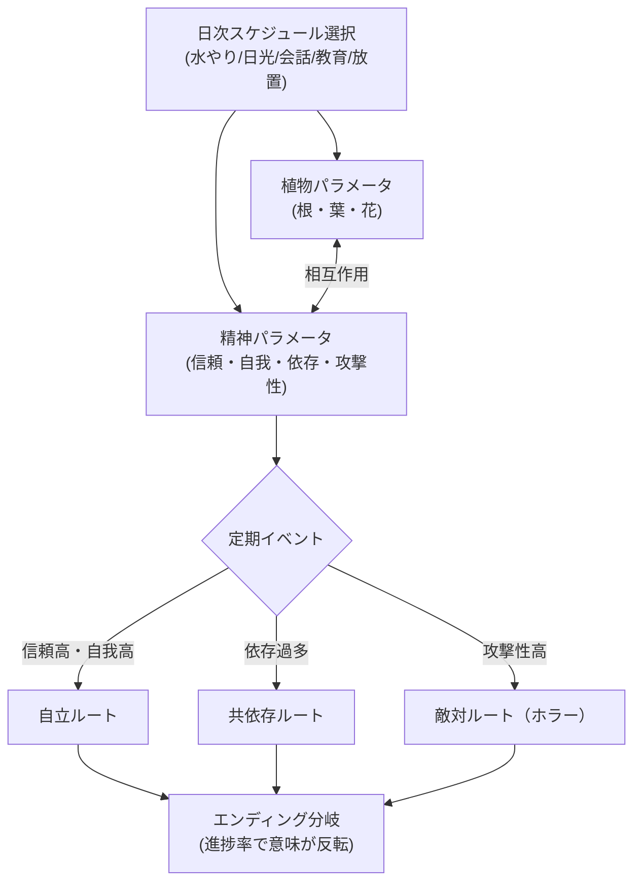
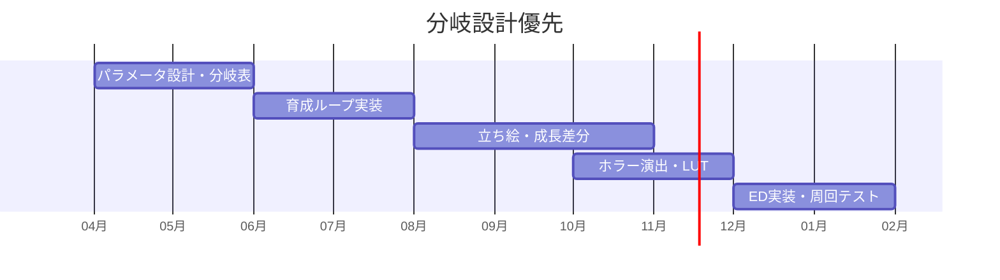

# 🌱 植物娘育成ホラー — ゲーム設計書

育成シミュレーション ホラー マルチエンディング

> 🧪 PoC: [poc/08_plant-girl-horror/index.html](../poc/08_plant-girl-horror/index.html)（SVG+CSS — パラメータ→成長描画・攻撃性→LUT遷移の検証）

## 1. コンセプト

**「きっかけ一つで、あなたの味方にも敵にもなります」**

探検中に手に入れた種子を培養器で育てたら、女の子になった。彼女を**自立できるように育てる**のがあなたの目的。どう育てるかは自由 — しかし育て方次第では、あなたに牙を剥くかもしれない。植物娘は無事に巣立っていけるのか？

- カイヨワ分類: **ミミクリ（保護者ロール）× アレア（成長の不確定性）**
- 関連する自作コンセプト（txt）を統合:
  - 「話の進み方で同じEDでも意味が変わるゲーム」（L553）
  - 「ゲーム内進捗率によって分岐するエンディング」— 進捗率が低いままクリアすると**ハッピーに見えるが何も解決していないノーマルエンド**＋不穏なカットイン（L582-586）
  - 「ダブルミーニングのタイトル」（L588 例: V-Girl = ヴァルキリーとビクティム）→ 本作でも英題に二重含意を仕込む（例: **SEEDLING**〈苗／潜伏する脅威〉）

## 2. 他ゲームとの差別化

| 比較対象 | 共通点 | 本作の差別化 |
|---|---|---|
| プリンセスメーカー系 | スケジュール育成・分岐ED | 育成対象が**人外（植物）**で、愛情の注ぎ方が生態管理（水・光・土・剪定）とコミュニケーションの二層 |
| DDLC等のメタホラー | かわいい見た目からの落差 | ホラーが演出ギミックでなく**育成パラメータの帰結**として起こる（偏った育成→歪んだ自我） |
| たまごっち系 | 世話ループ | 「死なせない」でなく**「自立させて手放す」**が目標。過保護もバッドエンド要因 |
| Growth系放置ゲー | 植物育成 | 植物パラメータと精神パラメータが相互作用（日照不足→内向化、農薬過多→攻撃性） |

> **一言差別化**: 「過保護も放任も等しく破滅に向かう、“手放すこと”がゴールの育成ホラー」

## 3. コアメカニクス

- **進捗率システム**: 真相（種子の正体）の解明度が低いままEDに到達すると、同じ映像でも不穏なカットインが挿入され「まだ終わっていない」ことを示唆 → 周回動機
- 鬱展開に**向き合うか否か**の選択がハッピー/バッド分岐を決める（txt L586）

## 4. レベルデザイン方針（Totten理論の適用)

- **家＝記憶の宮殿（Ch5/Ch12）**: 舞台はほぼ一軒の家＋温室。娘の成長に応じて部屋のビジュアル・ランゲージが変化（葉が増える、根が壁を這う、花の香りの表現）— 環境が育成結果のフィードバックUI
- **薄暗がりと曖昧さ（Ch6）**: ホラールートでは同じ間取りの照明・影だけを変えて恐怖を演出。新規アセットではなく光の転覆で費用対効果を最大化
- **ナラティブの空間（Ch9）**: 「急いで立ち去った痕跡」「生活感」「見かけによらない」等のセット構成テクニック（Ch9演習3）で、探索パートの手掛かりを言葉なしで配置
- **報酬空間（Ch7）**: 真相の断片（研究日誌）は瞑想的空間（温室の奥・屋根裏）に置き、育成の合間の緩急を作る

## 5. 配色計画（kotonoha_sai）

メイン: **草青む（季節）** — 健全な成長の緑

| 用途 | 色 | HEX |
|---|---|---|
| 日常UI | &nbsp;&nbsp;&nbsp; | `#fff3d4` |
| 娘（健全） | &nbsp;&nbsp;&nbsp; | `#c8e3bd` |
| 植物・温室 | &nbsp;&nbsp;&nbsp; | `#a1c9a8` |
| 成長・基調 | &nbsp;&nbsp;&nbsp; | `#5ea589` |
| 頬・花 | &nbsp;&nbsp;&nbsp; | `#f6bfbb` |
| 実り | &nbsp;&nbsp;&nbsp; | `#f6b371` |

ホラールート移行時: **焦がれる（感情）**へ段階的にLUT遷移 &nbsp;#da2730&nbsp;&nbsp;#9a2226&nbsp;&nbsp;#4e0003&nbsp;&nbsp;#473545&nbsp;

> 攻撃性パラメータを画面全体のカラーグレーディングに直結させ、**プレイヤーが数値を見なくても危険水域を体感**できるようにする（Ch5 色彩コミュニケーション）。

## 6. 技術的要素の羅列

- パラメータシミュレーション（植物系×精神系の相互作用行列）
- スケジュール式育成ループ（日次選択→週次イベント）
- 会話システム（好感度・記憶フラグ、選択肢の遅効性）
- マルチエンディング管理（進捗率×パラメータ×選択の3軸分岐表）
- カラーグレーディング／LUT遷移（ルート別ポストプロセス）
- 娘の外見モーフィング（成長段階×ルート別の差分システム: Live2D or スプライト差分）
- ホラー演出（音響のstinger、視線検知風の演出、セーブ画面の改変等のメタ演出）
- 周回システム（強くてニューゲーム: 解明済み真相の引継ぎ）
- 実績（やっさんペルソナ向け・ED回収率）

## 7. 適した制作環境

| 環境 | 適性 | 評価理由 |
|---|---|---|
| **Unity** | ◎ | Live2D連携・ポストプロセス・音響演出が揃う。ADV系アセットも豊富 |
| HTML5 | ○ | テキスト主体構成なら可。ただしホラー演出（音響・画面制御）の自由度が下がる |
| exe (WPF) | △ | UI主体の育成部分だけなら組めるが演出に限界 |
| UE / Qt | × | 規模・目的に不適合 |

**推奨: Unity**（メタ演出のためフルスクリーン制御・ファイルI/O演出がしやすいスタンドアロンexe配布）。

## 8. 開発ロードマップ

