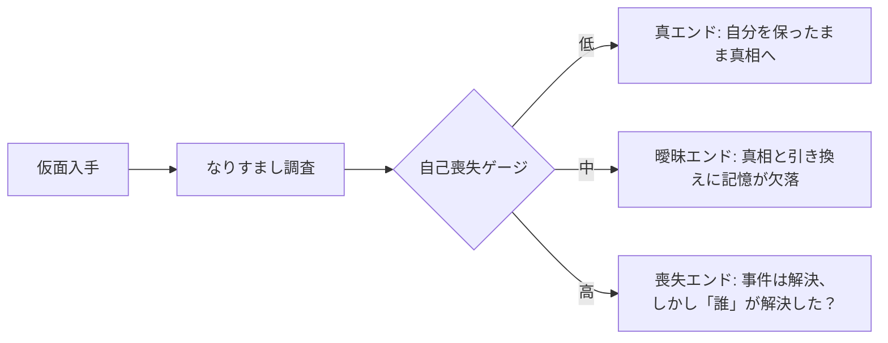
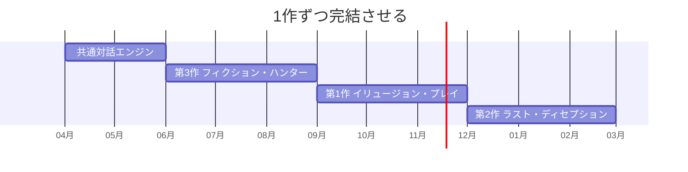

# 🎭 嘘三部作 — ゲーム設計書

テーマ: 嘘・偽り・虚構 シングルプレイ3部作

> 🧪 PoC: [poc/09_uso-trilogy/index.html](../poc/09_uso-trilogy/index.html)（HTML/JS — 第3作フィクション・ハンター: フェイク判定＋根拠選択の検証）

「嘘」を3つの角度（なりすます／生き抜く／見抜く）から扱う短編3部作。共通の世界観トーンとUIで、アンソロジーとして展開する。

---

## 第1作: イリュージョン・プレイ

- **ジャンル**: 謎解きアドベンチャー
- **概要**: 謎の仮面を手に入れたプレイヤーは、他人になりすますことができる。ただし仮面を使うたびに**「自己喪失」のリスク**が増え、自分が誰なのか分からなくなっていく
- **ルール**: 仮面でNPCを欺き事件の真相を解明／「正体がバレるタイムリミット」の緊張感／リスク管理下の選択のジレンマ
- **独自要素**: 自分の真実と偽りが交錯する心理的ストーリー。**仮面の使用頻度でエンディングが変化**

## 第2作: ザ・ラスト・ディセプション

- **ジャンル**: ライフシミュレーション
- **概要**: **嘘で固めた人生**を築くシミュレーション。職場や人間関係で自分を偽り続けて成功を目指すが、嘘がバレると人生が崩壊する
- **ルール**: 「正直」「嘘」「沈黙」の選択肢でストーリー進行／嘘の成功で収入・ステータス向上／嘘の累積が閾値を超えると「信用度」が低下し破滅リスク
- **独自要素**: バレそうな場面で**「即興の弁明」を作るミニゲーム**／過去の選択がストーリーに影響（嘘の整合性管理＝プレイヤー自身の記憶力が試される）

## 第3作: フィクション・ハンター

- **ジャンル**: サスペンス／パズル
- **概要**: 未来の**「フェイクニュース対策官」**として、SNSに拡散される虚偽情報を見抜き真実を守る。時には自らフェイクを作って悪質な組織に潜入する
- **ルール**: 本物と偽物のニュース・画像を分析して判断／潜入ミッションでは嘘をつき続けて敵組織の信頼を獲得／時間制限内の情報精査
- **独自要素**: AIを模したフェイク生成システムの再現／ミスリードを防ぐ**「疑うべき根拠」の選択**

---

## 他ゲームとの差別化（3作共通）

| 比較対象 | 共通点 | 差別化 |
|---|---|---|
| 逆転裁判 | 嘘を暴く | 第1・2作では**プレイヤー側が嘘をつく主体**。倫理的な居心地の悪さをデザインの核に据える |
| Papers, Please | 書類審査・判断 | 第3作は判断根拠の**メタ認知**（なぜ疑ったか）を選ばせ、情報リテラシー教材としても機能 |
| ペルソナ系 | 仮面モチーフ | 仮面が力でなく**自己の消耗**である点。使うほど強くなるのでなく、使うほど失う |
| 一般ADV | 選択肢分岐 | 三部作を通して「嘘」の主体・客体・観測者を一巡させるアンソロジー構造 |

> **一言差別化**: 「嘘を『つく・生きる・見抜く』の三面から解剖するアンソロジーADV」

## レベルデザイン方針（Totten理論の適用）

- **ナラティブの空間（Ch9）**: 会話中心のゲームだが、舞台（事件現場・職場・SNS空間の可視化）を「セット構成」で語る。第3作のSNSは情報の街並み＝ディストリクト（Ch4 都市設計）として空間化
- **既存トロープの転覆（Ch8）**: 「選択肢の正解色」の慣例を意図的に裏切る — 誠実に見える青い選択肢が破滅を招く場面を作り、色への盲信自体をテーマ化
- **緊張のペーシング（Ch9）**: タイムリミット演出はドラマティックアークに同期。連続緊張を避け、瞑想的空間（第1作: 仮面を外せる自室）を必ず挟む（Ch7）
- **報酬＝情報（Ch7）**: 本作の報酬は真相の断片。「物語の舞台」型報酬空間を軸に、開示スケジュールを一定に保つ

## 配色計画（kotonoha_sai）

3作で共通の低彩度基調＋作品別アクセント:

| 作品 | パレット | キーカラー | 意味 |
|---|---|---|---|
| 共通基調 | 依怙地（感情） | &nbsp;#c8ced0&nbsp;&nbsp;#9f9187&nbsp;&nbsp;#475a61&nbsp; | 灰色の日常＝嘘の膜 |
| イリュージョン・プレイ | とつおいつ（感情） | &nbsp;#b04757&nbsp;&nbsp;#3a2a56&nbsp; | 迷い・自己喪失の紫 |
| ザ・ラスト・ディセプション | 黄昏時（時間） | &nbsp;#f7df51&nbsp;&nbsp;#513738&nbsp; | 成功の金色と長い影 |
| フィクション・ハンター | 空知らぬ雨（感情） | &nbsp;#7da9d4&nbsp;&nbsp;#2c628d&nbsp; | 情報の雨・冷静な検証 |

> 「嘘をついている間」だけ画面の彩度がわずかに上がる（嘘は魅力的）— 数値でなく色で状態を伝える（Ch5）。

## 技術的要素の羅列

- 会話・分岐スクリプトエンジン（Yarn Spinner / Ink 等のノードベース対話）
- フラグ・整合性管理（過去の嘘のデータベースと矛盾検出）
- 自己喪失／信用度などのグローバルパラメータとED分岐
- 即興弁明ミニゲーム（制限時間内のワード合成）
- フェイク判定パズル（画像・記事の違和感アノテーション、拡大鏡UI）
- 疑似SNSフィードUI（自動生成投稿、拡散シミュレーション）
- タイムリミット演出（リアルタイム制約と心拍系SE）
- 彩度制御ポストエフェクト
- 実績・周回（ED回収、真相ログ）

## 適した制作環境

| 環境 | 適性 | 評価理由 |
|---|---|---|
| **HTML5** | ◎ | テキスト・UI主体で軽量。第3作の疑似SNSはWeb技術（DOM）と最高の相性。ブラウザ配布で間口が広い |
| Unity | ○ | 3作を同一基盤でexe配布するなら有力。演出の自由度も高い |
| exe (WPF) | ○ | 対話UI主体なら実装可能。C#練習題材としては好適 |
| UE / Qt | × | 過剰 |

**推奨: HTML5（第3作から着手）**。itch.ioブラウザゲームとして1作ずつ公開し、反応を見て次作へ。

## 開発ロードマップ

