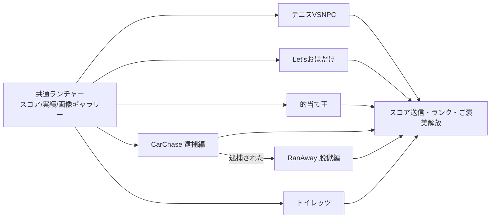
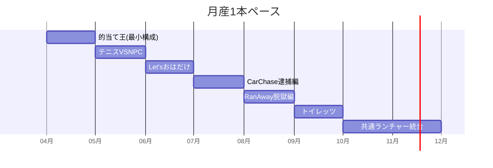

# 🎪 おはだけ＆ミニゲーム集 — ゲーム設計書

カジュアルミニゲーム集 短期開発・技術練習を兼ねる

> 🧪 PoC: [poc/10_ohadake-minigames/index.html](../poc/10_ohadake-minigames/index.html)（pixi.js — CarChase逮捕編: マウス追尾AI・ドリフト演出の検証）

## 1. コンセプト

1本数日〜数週間で完成させる**ミニゲーム集**。「おはだけ」シリーズ（ご褒美画像解放系のバカゲー路線）とクラシック題材（テニス・的当て）で構成。共通ランチャーから起動し、スコア・実績を集約する。

- カイヨワ分類: **アゴン（スコアアタック）× イリンクス（スピード・ドタバタ）**
- 位置づけ: 本命プロジェクトの**技術練習と完成経験の積み上げ**（txt内で最も実装が具体化している群）

## 2. 収録タイトル

### 🎾 テニス「VS NPC」
- 得点: 0→15→30→40→勝利。40-40でデュース、2点連取で勝ち
- 発射=Z、移動=アローキー。**ジャストヒットで加速、ミスヒットで減速**
- NPC対戦、敵を倒したらクリア

### 🧱 Let'sおはだけ（ブロック崩し）
- ブロックを崩して背景画像を拝む。**横バーに加え縦バーも操作**する二軸ブロック崩し
- 全ブロック破壊でクリア

### 🎯 的当て王
- 30〜90秒の時間制限内でスコアを稼ぐ的当て。スコアに応じたランク表示

### 🚓 おはだけCarChase（逮捕編）
- **マウス操作のみ**。パトカーから逃げ切る or スコア50000でクリア
- パトカーNPCはマウスポインタを追尾。接触でゲームオーバー（→脱獄編に移行）
- パトカー: 前・横の車を回避しつつプレイヤー追尾
- プレイヤー: パトカー接触 or 燃料切れでゲームオーバー。リトライ＆ネクストゲーム機能、爆破要素

### 🔑 おはだけRanAway（脱獄編）
- **キーボード操作**。障害物を避け、カギを持ったまま看守から逃げ切る
- 体力ゲージ制（0でゲームオーバー）。看守は追尾＋一定時間後に警告演出つき直線突撃
- 一回だけ使えるブースト。アイテム: 回復薬／回復薬グレート（全快）／スピード薬
- 逃げ切った看守の数に応じて画像公開

### 🚽 Let'sトイレッツ
- 漏らす前にトイレへ駆け込むレースゲーム
- 漏らすゲージ増加要因: 衝突（極大）＞下剤（大）＞飯（中）＞水（小）／トイレットペーパーで回復

### 😳 赤面（おはだけシリーズ番外）
- 動詞テーマ: 恥じる・恥じらう・辱める・脱がす・喘ぐ — シリーズの「ご褒美とリスク」構造をパーティゲーム化する枠

## 3. 共通構造

> **逮捕編→脱獄編の連結**が本シリーズ最大の発明。ゲームオーバーが次のゲームの開始になる（失敗の再文脈化）。

## 4. 他ゲームとの差別化

| 比較対象 | 共通点 | 差別化 |
|---|---|---|
| WarioWare系 | ミニゲーム集 | 瞬間芸でなく1本3〜5分の**スコアアタック**粒度。ランキングとご褒美ギャラリーで周回させる |
| 古典ブロック崩し | ルール | **縦バー追加**の二軸操作、背景画像の段階開示という明確な報酬 |
| 一般ランゲーム | 追跡から逃げる | **逮捕→脱獄の連環構造**でゲームオーバーに物語的意味を持たせる |

## 5. レベルデザイン方針（Totten理論の適用）

- **報酬スケジュール（Ch7）**: 全タイトル共通で「スコア閾値→ギャラリー解放」の一貫スケジュール。解放条件は事前に一覧表示（見せて拒絶）
- **Level 1-1（Ch8）**: 各ゲーム開始直後の10秒は失敗しない難度（CarChaseはパトカー登場前の助走時間）でルールを体感させる
- **リズム（Ch13）**: トイレッツ・CarChaseはBGMテンポを危険度に同期させ、ゲージを見なくても危機を感じ取れるようにする

## 6. 配色計画（kotonoha_sai）

メイン: **戯れ（たわむれ・感情）** — ポップで賑やかなパーティトーン

| 用途 | 色 | HEX |
|---|---|---|
| スコア・報酬 | &nbsp;&nbsp;&nbsp; | `#fdd000` |
| プレイヤー | &nbsp;&nbsp;&nbsp; | `#f19db5` |
| 敵・看守 | &nbsp;&nbsp;&nbsp; | `#9d82ba` |
| 安全・回復 | &nbsp;&nbsp;&nbsp; | `#89c997` |
| 背景 | &nbsp;&nbsp;&nbsp; | `#9fd9f6` |
| 警告・危険 | &nbsp;&nbsp;&nbsp; | `#e35b74` |

サブ: **有頂天（感情）** — クリア・ランクアップ演出 &nbsp;#f4f299&nbsp;&nbsp;#ea5e8e&nbsp;&nbsp;#e6844a&nbsp;&nbsp;#86b3e0&nbsp;

## 7. 技術的要素の羅列

- 追尾AI（マウスポインタ追尾、警告つき突進、前方障害物回避）
- 当たり判定と物理（ボール反射・ジャストヒット判定の猶予フレーム設計）
- ゲージ管理（体力・燃料・漏らすゲージ、アイテムによる増減）
- タイマー・スコア・ランク算出、ローカルランキング
- 画像の段階開示（ブロック崩し背景、看守数に応じたギャラリー）
- ゲーム間遷移（逮捕→脱獄のステート引継ぎ）
- リトライ／ネクストゲーム機能、爆破などのジュース演出
- 共通ランチャー（実績・設定・ギャラリーの永続化）

## 8. 適した制作環境

| 環境 | 適性 | 評価理由 |
|---|---|---|
| **HTML5** | ◎ | txtにも「WebゲームはHTML5製」と調査メモあり。1本ずつ即公開でき、マウス系ゲームとの相性も良い |
| Unity | ○ | ランチャー統合やexe配布をするなら。WebGL出力で両取りも可 |
| exe (WPF) | ○ | CarChase等は元々WPF/Forms練習の文脈。C#学習目的なら選択肢 |
| UE / Qt | × | 規模不適合 |

**推奨: HTML5（Canvas/PixiJS等）で1本ずつ公開 → 揃ったらUnityランチャー統合版**。

## 9. 開発ロードマップ

