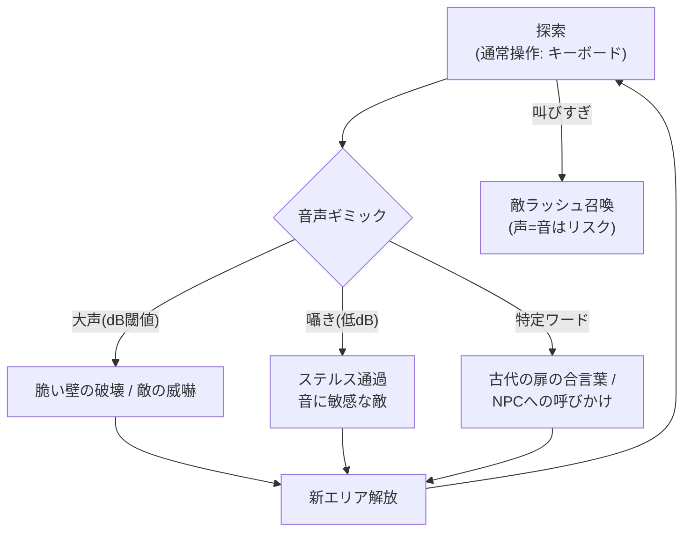
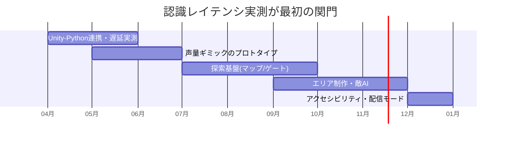

# 🎤 アヒルの叫び — ゲーム設計書

メトロイドヴァニア 音声認識操作 技術実証タイトル

> 🧪 PoC: [poc/11_ahiru-no-sakebi/index.html](../poc/11_ahiru-no-sakebi/index.html)（pixi.js＋WebAudio — マイクdB→ギミック・音波リング演出の検証。マイクなしはX長押し代替）

## 1. コンセプト

**音声認識を用いたメトロイドヴァニア。**「叫ぶ」ことがアビリティであり、鍵であり、リスクでもある探索アクション。

- 声量・特定ワード・発声タイミングをゲームメカニクスに変換する（例: 大声で壁を壊す、囁きでステルス、特定ワードでギミック起動）
- 音声はあくまで**追加チャンネル**とし、キーボードのみでもクリア可能なアクセシビリティ設計（マイクなし環境のフォールバック）
- txt内の先行検証（みこちシューティング: 音声認識で特定ワードによる難易度決定＋弾・エフェクト変更）の発展形
- カイヨワ分類: **イリンクス（叫ぶ身体性）× アゴン**

## 2. 他ゲームとの差別化

| 比較対象 | 共通点 | 差別化 |
|---|---|---|
| Chicory / One Hand Clapping | 音声・音程入力 | 音程でなく**声量と語**を使う。探索ジャンルとの掛け算で「静かにすべき場所／叫ぶべき場所」の空間設計が成立 |
| 一般メトロイドヴァニア | 能力ゲート探索 | ゲートの鍵が装備でなく**プレイヤー自身の声**。実況配信と極めて相性が良い（配信者が叫ぶ＝コンテンツ化） |
| すれ違い/電波人間系 | カジュアル層 | 音声入力の敷居をローカルワード辞書で下げる（後述の技術知見） |

> **一言差別化**: 「配信者が遊ぶと画面外まで面白い、“声がアビリティ”のメトロイドヴァニア」

## 3. コアメカニクス

- **声量メーター**を常時HUD表示。叫ぶと解放系ギミックが動くが、周囲の敵も引き寄せる（リスクとリターンの同源化）
- ワード認識は**ローカル辞書方式**（後述: 応用性は減るが確実・低遅延）

## 4. 音声認識の技術検証知見（txtより整理）

| 手段 | 結果 | 詳細 |
|---|---|---|
| Microsoft Speech API | ❌ 断念 | NuGet導入は一発だったが、サブスクリプションキー＋リージョン設定が必要で、オンライン依存のためラグが酷い |
| Vosk | ❌ 断念 | オフライン・組み込み可で採用したが、言語モデル＋Vosk＋Kaldi（Linux推奨）のCMakeビルド手順が複雑。WSLでのKaldiビルドに必要な依存の取得がGitHubのパスワード認証廃止（2021）で詰み |
| **Python音声認識 + C/C++呼び出し** | ✅ 現行 | Python側の認識は完成、精度良好。レスポンス性能が未知数（要実測） |
| C#実装をC++から呼ぶ | 検討中 | 強引な相互運用のため保留 |

参考: https://nekonogorogoro.com/speech_recognition/

**本作での方針**: Unity（C#）⇔ Pythonプロセス間をUDP/名前付きパイプで接続し、認識結果とdB値をストリーミング。認識対象を**ローカル格納の特定ワード辞書**に限定して精度と速度を確保（txt L824-827「待つのが楽しい処理にする」= 認識待ち時間を詠唱演出に変換する）。

## 5. レベルデザイン方針（Totten理論の適用）

- **サウンドこそ道標（Ch13）**: 本作はCh13理論の全面適用。エコーの反響距離で空間の広さを伝え、「合言葉の扉」は近づくと囁き声の3Dサウンドで存在を予告
- **静寂地帯と叫び地帯のコントラスト（Ch6）**: 音に敏感な敵が巣食う「静寂の廃墟」（避難所なし・緊張）と、叫びが必要な「風の峡谷」（開放・眺望）を交互配置
- **能力ゲート＝声（Ch7 報酬の拒絶）**: 未習得の「叫びの巻物」で開く扉は、先に見せておく。獲得後の再訪で世界が開ける定番の快感を音声で再構成
- **チュートリアル（Ch8）**: 最初の部屋で「マイクに向かって名前を呼ぶ」ことをNPCとの挨拶として自然に実施 → マイクチェックを物語に溶かす

## 6. 配色計画（kotonoha_sai）

メイン: **霹靂（へきれき・天文）** — 空・音の波動

| 用途 | 色 | HEX |
|---|---|---|
| ハイライト | &nbsp;&nbsp;&nbsp; | `#ffffee` |
| 声量メーター（小） | &nbsp;&nbsp;&nbsp; | `#ffeca6` |
| 音波エフェクト | &nbsp;&nbsp;&nbsp; | `#83c2e2` |
| 主人公・UI | &nbsp;&nbsp;&nbsp; | `#49afd3` |
| 背景（深部） | &nbsp;&nbsp;&nbsp; | `#1169a3` |
| 静寂地帯 | &nbsp;&nbsp;&nbsp; | `#082f50` |

サブ: **五月雨（情景）** — 湿った洞窟エリア &nbsp;#c0deed&nbsp;&nbsp;#7ea6d2&nbsp;&nbsp;#60b485&nbsp;&nbsp;#488654&nbsp;

> 声量に応じて音波リングの色が `#ffeca6 → #83c2e2 → #49afd3` と変化。**画面の色＝自分の声**という即時フィードバック（Ch5）。

## 7. 技術的要素の羅列

- 音声認識パイプライン（Python: SpeechRecognition／faster-whisper 等 → UDP/パイプでUnityへ）
- マイク入力のdB計測・ノイズゲート（Unity Microphone API）
- ローカルワード辞書とあいまいマッチ（レーベンシュタイン距離）
- メトロイドヴァニア基盤: 能力ゲート管理、マップ自動生成 or 手作り＋ファストトラベル、ミニマップ／インベントリ
- 壁ジャンプ・振り子/ワイヤーアクション・重力切替（txt調査項目の実装先）
- 敵AI: 聴覚センサー（プレイヤー実声量に反応）、徘徊・追跡
- 3Dサウンド定位・リバーブゾーン設計
- InputSystemによるキーボード完結の代替操作（アクセシビリティ）
- 実況配信向け: 認識ワードのオーバーレイ表示モード

## 8. 適した制作環境

| 環境 | 適性 | 評価理由 |
|---|---|---|
| **Unity＋Python連携** | ◎ | 現行検証の延長線。Microphone API＋外部プロセス連携の実績パターン |
| HTML5 | ○ | Web Speech APIで認識は簡単だがブラウザ依存・精度と遅延が課題 |
| UE | △ | 音声連携の資料が少なく学習コスト大 |
| Qt / exe (WPF) | △ | 認識自体は.NETでも可能だがゲーム部分が弱い |

**推奨: Unity 2022.3 ＋ Pythonサイドカー方式**（失敗時はWebGL版でWeb Speech APIに切替できるよう認識層を抽象化しておく）。

## 9. 開発ロードマップ

