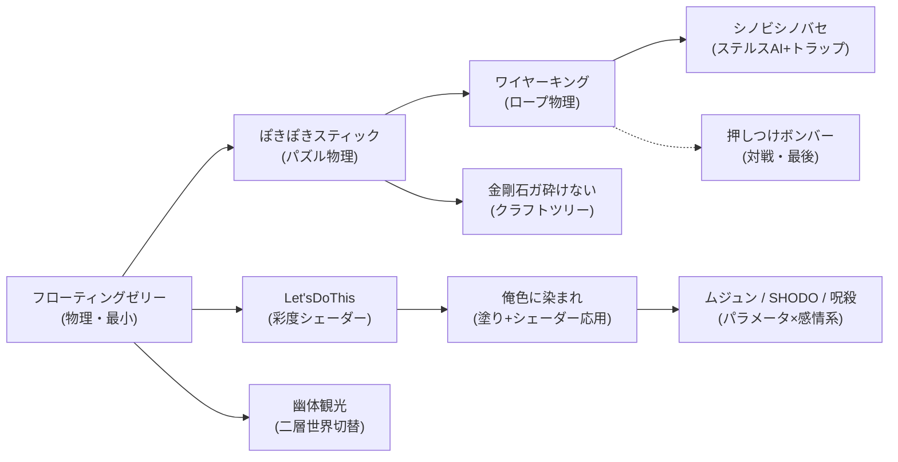
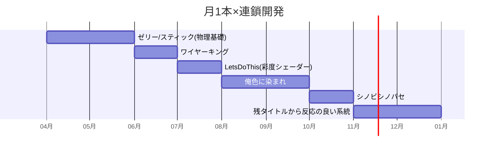

# 🔤 動詞ゲーム集（12本） — ゲーム設計書

ゲームジャム規模 動詞駆動デザイン

> 🧪 PoC: [poc/12_verb-games/index.html](../poc/12_verb-games/index.html)（**12本すべて個別PoC化済み**・ランチャーから起動。各ゲームにScene遷移＋プロシージャルBGM/SFX＝audio.js搭載）

## 1. コンセプト

**「動詞からゲームを作る」発想法**による小品群。各案はコア動詞（2〜6語）を先に決め、その動詞体験を最短距離で成立させる。1本1〜4週間のジャム規模で、量産して当たりを見つけるポートフォリオ戦略。

> カイヨワの四分類を動詞選定のチェックリストに使う: その動詞はアゴン/アレア/ミミクリ/イリンクスのどれを生むか？

## 2. タイトル一覧

| # | タイトル | コア動詞 | 概要 | 分類 |
|---|---|---|---|---|
| 1 | シノビシノバセ | 忍ぶ・忍ばせる・縛る・斬る | 忍びのステルス＋トラップ設置 | ミミクリ |
| 2 | Let'sDoThis | 飽きる・動く・急ぐ | **行動するほど画面が鮮やかに、行動しないとモノクロ化して死ぬ**。同じ行動の繰り返しも刺激が減りモノクロ化。「何もしないのは緩やかな自殺」 | イリンクス |
| 3 | フローティングゼリー | 浮かぶ・さまよう・伸ばす | クラゲがぷかぷか浮かぶ癒し系操作玩具 | イリンクス |
| 4 | 呪殺 | 祝う・奪う・恨む・呪う・得る・負う | 相手を恨んで位置特定→呪ってデバフ。**格上を呪うと自分に跳ね返る**。味方を祝うと強化、味方の死で力を還元 | アゴン |
| 5 | ぽきぽきスティック | 折れる・進む | **自分を折って進む**パズル。長さが資源 | アゴン(パズル) |
| 6 | 俺色に染まれ | 染める・吸う・終わる・描く | 自称神にモノクロ世界の彩色を強制されたパレットが、全てを俺色に染めて世界を終わらせるアクション。「染めるのか、染められるのか」 | アゴン |
| 7 | 押しつけボンバー | 贈る・押す・投げる | 爆弾を相手に押し付け合うパーティゲーム | アゴン |
| 8 | SHODO | 怒る・鎮める・暴れる・探す・受け入れる | 自身の怒りを鎮めるゲーム。感情のセルフコントロールが操作系 | イリンクス→静 |
| 9 | ムジュン | 衰える・枯れる・奪う・欠ける・朽ちる | 欠けた心を埋めるために相手から奪うと、相手が著しく衰える。奪うほど自他が壊れる矛盾（イメージ: クレイジーチョコレートのムジュン） | アゴン(ジレンマ) |
| 10 | 金剛石ガ砕けない | 砕く・崩す・割る・集める・加える | 万病を治す「命の石」が硬すぎて採取不能。**砕くために最硬のピッケルを作る**鉱物クラフト逆算ゲーム | アゴン(クラフト) |
| 11 | 幽体観光 | 供える・漂う・浮かぶ・散る | 幽霊⇔人間を切替えて冒険。仏壇に供えると幽霊時アイテム化。**幽体のまま長時間漂うと戻れず散って死ぬ** | ミミクリ |
| 12 | ワイヤーキング | 飛ばす・吸い付く・蹴る・飛ぶ | ワイヤーアクション＋ワイヤートラップ。「敵を飛ばす楽しさ・高速移動の爽快感」（txt: 車窓の風の気持ちよさが原体験） | イリンクス |

## 3. 開発順の推奨（技術資産の連鎖）

## 4. 他ゲームとの差別化（群として）

| 比較対象 | 差別化 |
|---|---|
| 一般ゲームジャム作品 | 動詞→メカニクス→ビジュアルの順で設計を固定し、**動詞にない機能は実装しない**ことでスコープ管理を仕組み化 |
| ZORT（旋律を奏でる着想元） | 「楽器・旋律」など名詞ストック（シャボン玉/気球/傘/マネキン/折り紙/時計/記録媒体…txt L1008-1028）と動詞を掛け合わせる**組合せ表**から量産する |
| Downwell等の単一メカ特化 | 単一メカ特化という思想は同じ。12本を**シリーズブランド（統一UI・統一ドット）**で出すことで相互送客する |

## 5. レベルデザイン方針（Totten理論の適用・共通）

- **1画面=1レッスン（Ch8）**: ジャム規模ではチュートリアルを作る余裕がないため、最初の1画面をLevel 1-1理論で設計し「動詞を1回成功させてから」スクロールさせる
- **報酬の一貫性（Ch7）**: 全タイトル共通の収集アイテム（★）とランク表記で、シリーズ横断の報酬文法を統一
- **Let'sDoThis / 俺色に染まれ**は「色を取り戻す」ゲーム（Ch6で言及される『Flowery』の構造）— **彩度＝生命力**の空間設計をTottenの「危険の転覆」理論で正当化できる

## 6. 配色計画（kotonoha_sai）

シリーズ共通枠: **有頂天（感情）** &nbsp;#f4f299&nbsp;&nbsp;#ead45b&nbsp;&nbsp;#efb671&nbsp;&nbsp;#ea5e8e&nbsp;&nbsp;#e6844a&nbsp;&nbsp;#86b3e0&nbsp;（ランチャー・共通UI）

作品別アサイン例:

| タイトル | パレット（章） | 意図 |
|---|---|---|
| Let'sDoThis | 百花繚乱（自然）→グレースケール | 行動量で彩度が百花繚乱 &nbsp;#e99aad&nbsp;&nbsp;#d70056&nbsp; に向かう |
| 俺色に染まれ | 浮きたつ（感情） | 塗り色のパレット群 &nbsp;#f3acb8&nbsp;&nbsp;#d474a6&nbsp; |
| 呪殺／ムジュン | 逢魔が時（時間） | 呪詛の紫暮れ &nbsp;#ac306c&nbsp;&nbsp;#362654&nbsp; |
| SHODO | 焦がれる→一片氷心 | 怒りの赤 &nbsp;#da2730&nbsp; から鎮静の水色 &nbsp;#75c8cf&nbsp; へ |
| 幽体観光 | 月の雫（自然） | 夜の透明感 &nbsp;#82a0b3&nbsp;&nbsp;#6b6482&nbsp; |
| 金剛石ガ砕けない | 銀波（自然） | 鉱石の照り &nbsp;#c6ceda&nbsp;&nbsp;#375578&nbsp; |
| フローティングゼリー | 泡沫（自然） | 水中の浮遊 &nbsp;#9aced8&nbsp;&nbsp;#5db3c9&nbsp; |

## 7. 技術的要素の羅列

- 彩度・グレースケール制御シェーダー（Let'sDoThis／俺色に染まれ：画像の色彩変化、リニアワイプ画面遷移）
- ロープ／ワイヤー物理（Verlet、ばね: ワイヤーキング、振り子アクション、停止可能/不可能の切替）
- 分割・変形メッシュ（ぽきぽきスティックの自己切断）
- ソフトボディ風表現（ゼリー・クラゲ: 頂点シェーダー揺らぎ）
- ステルスAI・視界コーン（シノビシノバセ）
- パラメータ間の跳ね返り計算（呪殺の格差判定、ムジュンの奪取劣化）
- クラフトツリーと素材硬度モデル（金剛石）
- 二層世界のレイヤー切替（幽体観光: 3D/2D切替・カメラ切替の応用）
- ローカル対戦（押しつけボンバー: 2〜4人同一画面）
- シリーズ共通: ランキング、★収集、統一セーブ形式

## 8. 適した制作環境

| 環境 | 適性 | 評価理由 |
|---|---|---|
| **Unity** | ◎ | シェーダー・物理・対戦まで全案をカバー。シリーズ共通基盤を作れば量産が効く |
| **HTML5** | ◎ | ジャム規模と相性最高。itch.io即公開でフィードバックが速い |
| UE | △ | 小品の量産には起動もビルドも重い |
| Qt / exe (WPF) | × | 物理・シェーダー主体の案が多く不適 |

**推奨: 物理・シェーダー系はUnity、UI/パズル系はHTML5の二本立て**。

## 9. 開発ロードマップ

