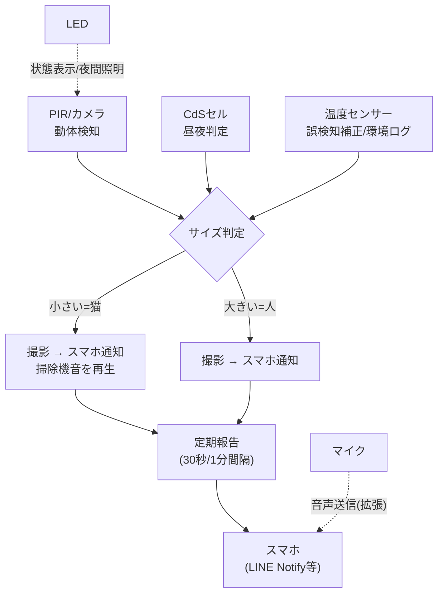
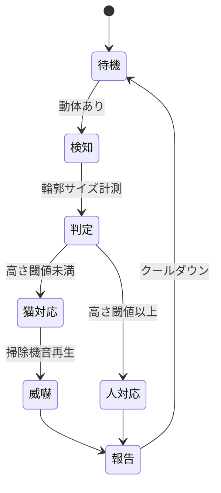
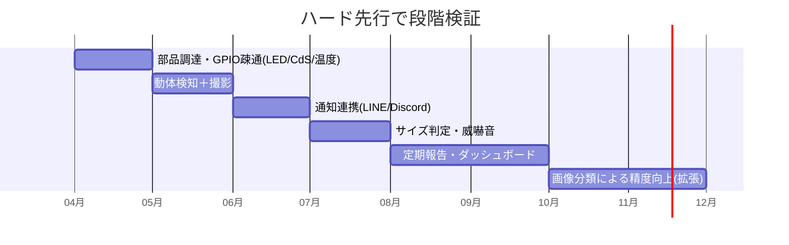

# 🐈 猫監視・撃退システム — 設計書

IoT／組み込み 非ゲーム 電子工作

> 🧪 PoC: [poc/13_cat-guard-system/index.html](../poc/13_cat-guard-system/index.html)（Canvas＋WebAudio — 検知→サイズ判定→通知/威嚇のロジックシミュレータ）

## 1. コンセプト

**動体検知で対象を識別し、大きさで「人か猫か」を判断して対応を変える監視・撃退システム（人間も監視対象）。**

| 対象 | 対応 |
|---|---|
| 猫 | 写真を撮ってスマホにメッセージと一緒に送信 ＋ **掃除機の音を再生して威嚇** |
| 人 | 写真を撮ってスマホにメッセージと一緒に送信 |
| 共通 | 30秒〜1分ごとの定期報告、音声の送信にも対応したい |

使用パーツ（txt指定）: **CdSセル（光センサー）、温度センサー、LED**

姉妹コンセプト（txt L84-87）: **猫育成シミュレーション** — アレルギー・金欠・時間がない人向けの仮想飼育。撃退システムで収集した猫の行動データを育成ゲームのAIに転用する構想も可能（txt L1181「ペット情報をデータ化して復元」に接続）。

## 2. 類似製品との差別化

| 比較対象 | 共通点 | 差別化 |
|---|---|---|
| 市販ペットカメラ (Furbo等) | 検知・通知 | **撃退（威嚇音）まで自動実行**し、人/猫を大きさで判別して対応を分岐 |
| 防犯カメラアプリ | 動体検知通知 | 猫対応に特化したエスカレーション（威嚇→報告）と、自作ゆえの拡張自由度（センサー追加） |
| 超音波猫よけ | 撃退 | 証拠写真＋通知が残る。掃除機音という**学習忌避音**を使用 |

## 3. システム構成

## 4. 判定ロジック

- サイズのみの判別は誤検知（しゃがんだ人・大型犬）があるため、**将来的には軽量画像分類（MobileNet等）を併用**して精度を上げる拡張枠を確保
- 夜間はCdSセルで照度低下を検知→赤外線 or LED照明モードへ

## 5. UI配色（kotonoha_sai）

監視ダッシュボード: **一片氷心（感情）** — 清潔で機能的なモニタリングトーン

| 用途 | 色 | HEX |
|---|---|---|
| 背景 | &nbsp;&nbsp;&nbsp; | `#d2ebee` |
| パネル | &nbsp;&nbsp;&nbsp; | `#a9dbe5` |
| 正常ステータス | &nbsp;&nbsp;&nbsp; | `#d4e8c6` |
| 猫検知 | &nbsp;&nbsp;&nbsp; | `#75c8cf` |
| 人検知 | &nbsp;&nbsp;&nbsp; | `#50c0c1` |
| アラート・強調 | &nbsp;&nbsp;&nbsp; | `#2a8bc0` |

## 6. 技術的要素の羅列

- 動体検知（PIRセンサー or OpenCVフレーム差分）
- 物体サイズ推定（輪郭抽出・バウンディングボックス高さ）
- CdSセルによる照度取得（ADC経由）、温度センサー（DHT11/DS18B20等）
- カメラ撮影・画像保存（Piカメラ／USBカメラ）
- スマホ通知（LINE Messaging API／Discord Webhook: 画像添付＋メッセージ）
- 音声再生（掃除機音源、スピーカー出力）／音声録音・送信（拡張）
- 定期報告スケジューラ（30秒/1分インターバル、クールダウン制御）
- GPIO制御（LEDステータス表示）
- ログDB（検知履歴、SQLite）とダッシュボード表示

## 7. 適した制作環境

| 環境 | 適性 | 評価理由 |
|---|---|---|
| **Raspberry Pi ＋ Python** | ◎ | カメラ・GPIO・OpenCV・通知APIが全部揃う標準構成 |
| **Qt (PySide6)** | ◎ | 監視ダッシュボードUI（PC側ビューア）に最適。指定5環境の中では唯一の適任 |
| exe (WPF) | ○ | Windows PC＋USBカメラ運用ならビューアとして可 |
| HTML5 | ○ | ダッシュボードをWeb化するなら（Flask＋ブラウザ） |
| Unity / UE | × | ゲームエンジンの出る幕なし |

**推奨: Raspberry Pi（検知・撃退本体）＋ PySide6/Qt または Web のダッシュボード**。

## 8. 開発ロードマップ

