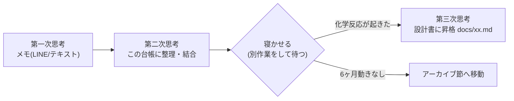

# 💡 その他構想集 — コンセプトカタログ

アイデアストック 熟成待ち（『思考の整理学』の"寝かせる"対象）

単独の設計書に満たない案の台帳。『思考の整理学』（txt後半のノート）に従い、**第一次思考（メモ）→第二次思考（この台帳で整理）→第三次思考（設計書昇格）**のパイプラインで管理する。設計書に昇格したら本ファイルから該当行を削除し、リンクに置き換える。

配色: **幻日（天文）** &nbsp;#f6beca&nbsp;&nbsp;#fff4c7&nbsp;&nbsp;#cae1a1&nbsp;&nbsp;#b8b1cb&nbsp;&nbsp;#7e9bbf&nbsp;&nbsp;#4f7db4&nbsp;

## 1. ナラティブ・実験系

| 案 | フック（差別化の芽） | 技術要素 | 適環境 |
|---|---|---|---|
| トイストーリーのゲーム版 | 「本来のゲームのキャラ通りの動き」を強制されるメタゲーム。例: マリオ空間でクリボーを踏む=正解、仲良くする=違反 | ルール逸脱検知、パロディステージ | Unity |
| グリードアイランド再現 (H×H) | カード化＝現実物品の収集ゲーム化。指定ポケット・制約付き魔法 | カードDB、トレード、位置ゲー要素 | Unity/スマホ |
| 精神状態で視界が変わるゲーム | 人生ゲーム＋ニーディガールオーバードーズ。メンタル値がポストエフェクト・UI・選択肢を歪ませる | ポストプロセス、視界シェーダー | Unity |
| 世界に散らばった仮面集め | ラタトスクの騎士＋朱色の仮面＋プランダラ。仮面ごとの権能で探索が開く | 能力ゲート設計 | Unity |
| 頭脳チェイス「訴える×嘘×逃げる×集める」 | **警察から逃げながら証拠を集め、裁判で逆転する**。逃走(アクション)と法廷(ADV)の交互構造 | 追跡AI、証拠フラグ、法廷ロジック | Unity |
| 一日一善 | 善行を積むと世界が明るくなるシム。彩度と住民AIの好意が資源 | 評判システム、カラーグレーディング | Unity/HTML5 |
| 本の世界を行き来するメトロイドヴァニア | **形状・色に意味＝権能**があり、それを使ってステージ攻略。書物ごとに物理法則が変わる | ステージ別ルールエンジン | Unity |
| 通話もちもち | マシュマロ（=匿名質問）にはおいしいものも毒もある。配信文化の風刺パズル | テキスト判定 | HTML5 |

## 2. AI・認識技術系（リードスピーカー実習案含む）

| 案 | フック | 技術要素 | 適環境 |
|---|---|---|---|
| ChatGPT NPC会話ゲーム | 読み上げ＋音声認識＋ChatGPT APIで**NPCとリアルタイム会話**（トモコレ・シーマン系譜の育成ゲーム） | LLM API、TTS、音声認識 | Unity |
| 視界破損×サポートロボ探索 | 視界が壊れた状態を**TTSのロボ音声案内**で攻略する探索ゲーム。アクセシビリティ設計と地続き | TTS(リードスピーカー)、ナビAI | Unity 2022.3.26以前(SDK要件) |
| しゃべる図鑑ナビ | 探索ゲームで「アイテム名を言う」と回収済みならマップにピン＋ナビ、未回収ならヒント。権限不足の演出も | 音声認識、経路探索、ピン留めUI | Unity |
| お絵描き魔法 | **絵を描いてAIが判別**、下手だと発動しない。おえかき＋謎解き＋アクション | 画像分類（CNN）、描画UI | Unity＋Python |
| 音声/文字/画像認識ミックス | 認識技術のショーケース的パーティゲーム | OCR、音声、画像認識 | Unity |
| ピクミン系×空間AI | 空間AI・ミメシス実習の成果＋Boidsで群体操作 | 空間AI、Boids、群制御 | Unity |
| ペット復元データ化 | ペットの情報を集めてデータ化し、死んだペットをデジタル復元 | データモデリング、倫理設計 | 要検討 |
| ヘルスケアPWA→ゲーム転用 | 歩数・GPS・栄養素をパラメータ化し、**カードのコスト等アウトゲーム資源**に接続 | PWA、センサーAPI、外部データ連携 | HTML5(PWA)＋Unity |

## 3. ホロライブ派生スタジオ案

| 案 | イメージ元 | 状態 |
|---|---|---|
| ホロファイター | ストリートファイター/ソウルキャリバー6 | **没**（既存の同人格ゲーあり） |
| ホロクエスト | ドラクエ。魔王YAGOO・幹部マネージャー、敵はホロリス | 熟成中 |
| ホロカート | マリカ＋**必殺技の追加**が差別化軸 | 熟成中 |
| 大乱闘スマッシュホロライブ | スマブラ | 熟成中（権利面リスク大） |
| micometの会社経営 | 龍が如く7の会社経営 | 熟成中 |
| ホロハン | モンハン | 熟成中 |
| ホロモン | ドラクエジョーカー系育成 | 熟成中 |
| みこすばアクション／みこち序列決定戦（負けたら「み俺恥」）／おさんぽスバル（最強カレーの素材集め・シチュー派ポトフ派騒動） | — | 小品候補 → [12_verb-games.md](12_verb-games.md) の量産ラインに乗せられる |
| みこち株ゲーム | 株シミュレーション | 熟成中 |

## 4. メカニクス断片・素材ストック

- **ジャンクシューティング改修メモ**: 敵・自機・背景をスチームパンク化／描画機能で自機イラスト生成→優先表示／敵撃破で歯車ドロップ→スキルポイント
- **ガラクタ機体カスタム**: 蒸気機関の機械とガラクタの世界。ガラクタ＝換金・換装の二重資源（原体験: ベイブレード・レゴ・ミニ四駆・マイクラ。「僕が考えた最強の装備」15〜35男性向け）
- **シューティング技術メモ**: 斜め移動の正規化、無敵時間、射出間隔調整、弾種（拡散=扇状/追尾/チャージ=押下時間で威力/連射）
- **スマホゲーム案**: オセロ、カードゲーム、カタン、美少女RPG（タップ操作・音ゲー・スコアランキング・銃・背中で魅せる）
- **演出ストック**: 進捗率分岐ED（→ [08_plant-girl-horror.md](08_plant-girl-horror.md) に採用済）、ダブルミーニングタイトル、話の進み方で同じEDの意味が変わる
- **名詞ストック**（動詞と掛け合わせる素材箱）: シャボン玉／ロープライト／気球／ひかるわたあめ／爪・ネイル／アロマオイル／枕・ビーズ・子守歌／傘・雨／マネキン／盾／折り紙／マント／時計／カメラ／電話（糸・意図・黒・会話・動きが止まる）／住宅・影／記録媒体（才能・擬態）／肉・熟成・ワサビ・はちみつ／図形＋食べ物／鉱石／楽器（バイオリン・リコーダー・ギター・トランペット・カスタネット、ZORT着想の旋律ゲー）／仏を殴る・祈りを妨害
- **エクスプローラーの逆襲**: 「全てがEになる」。使っているWebサイト派閥で争うパーティゲーム

## 5. 熟成→昇格の運用ルール

- アイデアは**複数を同時進行**させ競争させる（思考の整理学2章）
- 昇格判定: ①コア動詞が言える ②差別化が1文で言える ③ターゲットペルソナ（松浦/そめりん/やっさん/ベンティ）の誰かに刺さる — 3つ揃ったら設計書化
