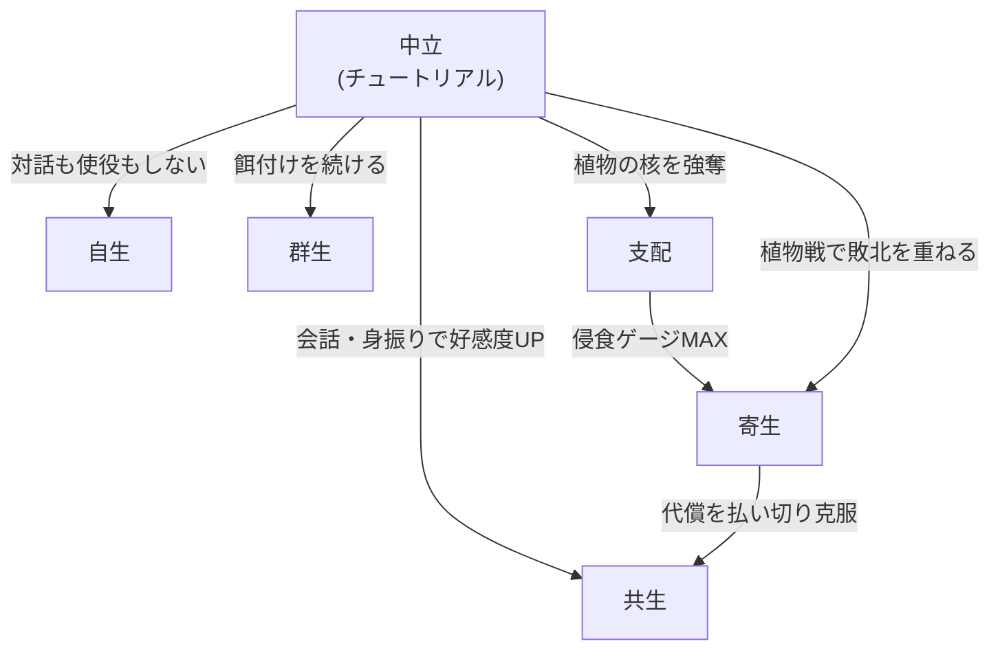
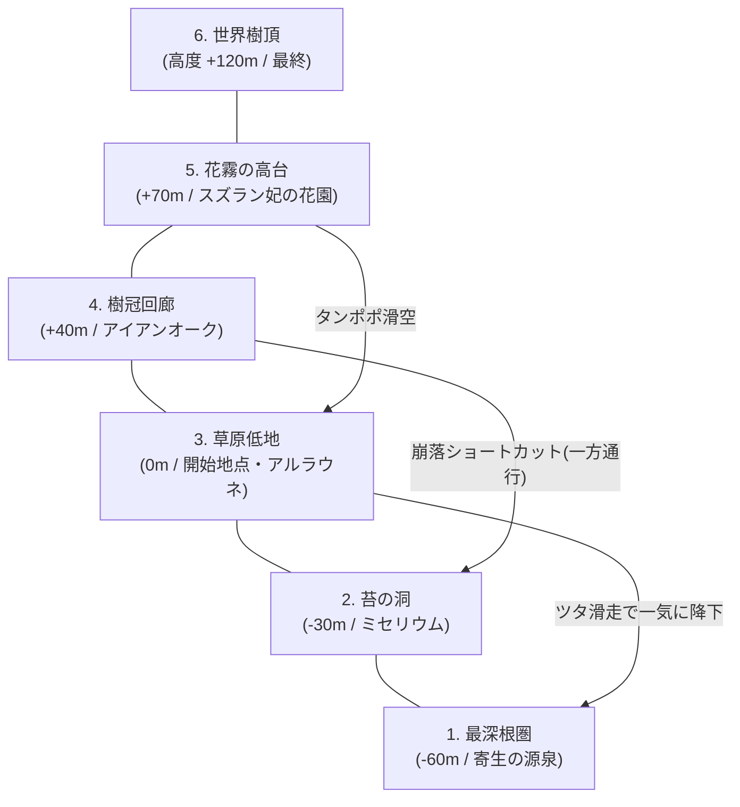
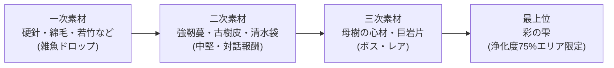
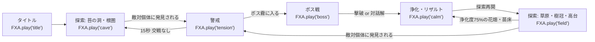
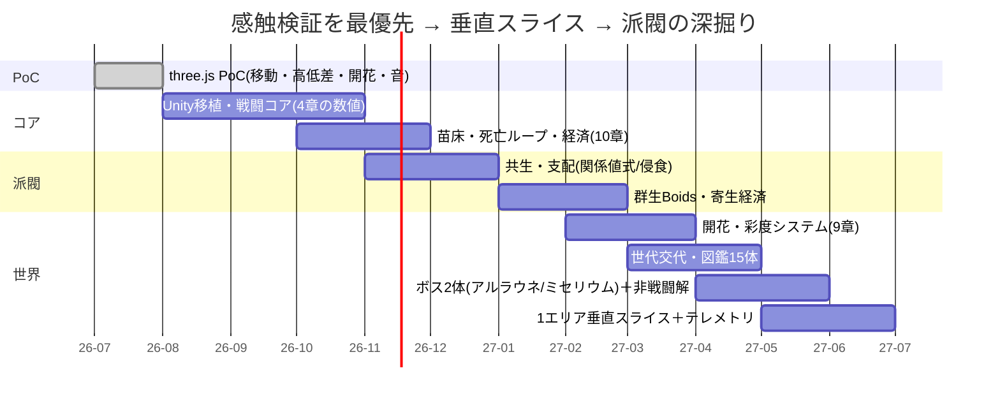

<style>
:root { --main:#018573; --accent:#c2da75; --danger:#b33033; --sub:#00512e; }
h1 { color:var(--sub); border-bottom:4px solid var(--accent); padding-bottom:.3em; }
h2 { color:var(--main); border-left:8px solid var(--accent); padding-left:.5em; }
h3 { color:var(--sub); }
th { background:var(--main); color:#fff; }
blockquote { border-left:5px solid var(--danger); background:#f2f8ee; }
.badge { display:inline-block; padding:1px 10px; border-radius:12px; background:var(--main); color:#fff; font-size:.85em; }
</style>

# 🌿 植生ソウルライク（仮題: VERDANT） — ゲーム設計書 v2.0

<span class="badge">ソウルライク</span> <span class="badge">高低差×疾走感</span> <span class="badge">5派閥分岐</span> <span class="badge">開花＝関係性の可視化</span>

> 🧪 PoC: [poc/15_plant-soulslike/index.html](../poc/15_plant-soulslike/index.html)（three.js — 高低差マップ・ダッシュ移動・素材収集・開花演出・FXAプロシージャル音源の感触検証）

| 版 | 日付 | 変更 |
|---|---|---|
| v1.0 | 2026-07 | 初版（コンセプト・派閥・PoC方針） |
| v2.0 | 2026-07 | 全面改訂: コアピラー／戦闘数値／派閥完全仕様／図鑑・ボス／世界構造／開花・彩度／経済／音響／難易度・テレメトリ |

## 1. コンセプト

**植物が発達した世界のソウルライク。**植物に対して会話や身振り手振りでコミュニケーションを取るもよし、武器で攻撃して素材を集めるもよし — **敵対と対話が常に両方開いている**。

- 植物側の目的: **圧倒的な種のばら撒き／知識の吸収／進化**。植物は「ただの敵」ではなく、プレイヤーから学習し進化する敵対文明
- レベルは**高低差を生かす**。従来のフロム作品よりも**疾走感**を重視（スピード型ソウルライク）
- 世界は初期状態で**ほぼ無彩色**。プレイヤーと植物の関係が深まった場所から**花が開き、色彩が戻る**（852wa.com「P.S.」「彩ノ庭」参照 — §9）
- カイヨワ分類: **アゴン（戦闘）× ミミクリ（派閥ロールプレイ）**
- ペルソナ適合: やっさん（エルデンリング好き・重厚パワー・アチーブ）ど真ん中、松浦（疾走感・自由度・収集）

## 2. コアピラー（すべての仕様判断の物差し）

| # | ピラー | 意味 | 仕様への落とし込み | 違反例（やらないこと） |
|---|---|---|---|---|
| P1 | **全ボスに非戦闘解** | 「倒す」以外の解法が最低1ルートある | 各ボスに対話・使役・環境利用いずれかの攻略ルートを必ず設計（§7） | 戦闘でしか進めないボス、力押し専用の隠しボス |
| P2 | **疾走感 — 移動でスタミナを減らさない** | スタミナは「攻める・受ける」のコスト。移動・ダッシュ・ジャンプは無償 | スタミナ消費表（§4.2）に移動系の行が存在しない | ダッシュゲージ、スタミナ切れの息切れ歩き |
| P3 | **敗北がビルドになる** | 死・被支配・搾取が「別のプレイスタイルの入口」になる | 寄生派閥（§5.5）、侵食転落（§5.4）、死亡ペナルティの派閥差（§10.4） | 死＝単純な巻き戻し、詰みセーブ |

> 迷ったらこの3本に照らす。「格好いいがP2に反する」仕様（例: ダッシュ消費）は**即却下**。

## 3. 他ゲームとの差別化

| 比較対象 | 共通点 | 本作の差別化 |
|---|---|---|
| エルデンリング／ダークソウル | 死にゲー・ビルド | 敵が**交渉可能**。全ボスに「倒す」以外の解法（対話・使役・共生）が最低1つある（P1） |
| SEKIRO | 高低差・機動力 | 鉤縄でなく**植物を足場化**（ツタ滑走・花のジャンプ台）する疾走感。移動自体が派閥能力に依存 |
| Pikmin／群体使役ゲー | 群れの使役 | 使役対象が**本来は敵**で、餌が尽きると反乱する緊張感 |
| Rain World | 生態系の中の弱者 | 「寄生」派閥＝負け続けても進行でき、**敗北がビルドになる**設計（P3） |
| 852wa「P.S.」「彩ノ庭」 | 接近で開花／無彩の世界に彩を取り戻す | 開花・彩度回復を**関係性システムの出力**にする（好感度・浄化度が世界の色になる、§9） |

> **一言差別化**: 「全ての敵と“戦う・飼う・組む・奪う・奪われる”が選べる、高低差特化のスピードソウルライク。歩いた道に花が咲く」

## 4. 戦闘パラメータ（数値仕様）

基準: 60fps。1F = 1/60秒。距離単位 m（プレイヤー身長 1.6m）。

### 4.1 移動系

| 動作 | 速度／値 | 備考 |
|---|---|---|
| 歩行 | 4.5 m/s | スティック倒し量で 1.5〜4.5 可変 |
| 走行（デフォルト） | 6.5 m/s | **スタミナ消費なし**（P2） |
| ダッシュ | 9.5 m/s | 押しっぱなしで維持。**消費なし**。FOV 70→84 に補間 |
| ダッシュ初速ブースト | 開始6Fのみ 11.5 m/s | 「一歩目が速い」手触りの要 |
| ジャンプ初速 | 8.0 m/s（頂点高 1.9m） | 空中制御 65% |
| 2段ジャンプ（共生Lv2〜） | 6.5 m/s | 空中で1回 |
| ツタ滑走 | 12.0 m/s（下り）／ 8.0（水平） | レール型。滑走中もダッシュ入力で +2.0 |
| 壁ツタ登り | 2.4 m/s | 最大 6.0 秒（ツタ品質で延長）。**スタミナでなく専用の握力タイマー** |
| コヨーテタイム | 8F | 崖端を離れても8F以内ならジャンプ成立 |
| ジャンプ先行入力 | 10F | 着地前入力を保持 |
| 落下ダメージ | 高度差 8m 超から: (h−8)×6 HP | 20m 超で即死。**着地ロール入力（着地前12F）で無効化** |
| 着地硬直 | 通常 6F ／ 大落下 22F ／ ロール成功 0F | 疾走感維持のため通常着地はほぼノー硬直 |

### 4.2 スタミナ（最大 100。移動系の行は存在しない = P2）

| 行動 | 消費 | 備考 |
|---|---|---|
| 弱攻撃 | 12 | 3連まで（3段目 15） |
| 強攻撃 | 22 | チャージで最大 30 |
| ジャンプ攻撃 | 18 | 落下攻撃は高度 4m 超でダメージ 1.5 倍 |
| 回避ロール | 14 | 連続使用 3 回目から 20（回避連打の抑制） |
| ガード（構え） | 0 | 構え自体は無償 |
| ガード被弾 | 敵攻撃値×0.35 | 削り HP 5% |
| パリィ空振り | 10 | 硬直 26F のリスクが本体 |
| パリィ成功 | **+15 回復** | 成功時はむしろ攻めの燃料になる |
| 被弾（のけぞり） | 10 | HP と二重に減る |
| 回復速度 | 28 /s（非戦闘 40 /s） | 攻撃後 18F は回復停止 |
| スタミナ 0 | 攻撃・回避 1.2 秒 使用不可 | **移動速度は落ちない**（P2） |

### 4.3 武器3種フレームデータ

| 武器 | 攻撃 | 発生F | 持続F | 硬直F | ダメージ | スタミナ | リーチ |
|---|---|---|---|---|---|---|---|
| **茨鞭**（速） | 弱1/2/3 | 8 / 7 / 10 | 3 | 10 / 10 / 14 | 34 / 36 / 48 | 12 / 12 / 15 | 3.2m |
| | 強（薙ぎ） | 14 | 5 | 18 | 62 | 22 | 3.6m・扇 120° |
| | ダッシュ攻撃 | 10 | 4 | 12 | 44 | 14 | 前方 2.5m 滑り込み |
| **樹槍**（中） | 弱1/2/3 | 11 / 10 / 13 | 4 | 13 / 13 / 17 | 48 / 50 / 66 | 12 / 12 / 15 | 2.8m・直線 |
| | 強（突進突き） | 17 | 6 | 22 | 88 | 22 | 前進 1.8m 付き |
| | ジャンプ攻撃 | 12 | 5 | 落下着地+8 | 70 | 18 | 真下扇 |
| **根槌**（重） | 弱1/2 | 16 / 15 | 6 | 20 / 22 | 74 / 80 | 15 / 15 | 2.2m |
| | 強（叩きつけ） | 24 | 7 | 30 | 128＋衝撃波 40 | 30 | 地面 3m 円 |
| | ダッシュ攻撃 | 18 | 6 | 24 | 96 | 20 | 体当たり付き |

- 全武器共通: ヒットストップ 弱 3F／強 5F。攻撃キャンセル: 持続終了後 4F から回避でキャンセル可（硬直の約半分を踏み倒せる = 疾走感）
- 武器は植物素材で成長する「生きた武器」— 強化でなく**育成**（§10.2）

### 4.4 防御・回避

| 項目 | 値 | 備考 |
|---|---|---|
| パリィ猶予 | **10F**（入力後 2F 目〜11F 目） | ソウル系標準（8〜12F）のやや甘め。派閥「支配」Lv2 で 12F |
| パリィ成功時 | 敵を 40F 崩し状態＋致命可 | スタミナ +15（§4.2） |
| 回避ロール全体 | 24F | 移動距離 3.4m |
| 回避 i-frame | **10F**（4F 目〜13F 目） | 回避 3 連目は 8F に減衰 |
| ステップ回避（ロックオン中横） | 全体 16F・i-frame 6F | 高速だが距離 1.8m |
| のけぞり耐性 | 弱攻撃 2 発で怯み | 根槌装備中は 3 発 |

## 5. 派閥システム（本作の核・完全仕様）

プレイヤーと植物の関係性が5系統に分岐する:

| 派閥 | 関係 | プレイスタイル | コスト／リスク |
|---|---|---|---|
| 自生 | 独立 | 主人公の力だけで乗り切る純粋ソウルライク | 補助なし（実績・高難度層向け） |
| 群生 | 使役 | 植物を群れで使役し、数で戦う | 使役・管理に**餌**が必要（リソース管理） |
| 共生 | 対等 | 自分の力＋植物の力の両方を使える | 引き出せる植物の力の上限＝**好感度**で決まる |
| 支配 | 上位 | 植物の力を我が物として自由に使う | **油断すると逆に支配される**（侵食ゲージ） |
| 寄生 | 敗北 | 植物に力（金・取得経験値）を奪われ続けるが、**代償を払えば強力な攻撃**が撃てる | 恒常的な収入減と引き換えの瞬間火力 |



> 派閥は固定ジョブではなく**関係の状態**。プレイ中の行動で滑らかに遷移し、周回で全派閥ルートを回収できる（ED分岐）。

### 5.1 関係値の式（行動ログ→派閥判定）

4 つの独立カウンタを常時更新し、**最大のものが現在派閥**（すべて閾値未満なら自生）:

```
G(群生) = Σ 餌付け(+4) + 使役出撃(+1) − 反乱発生(−20)          … 減衰: 1 日毎 ×0.98
K(共生) = Σ 対話(+3) + 供物(+5〜12) + 開花協力(+8) − 攻撃(−6)  … 減衰なし（信頼は残る）
S(支配) = Σ 核強奪(+25) + 強奪能力使用(+2) − 核返還(−30)
P(寄生) = Σ 同一ボス敗北3回目以降(+15/回) + 侵食MAX転落(+100)
```

| 遷移 | 条件（数値） | 演出 |
|---|---|---|
| 中立→群生 | G ≥ 40 かつ 使役数 ≥ 3 | 供の植物が常時追従を開始 |
| 中立→共生 | K ≥ 60 かつ 敵対進化させた種 ≤ 2 | 花が半径 9m で開花（§9） |
| 中立→支配 | 核強奪 1 回で即遷移（S ≥ 25） | UI 枠が赤に。侵食ゲージ出現 |
| →寄生（転落） | 侵食 E = 100、または P ≥ 45 | 画面外周に紫の根が這う |
| 寄生→共生（克服） | 累計「代償」支払い ≥ 3000 種子 かつ 寄主植物との対話 10 回 | 寄主が共生パートナーに変化（P3 の到達点） |
| 任意→自生（回帰） | 全カウンタを閾値未満に減衰させる（放置・断食・核返還） | 実績「独り立ち」 |

### 5.2 派閥別 固有アクション表

| 派閥 | 固有アクション | 入力 | 効果（数値） | UI |
|---|---|---|---|---|
| 自生 | 覚悟（パッシブ） | — | 被ダメ +20%、与ダメ +15%、種子取得 +30% | 枠なし・最小 HUD |
| 自生 | 不屈 | HP0 時自動（1 探索 1 回） | HP30% で踏みとどまる | — |
| 群生 | 突撃指示 | 長押し→方向 | 供 3〜8 体が突進（1 体 25 dmg）。帰還まで 6 秒 | 供の頭数＋空腹度バー |
| 群生 | 餌やり | 供物メニュー | 空腹度 −40%。空腹 0 で **反乱**（供が敵化） | 空腹度は 90 秒で 10% 減 |
| 共生 | 力の借用 | 借用ホイール | 好感度 10 毎に 1 種解放（ツタ射出／花盾／胞子踏み台／2段ジャンプ…） | 好感度リング |
| 共生 | 開花申請 | 花畑で長押し | エリア浄化度 +5%（§9）。回数制限: 好感度/20 回まで/日 | — |
| 支配 | 強奪スキル | 核ごとにスロット装備 | 敵植物の技をそのまま使用（威力 110%） | 侵食ゲージ常時表示 |
| 支配 | 威圧 | 単押し | 半径 8m の敵植物 3 秒硬直。侵食 +6 | — |
| 寄生 | 代償砲 | 強攻撃長押し | HP20% ＋ 種子 200 消費 → 380 dmg の貫通ビーム | 天引き率と負債表示 |
| 寄生 | 苦痛共有 | 被弾時自動 | 受けたダメージの 30% を最寄りの敵にも与える | — |

### 5.3 派閥間シナジー・相反

| 組合せ | 関係 | 内容 |
|---|---|---|
| 群生×共生 | シナジー | 好感度の高い種は餌消費 −50%（懐いた供は勝手に食べない） |
| 共生×支配 | 相反 | 核強奪 1 回で K カウンタ −40（信頼の崩壊）。共生解放能力が 24h ロック |
| 支配×寄生 | 表裏 | 侵食 E はそのまま P へ持ち越し。「支配していたはずの力に食われる」物語的往復 |
| 群生×支配 | シナジー（危険） | 強奪核で供を強化可（攻撃 +40%）。ただし侵食 +0.5/分 が全供に発生 |
| 自生×全て | 排他 | 自生ボーナスは他カウンタが 1 でも閾値を超えると消える（純粋性の証明） |

### 5.4 侵食ゲージ（支配）— 式

```
E(t+1) = E(t) + 2.0×(強奪スキル使用) + 6.0×(威圧) + 0.2/分×(保有核数)
         − 12×(核の返還) − 8×(浄化の花蜜使用) − 4×(苗床で休む)
E ≥ 70 : 画面端が赤く脈動、操作にランダム 2F 遅延（「体が言うことを聞かない」）
E = 100: 寄生へ転落（強制イベント: 保有核が体内で発芽する）
```

### 5.5 寄生の天引き率 — 式

```
天引き率 = min(60%, 30% + 5%×寄生深度)      … 種子・素材取得に常時適用
寄生深度 = 転落回数 + (代償砲使用回数 ÷ 10)
代償砲威力 = 380 × (1 + 0.08×寄生深度)       … 深く寄生されるほど火力も上がる（P3）
```

### 5.6 周回での回収設計

| 周回 | 引き継ぎ | 新規解放 |
|---|---|---|
| 1 周目 | — | 到達した派閥 ED を 1 つ回収 |
| 2 周目〜 | 武器育成・地図・図鑑 | 関係値カウンタはリセット。ただし**前周で共生した種は初対面から友好**（世界が覚えている） |
| 全 5 ED 回収 | — | 真 ED「雑種の庭」: 5 派閥の力を 1 つずつ持てる最終ビルド解放 |

## 6. 敵植物図鑑（15体）

「対話解」= 非戦闘での解決手段。「使役時」= 群生派閥で仲間にした際の性能。

| # | 名前 | 生態（出現層） | 攻撃 | 対話解 | 使役時性能 | ドロップ | 世代交代での変異 |
|---|---|---|---|---|---|---|---|
| 01 | ハリマツ兵 | 針葉の歩哨。低地に列で自生 | 針弾 3 連射（18×3） | 敬礼ジェスチャーで素通り可 | 遠距離砲台（DPS 22） | 硬針・種子 15 | プレイヤーが回避多用→偏差撃ちを学習 |
| 02 | タンポポ坊 | 綿毛の浮遊種。風の通り道 | 胞子雲（毒 4/s・視界悪化） | 息を吹く動作で自分から飛んでいく | 偵察機（マップ可視化） | 綿毛・種子 8 | 攻撃されると綿毛が炸裂性に |
| 03 | ハエトリ姫 | 罠花。宝箱に擬態 | 噛みつき掴み（60＋拘束） | 供物（虫の干物）で罠が友好化 | 設置罠（侵入者を 3 秒拘束） | 消化液・種子 30 | 擬態対象が回復アイテムに変化 |
| 04 | ツタカズラ | ツタ蛇。壁面を徘徊 | 鞭撃（35）・足払い | 登攀ルートを一緒に「散歩」すると懐く | 移動用ロープ（新ルート開通） | 強靭蔓・種子 20 | 滑走レールに電撃を流すようになる |
| 05 | オーク翁 | 樹皮の盾持ち古木。中層の門番 | 体当たり（55）・根の隆起 | 昔話を 3 回聞く（各 90 秒）と道を譲る | 移動壁（遮蔽物） | 古樹皮・種子 45 | 盾に反射能力（飛び道具が跳ね返る） |
| 06 | ザクロ弾 | 爆裂果実。崖に群生 | 自爆（80・半径 3m） | 水を撒くと不発化して収穫可 | 投擲爆弾×3 | 火種の実・種子 25 | 誘爆連鎖するようになる |
| 07 | ヒカリタケ | 夜光茸。洞窟の照明 | なし（接触で麻痺 2 秒） | 光を掲げると共鳴して道を照らす | 携行ランタン | 蛍光胞子・種子 10 | 偽の光で崖へ誘導してくる |
| 08 | ランナー根 | 走根。地表を高速移動 | 突進（40）・引き倒し | 競走して勝つ（ダッシュ勝負）と服従 | 騎乗（移動 +30%） | 瞬発根・種子 22 | プレイヤーのダッシュ速度を超えてくる |
| 09 | ウツボ砲手 | 水鉄砲の捕虫植物。水場 | 水弾（30・ノックバック大） | 水源を教える（マップピン）と中立化 | 消火・除毒係 | 清水袋・種子 18 | 水弾が凍結弾に |
| 10 | ヤドリギ子 | 寄生蔦。他の敵に取り付く | 宿主強化（+30%） | 「より良い宿主」として腕を差し出す（寄生ルート入口） | 敵にとり付き弱体化 −30% | 寄生針・種子 35 | プレイヤーの装備に寄生を試みる |
| 11 | ホネバナ | 白骨花。戦死者の上に咲く | 悲鳴（周囲の敵を呼ぶ） | 花前で 10 秒黙祷すると咲いて道が開く | 死亡地点の種子回収代行 | 鎮魂の花弁・種子 40 | 悲鳴が実ダメージ（25）を持つ |
| 12 | タケノコ衆 | 竹槍の伏兵。地中から奇襲 | 突き上げ（50・真下判定） | 足音を消して歩く（しゃがみ移動）と反応しない | 地雷原の設置 | 若竹・種子 12 | 奇襲前の土盛り予兆が消える |
| 13 | スズラン妃 | 毒霧の貴婦人。高台の花園 | 毒霧（8/s・広範囲） | 正装（花の装飾装備）で謁見すると通行証 | 毒霧支援（敵のみに毒） | 鈴の花・種子 50 | 毒が回復封印効果を持つ |
| 14 | コケゴーレム | 岩苔の巨体。最下層 | 岩投げ（70）・踏みつけ（90） | 背中の苔を刈って軽くしてやると友好化 | 壁破壊・重量ギミック起動 | 巨岩片・種子 60 | 岩投げが 2 連投に |
| 15 | ミドリムシ游 | 徘徊種子群。全層 | 群体タックル（15×n） | 種を蒔く動作を見せると追従（繁殖の同志と誤認） | 種子収入 +10%（金魚の糞） | 微種子・種子 5 | 群れの数が撃破数に比例して増加 |

> **世代交代**: エリアの苗床で休むたび、そのエリアの行動ログ（回避率・使用武器・攻撃した種）を集計し、上表「変異」列が段階適用される。**攻撃しなかった種は変異しない** — 対話プレイは世界を安定させる。

## 7. ボス4体 — フェーズ表

各ボスは P1 に従い**非戦闘解ルート**を持つ。非戦闘解は報酬が変わる（劣化ではなく別系統）。

### 7.1 アルラウネ・マザー（草原低地 — 開花の女王）

| フェーズ | HP閾値 | 技リスト | 対処 |
|---|---|---|---|
| 1 | 100–70% | 蔓薙ぎ（40・発生20F）／種子散弾（12×5）／抱擁掴み（65） | 蔓はジャンプ回避が安定（P2 の教育） |
| 2 | 70–35% | 追加: 花粉眠り霧（睡眠値蓄積）／子株召喚×3 | 子株は攻撃せず放置でも 20 秒で枯れる |
| 3 | 35–0% | 追加: 全画面開花レーザー（詠唱 4 秒・柱の陰で回避）／自己再生 2%/s | 再生は根元の核（弱点 1.5 倍）攻撃で停止 |

- **非戦闘解**: フェーズ 2 で眠り霧を**3 回受け入れて眠る**→夢の中の対話イベント→彼女は「枯れゆく我が子の庭」を守っていたと判明。花の供物 3 種で和解
- **報酬差分**: 撃破 = 武器育成素材「母樹の心材」／和解 = 共生能力「大開花」（エリア浄化 +20%）＋彼女の庭がファストトラベル拠点化

### 7.2 アイアンオーク（樹冠回廊 — 鋼鉄樫の巨兵）

| フェーズ | HP閾値 | 技リスト | 対処 |
|---|---|---|---|
| 1 | 100–60% | 剛腕振り下ろし（90・地面波及）／枝千本突き（30×n） | 腕に乗って登れる（敵は建築 = Totten Ch4） |
| 2 | 60–25% | 追加: 幹の回転乱舞（当たり続けると 120）／鉄葉の散布（地面がダメージ床に） | 体に生えたツタで肩まで登ると乱舞の内側が安地 |
| 3 | 25–0% | 追加: 怒りの根槌（180・予兆 40F）／自己装甲化（被ダメ半減） | 装甲は関節の苔（弱点）のみ通常ダメージ |

- **非戦闘解**: 体内に 100 年住み着いたヤドリギ子（図鑑 #10）を**寄生・使役ルートで除去**してやると敵対解除。戦わずに「治療」で解決
- **報酬差分**: 撃破 = 根槌の最上位素材／治療 = 巨兵が跳ね橋になり最短ルート開通＋群生の供上限 +2

### 7.3 ミセリウム（苔の洞 — 菌糸の賢者）

| フェーズ | HP閾値 | 技リスト | 対処 |
|---|---|---|---|
| 1 | 100–65% | 幻覚胞子（偽ボスを 2 体投影）／菌糸の槍（45） | 本体は音で判別（§11 — 実体のみ足音がする） |
| 2 | 65–30% | 追加: 記憶読み（プレイヤーの最頻攻撃に 80% 耐性）／洞窟暗転 | 使用頻度の低い武器に持ち替える（学習 AI の可視化） |
| 3 | 30–0% | 追加: 分裂（HP を 3 体に分割）／胞子の海（床全域・ジャンプ台の花のみ安全） | P2 の集大成: 花から花へ跳び続けながら戦う |

- **非戦闘解**: 賢者の出す**なぞなぞ 3 問**（世界の生態知識 — 図鑑を読んでいれば解ける）に正解すると「知識の交換」で友好化。知識の吸収が目的の植物には情報が供物になる（§1）
- **報酬差分**: 撃破 = 強奪核「幻覚」／問答 = 図鑑の変異予測が事前表示される「賢者の眼」＋テレメトリ的に最重要の対話 ED フラグ

### 7.4 ユグドラ・コア（世界樹頂 — 最終ボス）

| フェーズ | HP閾値 | 技リスト | 対処 |
|---|---|---|---|
| 1 | 100–75% | これまでの全ボス技を 1 つずつ引用 | 既習の答え合わせ（ペーシング: Totten Ch9） |
| 2 | 75–40% | 追加: 世代交代（その場でプレイヤーの周回ログに応じた対策技を生成） | ビルドの弱点を突かれる — 派閥能力の総動員 |
| 3 | 40–10% | 追加: 大落下フェーズ（足場が崩落し、滑走しながらの空中戦） | ツタ滑走 12m/s 中の攻撃・回避（§4.1） |
| 4 | 10–0% | 種の方舟（全画面即死詠唱 20 秒） | 派閥ごとに異なる停止手段（対話／供の特攻／核強奪／代償砲） |

- **非戦闘解**: 5 派閥すべての関係値を一度でも経験していると、フェーズ 4 で**「あなたは我々の何なのか」**の問いに 5 つの答えを提示でき、戦闘そのものが終了する（真 ED ルート）
- **報酬差分**: 撃破 = 各派閥 ED ／ 問答 = 真 ED「雑種の庭」（§5.6）

## 8. 世界構造

### 8.1 6エリアの垂直マップ



### 8.2 高低差レイヤー（各エリア内の縦 3 層構造）

| レイヤー | 位置づけ | 内容 | Totten 対応 |
|---|---|---|---|
| 樹冠層（上） | **好ましい高所** | 眺望・良素材（高度ボーナス）・安全な花畑 | Ch6 眺望と避難 |
| 地表層（中） | 主戦場 | 敵配置・対話イベント・苗床 | Ch4 分子構造 |
| 根圏層（下） | **嫌悪される低所** | 胞子雲・毒沼・寄生の誘惑（強力な報酬をわざと置く） | Ch6/Ch7 報酬の拒絶 |

### 8.3 能力／派閥ゲート表

| ゲート | 必要能力 | 取得手段 | 迂回路 |
|---|---|---|---|
| 高さ 4m 超の壁 | 壁ツタ登り | 初期所持 | — |
| 高さ 8m の断崖 | ツタ射出（共生 K≥30）or ツタカズラ使役 | §5.2 / 図鑑 #04 | ランナー根騎乗の助走ジャンプ |
| 毒霧の谷 | 清水袋（図鑑 #09）or ウツボ砲手使役 | ドロップ／使役 | 正装でスズラン妃に謁見（無効化） |
| 鉄葉の門（樹冠） | 威圧（支配）or オーク翁の口利き | §5.2 / 図鑑 #05 | アイアンオーク治療後の跳ね橋 |
| 最深根圏の根の扉 | 寄生深度 ≥ 1（= 一度は負けている） | §5.5 | なし（**敗北者だけが開ける扉** = P3） |
| 世界樹頂の霧 | ボス 3 体の解決（撃破・対話問わず） | §7 | なし |

### 8.4 苗床（篝火相当）とファストトラベル

- **苗床** = チェックポイント。休むと: HP/スタミナ全快・消耗品補充・**エリアの世代交代が進行**（§6）・敵復活
- 世代交代が進むデメリットがあるため「休むかどうか」自体が戦略（ソウル系の篝火と差別化）
- ファストトラベルは**開花した苗床間のみ**（浄化度 50% 以上のエリア、§9）。世界が彩を取り戻すほど移動が自由になる
- 死亡時: 最後の苗床へ。所持種子はその場に「種袋」として落ち、回収可（派閥別ペナルティは §10.4）

### 8.5 Totten理論の適用（v2.0 拡張）

- **好ましい高所と嫌悪される低所（Ch6）**: §8.2 の 3 層をエリア全てに適用。高所の花畑 = 避難所、低所の毒沼 = 緊張。垂直に緊張と緩和を往復させる
- **敵は建築（Ch4）**: アイアンオーク（§7.2）は登れるダンジョンそのもの。枝が足場、根が壁、開花・閉花が時限ドア
- **報酬の拒絶（Ch7）**: 光る種子は透明な花弁の中に見えているが、派閥能力（支配の強奪／共生の開花申請）がないと取れない。§8.3 の「敗北者だけが開ける扉」も同型
- **記憶の宮殿の上書き（Ch5×Ch10）**: 世代交代でエリアの意味が書き換わる — プレイヤーが作った空間記憶を**植物側が意図的に汚染してくる**恐怖。ただし対話プレイなら変異しない（§6）ため、記憶の安定は関係性の報酬になる
- **創発的空間（Ch10）**: 群生派閥の餌付け位置次第で植物の分布が変わり、プレイヤーごとに異なるショートカットが生える

## 9. 開花・彩度システム（852wa 参照 — v2.0 新規）

参照: 852wa.com「**P.S.**」（灰色の花がプレイヤーの接近で開花する）／「**彩ノ庭**」（無彩の世界を巡り、彩を取り戻す収集）。本作ではこの 2 つを**関係性の可視化装置**として世界設計の中核に置く。

### 9.1 接近開花（ミクロ: P.S. 型）

```
花の開花度 b ∈ [0,1]:  b ← b + (target − b) × min(1, 3.5·dt)
target = 1  if 距離 < R,  else 0
R = 6m（基本） / 9m（共生派閥時）      … PoC 実装済み
開花中: 発光 1.4→2.6、スケール 1.0→1.3、彩度 0→1 へ補間
```

- 世界の花は平常時**灰色に閉じている**。プレイヤーが近づいた花だけが開き、色を持つ — 「観測者がいて初めて世界に色がある」
- 共生派閥は開花半径が広い = **歩くだけで道に花の帯が咲く**。関係性が移動の景観として常時フィードバックされる
- 敵対進化した種の周囲では逆に**閉花半径**が発生（近づくと花が閉じ、灰色に戻る）— 敵意の可視化

### 9.2 エリア浄化度（マクロ: 彩ノ庭 型）

```
浄化度 C(area) ∈ [0,100%] = 0.5×(共生の開花申請×5%) + 0.3×(そのエリアの好感度総和/上限)
                           + 0.2×(対話解で解決したボス・図鑑イベント)
```

| 浄化度 | 世界の見た目 | 機能解放 |
|---|---|---|
| 0–25% | ほぼ無彩色（彩度 15%）。花は全て閉花 | — |
| 25–50% | 歩いた軌跡に花が残るようになる（永続開花） | 苗床の回復量 +25% |
| 50–75% | エリア基調色（§14 の緑グラデ）が戻る | ファストトラベル解放（§8.4） |
| 75–100% | 満開。火の粉ならぬ**花弁の粉**が舞う | 隠し素材「彩の雫」出現・実績 |

- 浄化はセーブデータに永続。**周回でもリセットされない**（世界そのものが進捗、§5.6 の「世界が覚えている」と同根）
- 撃破プレイでも進行は可能だが浄化は伸びない — 攻略速度（撃破）と世界の豊かさ（対話）のトレードオフ

### 9.3 ぬくもり（リソース案）

| 項目 | 仕様 |
|---|---|
| 概念 | 夜間・洞窟・高高度で体温「ぬくもり」（最大 100）が減少（−2/s〜−6/s）。0 で HP がスリップ（3/s） |
| 回復 | 開花した花のそば（+4/s）・苗床（全快）・供の植物と密着（群生: +2/s） |
| 意図 | 「花のそばは暖かい」= 開花システムに生存上の意味を与える。夜の探索は開花させた道が命綱になる |
| 調整弁 | アクセシビリティ設定でオフ可（§12.2） |

## 10. 経済（種子通貨・素材・強化）

### 10.1 種子通貨

- 万能通貨 = **種子**。敵ドロップ（§6 の表）・高所採取（高度 4m 毎に +1 ボーナス）・売却で入手
- 用途: 武器育成・消耗品・餌（群生）・代償砲（寄生）・開花申請の触媒

### 10.2 素材ツリー



### 10.3 武器育成コスト曲線（「強化」でなく生きた武器の「育成」）

| 段階 | 種子 | 素材 | 累計種子 | 効果 |
|---|---|---|---|---|
| +1〜+3 | 300 / 段 | 一次×4 | 900 | 攻撃 +8% / 段 |
| +4〜+6 | 800 / 段 | 二次×3 | 3,300 | 攻撃 +8% / 段＋特性 1（吸血 2% など） |
| +7〜+9 | 2,000 / 段 | 三次×2 | 9,300 | 攻撃 +10% / 段 |
| +10 | 5,000 | 彩の雫×1 | 14,300 | 開花形態: 攻撃時に周囲の花が開く（§9.1 連動） |

- 曲線意図: +6 まで（1 周目想定 12,000 種子収入の約 27%）は快適に届き、+10 は浄化プレイの証明になる

### 10.4 死亡時ペナルティ（派閥別 — P3）

| 派閥 | 死亡時に起こること | 設計意図 |
|---|---|---|
| 自生 | 種子全ロスト（種袋回収可・2 回目の死で消滅） | 純ソウルライクの緊張 |
| 群生 | 種子ロストなし。供が 1 体「野生に帰る」 | 損失が数字でなく仲間 |
| 共生 | 種子半分ロスト。死亡地点にホネバナ（図鑑 #11）が咲き、黙祷で全額回収 | 弔いが回収手段 |
| 支配 | 種子ロストなし。侵食 E +15 | 死ぬほど転落が近づく |
| 寄生 | ロストなし（そもそも天引き済み）。寄生深度 +0.5 | 敗北がビルドを深める |

## 11. 音響設計（FXA 対応 — v2.0 重点）

PoC は共通プロシージャル音源 `poc/common/audio.js`（FXA）を使用。本実装（Unity）は同じ状態遷移をアダプティブレイヤーで再現する。

### 11.1 BGM 遷移図（エリア×状態 → FXA スタイル）



- 遷移ルール: クロスフェード 1.5 秒（FXA はステップシーケンサのため小節頭で切替）。ボス非戦闘解ルート中は `boss` でなく `tension` を維持し、和解成立の瞬間に `calm` へ — **音楽が解法の成否を先に教える**
- 開花度と連動: エリア浄化度 25% 毎にパッドレイヤー +1（本実装）。無彩の世界は音数も少ない

### 11.2 SFX 表（PoC 実装済みマッピング）

| ゲームイベント | FXA SFX | 実装箇所（PoC） | 備考 |
|---|---|---|---|
| 攻撃命中 | `hit` | interact() 攻撃分岐 | ヒットストップ 3F と同期 |
| 株撃破・素材化 | `break` ＋ `duck()` | hp ≤ 0 分岐 | BGM を一瞬下げ破壊音を立たせる |
| 対話・好感度上昇 | `heal` | 共生分岐 | 3 和音上行 = ポジティブの記号 |
| 敵対進化 | `alarm` | hostile 化分岐 | 2 音下行 = 警告。将来 `evil` は侵食 MAX 用に予約 |
| ツタ足場で跳ぶ | `jump` | bouncy 着地 | スライドアップ音 |
| 落下→リスポーン | `land` | y < −20 | **`gameover` は使わない**（落下は死でなく移動の失敗 = P2/P3） |
| 素材 12 達成 | `play('calm')` ＋ `clear` | finish() | リザルトは緊張の解放 |
| 探索開始 | `play('cave')` | startBtn | 初回操作で AudioContext 起動（FXA 仕様） |
| UI 操作 | `ui` | （本実装で派閥切替等に割当） | |
| 収集 | `pickup` | （本実装で種子取得に割当） | |

### 11.3 本実装方針（Unity・アダプティブレイヤー）

- 4 レイヤー構成（ベース／リズム／リード／パッド）を垂直リミックス。状態遷移（§11.1）はレイヤーのオン/オフで表現し、曲自体は止めない
- **音は道標（Totten Ch13）**: ミセリウム戦の実体判別（§7.3）、ヒカリタケの共鳴音、開花した花の環境音（浄化度が耳でわかる）など、3D 音響をレベルデザインの情報チャネルとして使う
- 敵対進化した個体は BGM と**不協和な固有周波数**のドローンを持つ — 見る前に「この個体は学習済みだ」と聴き分けられる

## 12. 難易度思想・アクセシビリティ

### 12.1 ソウルライクとしての公平性原則

| 原則 | 具体 |
|---|---|
| 予兆は必ず読める | 全攻撃に発生前の視覚（構え）＋聴覚（§11）の 2 重予兆。最速技でも 14F の予兆 |
| 死は必ず説明可能 | 死亡時に直前 5 秒のダメージ内訳を表示（テレメトリと共用、§13） |
| 難所には常に別解 | P1: 戦闘が無理なら対話・使役・寄生。**難易度選択の代わりに派閥がある** |
| 理不尽な初見殺しの禁止 | 罠（ハエトリ姫等）は必ず 1 つ手前に「安全に観察できる同型」を置く（Totten Ch8） |
| 学習 AI の上限 | 世代交代の変異は 1 種につき 2 段階まで。無限にいたちごっこはさせない |

### 12.2 アクセシビリティ

- 操作: 全キーリマップ／連打→長押し変換／パリィ猶予拡大モード（10F→16F、実績は無効化されない）
- 視覚: 色覚多様性対応（敵対 = 赤に加えて破線アウトライン）／画面揺れ・FOV 変化の強度スライダー／文字サイズ 3 段階
- 開花・彩度演出は情報でもあるため、**高コントラストモードでは開花状態をアイコンでも併記**
- ぬくもりシステム（§9.3）はオフ可能。オフでも実績に影響しない

## 13. テレメトリ

| 計測 | 目的 | 発火 |
|---|---|---|
| 派閥カウンタ推移（G/K/S/P） | 5 派閥の到達率バランス調整（目標: どの派閥も 1 周目到達率 10% 以上） | 苗床休息ごとにスナップショット |
| ボス別: 撃破率 vs 非戦闘解率 | P1 の健全性（非戦闘解が 5% 未満なら導線が見えていない） | ボス解決時 |
| 死亡ヒートマップ＋直前 5 秒ログ | 理不尽死の検出（§12.1 と共用） | 死亡時 |
| スタミナ枯渇頻度／攻撃キャンセル使用率 | §4 数値の実効性検証 | 戦闘終了時 |
| エリア浄化度の最終分布 | 開花システムが「やる価値がある」と感じられているか | セッション終了時 |
| 世代交代後の再訪離脱率 | 変異が「新鮮」でなく「苦痛」になっていないか | エリア再入場時 |

## 14. 配色計画（kotonoha_sai）

メイン: **山滴る（自然）** — 生命力が滴る深緑のグラデーション

| 用途 | 色 | HEX |
|---|---|---|
| 若い植物・UI安全 | <span style="background:#c2da75">&nbsp;&nbsp;&nbsp;</span> | `#c2da75` |
| 草原・低層 | <span style="background:#80b94e;color:#fff">&nbsp;&nbsp;&nbsp;</span> | `#80b94e` |
| 樹冠・中層 | <span style="background:#48a772;color:#fff">&nbsp;&nbsp;&nbsp;</span> | `#48a772` |
| 基調・成木 | <span style="background:#018573;color:#fff">&nbsp;&nbsp;&nbsp;</span> | `#018573` |
| 深部・古木 | <span style="background:#006e37;color:#fff">&nbsp;&nbsp;&nbsp;</span> | `#006e37` |
| 最深部 | <span style="background:#00512e;color:#fff">&nbsp;&nbsp;&nbsp;</span> | `#00512e` |

アクセント: **光炎（自然）**の赤 <span style="background:#b33033;color:#fff">&nbsp;#b33033&nbsp;</span><span style="background:#e56322;color:#fff">&nbsp;#e56322&nbsp;</span> ＝ 敵対進化した個体・侵食ゲージ。派閥ごとにUI枠色を変更（自生=無色／群生=黄緑／共生=青緑／支配=赤／寄生=紫）し、現在の関係性を常時可視化（Ch5）。

> v2.0 追記: 上表の緑グラデは**浄化度 50% 以上で初めて画面に現れる**（§9.2）。未浄化エリアは同パレットを彩度 15% に落として使用し、「彩ノ庭」的な回復感を演出する。

## 15. 技術的要素の羅列

- 三人称キャラコントローラ（壁ツタ登り・滑走・高所落下制御、コヨーテタイム 8F・先行入力 10F）
- ロックオン戦闘（スタミナ管理、パリィ 10F／回避 i-frame 10F、ヒットストップ設計 — §4）
- 派閥ステート管理（行動ログ→関係値 4 カウンタ→能力アンロックのデータ駆動 — §5.1）
- 群体AI（Boidsアルゴリズム: 群生派閥の使役植物、胞子群の表現）
- 敵の適応学習（プレイヤー行動の統計→世代交代時の敵パラメータ調整、変異は 2 段階上限）
- ジェスチャー対話UI（ラジアルメニュー、好感度テーブル）
- 侵食／寄生の経済システム（取得種子の自動天引き — §5.5）
- 植生プロシージャル配置（餌付け位置に応じた成長シミュレーション）
- 開花・彩度パイプライン: 接近開花の距離判定（空間ハッシュ）、エリア彩度のポストプロセス LUT ブレンド（§9）
- シェーダー: 風揺れ頂点アニメーション、サブサーフェス風の葉の透過、開花モーフ（b 値駆動）
- アダプティブ BGM（垂直リミックス 4 レイヤー、状態機械は §11.1 の遷移図と同一）
- 高低差ナビゲーション（3D NavMesh＋登攀リンク）

## 16. 適した制作環境

| 環境 | 適性 | 評価理由 |
|---|---|---|
| **Unity** | ◎ | 個人〜少人数でソウルライクを成立させる現実解。アセットストアの戦闘・IK資産が豊富 |
| UE | ○ | 植生表現（Nanite/Lumen）は最強だが、個人規模では物量・学習コストが重い |
| HTML5 (three.js) | △ | **PoC用途に限り最適**。移動の疾走感・高低差・開花演出の検証を最速で回せる（本実装には不向き） |
| Qt / exe (WPF) | × | 3Dアクション不適 |

**推奨: three.jsでPoC → Unityで本実装**の二段構え。

## 17. マイルストーン



**垂直スライス完了条件**: 草原低地 1 エリアで「戦う・飼う・組む・奪う・奪われる」の 5 動詞すべてが体験でき、アルラウネ戦に撃破／和解の 2 解法が動作し、浄化度 0→75% の彩度変化が確認できること。
