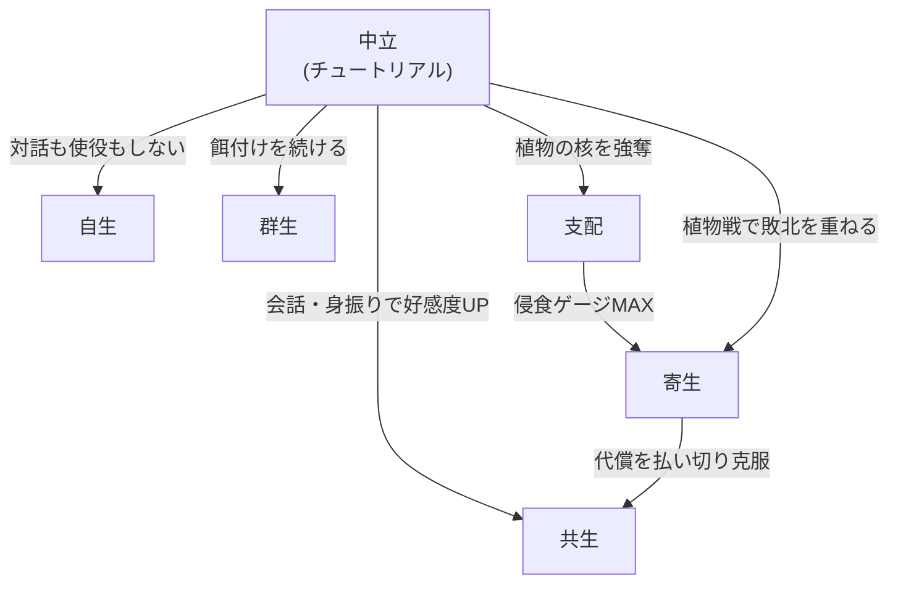
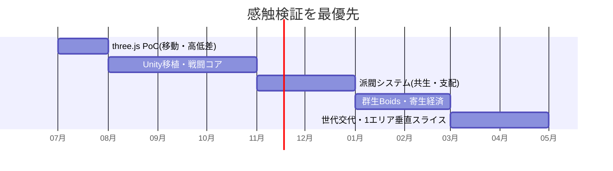

# 🌿 植生ソウルライク（仮題: VERDANT） — ゲーム設計書

ソウルライク 高低差×疾走感 5派閥分岐

> 🧪 PoC: [poc/15_plant-soulslike/index.html](../poc/15_plant-soulslike/index.html)（three.js — 高低差マップ・ダッシュ移動・素材収集の感触検証）

## 1. コンセプト

**植物が発達した世界のソウルライク。**植物に対して会話や身振り手振りでコミュニケーションを取るもよし、武器で攻撃して素材を集めるもよし — **敵対と対話が常に両方開いている**。

- 植物側の目的: **圧倒的な種のばら撒き／知識の吸収／進化**。植物は「ただの敵」ではなく、プレイヤーから学習し進化する敵対文明
- レベルは**高低差を生かす**。従来のフロム作品よりも**疾走感**を重視（スピード型ソウルライク）
- カイヨワ分類: **アゴン（戦闘）× ミミクリ（派閥ロールプレイ）**
- ペルソナ適合: やっさん（エルデンリング好き・重厚パワー・アチーブ）ど真ん中、松浦（疾走感・自由度・収集）

## 2. 派閥システム（本作の核）

プレイヤーと植物の関係性が5系統に分岐する:

| 派閥 | 関係 | プレイスタイル | コスト／リスク |
|---|---|---|---|
| 自生 | 独立 | 主人公の力だけで乗り切る純粋ソウルライク | 補助なし（実績・高難度層向け） |
| 群生 | 使役 | 植物を群れで使役し、数で戦う | 使役・管理に**餌**が必要（リソース管理） |
| 共生 | 対等 | 自分の力＋植物の力の両方を使える | 引き出せる植物の力の上限＝**好感度**で決まる |
| 支配 | 上位 | 植物の力を我が物として自由に使う | **油断すると逆に支配される**（侵食ゲージ） |
| 寄生 | 敗北 | 植物に力（金・取得経験値）を奪われ続けるが、**代償を払えば強力な攻撃**が撃てる | 恒常的な収入減と引き換えの瞬間火力 |

> 派閥は固定ジョブではなく**関係の状態**。プレイ中の行動で滑らかに遷移し、周回で全派閥ルートを回収できる（ED分岐）。

## 3. 他ゲームとの差別化

| 比較対象 | 共通点 | 本作の差別化 |
|---|---|---|
| エルデンリング／ダークソウル | 死にゲー・ビルド | 敵が**交渉可能**。全ボスに「倒す」以外の解法（対話・使役・共生）が最低1つある |
| SEKIRO | 高低差・機動力 | 鉤縄でなく**植物を足場化**（ツタ滑走・花のジャンプ台）する疾走感。移動自体が派閥能力に依存 |
| Pikmin／群体使役ゲー | 群れの使役 | 使役対象が**本来は敵**で、餌が尽きると反乱する緊張感 |
| Rain World | 生態系の中の弱者 | 「寄生」派閥＝負け続けても進行でき、**敗北がビルドになる**設計 |

> **一言差別化**: 「全ての敵と“戦う・飼う・組む・奪う・奪われる”が選べる、高低差特化のスピードソウルライク」

## 4. コアメカニクス

- **対話コマンド**: 身振り（ジェスチャーホイール）＋供物で植物の反応が変化。知識の吸収が目的の植物には「情報」も供物になる
- **素材収集**: 攻撃で得る素材は装備強化に必須 — ただし**攻撃した種は敵対進化**する（プレイヤーの攻撃パターンを学習し、対策個体をばら撒く）
- **疾走感**: スタミナは攻撃・被弾でのみ消費し、**移動・ダッシュでは減らない**（従来ソウルライクとの明確な操作感差）
- **植物の進化**: エリアごとに「世代」概念があり、プレイヤーの行動ログに応じて敵構成が世代交代する

## 5. レベルデザイン方針（Totten理論の適用）

- **好ましい高所と嫌悪される高所（Ch6）**: 高低差が本作の主軸。ツタの「登れる高所（安全・眺望）」と胞子雲の「落ちたら危険な低所」を交互配置し、垂直方向に眺望と避難を構成
- **敵は建築（Ch4）**: 巨大植物そのものが地形（ボス＝ダンジョン）。枝が足場、根が壁、開花・閉花が時限ドア
- **報酬の拒絶（Ch7）**: 光る種子（強化素材）は透明な花弁の中に見えているが、派閥能力（支配の強奪／共生の開花申請）がないと取れない
- **劣化戦略的デザイン（Ch10）**: 世代交代システムにより、同じエリアでも再訪時にレイアウトの意味が変わる — 記憶の宮殿（Ch5）を植物側が上書きしてくる、という体験
- **創発的空間（Ch10）**: 群生派閥の餌付け位置次第で植物の分布が変わり、プレイヤーごとに異なるショートカットが生える

## 6. 配色計画（kotonoha_sai）

メイン: **山滴る（自然）** — 生命力が滴る深緑のグラデーション

| 用途 | 色 | HEX |
|---|---|---|
| 若い植物・UI安全 | &nbsp;&nbsp;&nbsp; | `#c2da75` |
| 草原・低層 | &nbsp;&nbsp;&nbsp; | `#80b94e` |
| 樹冠・中層 | &nbsp;&nbsp;&nbsp; | `#48a772` |
| 基調・成木 | &nbsp;&nbsp;&nbsp; | `#018573` |
| 深部・古木 | &nbsp;&nbsp;&nbsp; | `#006e37` |
| 最深部 | &nbsp;&nbsp;&nbsp; | `#00512e` |

アクセント: **光炎（自然）**の赤 &nbsp;#b33033&nbsp;&nbsp;#e56322&nbsp; ＝ 敵対進化した個体・侵食ゲージ。派閥ごとにUI枠色を変更（自生=無色／群生=黄緑／共生=青緑／支配=赤／寄生=紫）し、現在の関係性を常時可視化（Ch5）。

## 7. 技術的要素の羅列

- 三人称キャラコントローラ（壁ツタ登り・滑走・高所落下制御、コヨーテタイム）
- ロックオン戦闘（スタミナ管理、パリィ／回避のヒットストップ設計）
- 派閥ステート管理（行動ログ→関係値→能力アンロックのデータ駆動）
- 群体AI（Boidsアルゴリズム: 群生派閥の使役植物、胞子群の表現）
- 敵の適応学習（プレイヤー行動の統計→世代交代時の敵パラメータ調整）
- ジェスチャー対話UI（ラジアルメニュー、好感度テーブル）
- 侵食／寄生の経済システム（取得ソウル・金の自動天引き）
- 植生プロシージャル配置（餌付け位置に応じた成長シミュレーション）
- シェーダー: 風揺れ頂点アニメーション、サブサーフェス風の葉の透過、開花モーフ
- 高低差ナビゲーション（3D NavMesh＋登攀リンク）

## 8. 適した制作環境

| 環境 | 適性 | 評価理由 |
|---|---|---|
| **Unity** | ◎ | 個人〜少人数でソウルライクを成立させる現実解。アセットストアの戦闘・IK資産が豊富 |
| UE | ○ | 植生表現（Nanite/Lumen）は最強だが、個人規模では物量・学習コストが重い |
| HTML5 (three.js) | △ | **PoC用途に限り最適**。移動の疾走感・高低差の検証を最速で回せる（本実装には不向き） |
| Qt / exe (WPF) | × | 3Dアクション不適 |

**推奨: three.jsでPoC → Unityで本実装**の二段構え。

## 9. 開発ロードマップ

