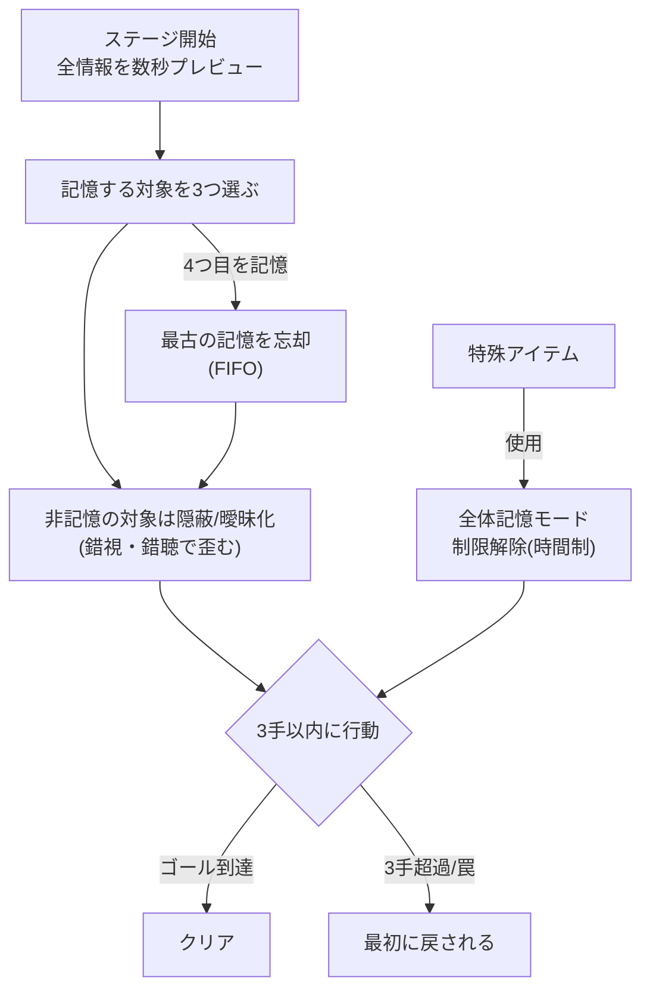
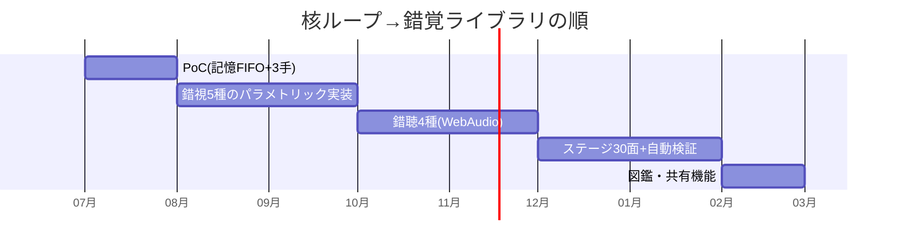

# 🧠 記憶トリプレット（仮題: みっつのこと） — ゲーム設計書

錯覚パズル 記憶3枠システム 明暗2モード

> 🧪 PoC: [poc/16_memory-triplet/index.html](../poc/16_memory-triplet/index.html)（pixi.js — 記憶3枠FIFO＋3手クリアの核ループ検証）

## 1. コンセプト

**「三つまでしか覚えられない」**制約下で錯視・錯聴だらけのステージを攻略するパズルゲーム。

- 記憶スロットは**3枠**。四つ目を覚えたとき、**最初の記憶を忘れる**（FIFO）
- **三手でステージをクリア**しないと最初に戻される
- 特殊アイテムで**全体記憶モード**が発動し、制限が一時解除される
- 記憶の対象: **ステージギミック・敵・アイテム**など、攻略に必要な情報すべて（覚えていないものは見えない／信用できない）

### 扱う知識・技能（ステージの明暗で切替）

| モード | 領域 | 採用する錯覚 |
|---|---|---|
| 明るいとき | 錯視（視覚） | ミュラー・リヤー錯視／エビングハウス錯視／形の錯視（大きさの恒常性）／明暗の錯視（コフカのリング）／色の錯視（色の残効・色の対比・色の同化・ネオンカラー効果） |
| 暗いとき | 錯聴（聴覚） | 感覚漏斗現象（ファントムセンセーション）／両耳ビート／定位残効／先行音効果／逆転の効果 |

- カイヨワ分類: **アゴン（パズル）× イリンクス（知覚が揺らぐ眩暈）**
- ペルソナ適合: そめりん（頭脳系・2D・カメラ酔いなし）、ベンティ（音系ギミック＝錯聴パート）

## 2. 他ゲームとの差別化

| 比較対象 | 共通点 | 本作の差別化 |
|---|---|---|
| Superliminal | 錯視ギミック | 錯視の**種類を明示的に教材化**（各面の題材が心理学の教科書に対応）し、2Dで酔わない |
| The Witness | 知覚パズル | **記憶3枠**という制約がパズルに時間軸を足す — 「解く順番」自体が解法 |
| 脳トレ系 | 記憶力 | 記憶力テストではなく、**何を捨てるかの取捨選択**（忘却のデザイン）。3手制限が詰将棋的な計画性を要求 |
| Hellblade | 幻聴の活用 | 錯聴を恐怖でなく**パズルの手掛かり**（両耳ビート＝正解方向、先行音効果＝偽の音源）として使う |

> **一言差別化**: 「忘れることまで計画に入れる、錯視×錯聴の詰将棋パズル」

## 3. コアメカニクス

- **記憶＝視界の信頼度**: 覚えた対象は正しく描画され、忘れた対象は錯視の影響を受けた「見た目のまま」描画される。錯視の知識があれば未記憶でも真の姿を推理できる — **知識がスロットを節約する**
- 暗いステージでは画面情報が最小になり、ヘッドホン推奨の錯聴ナビゲーション（両耳ビートの唸りの速さ＝距離、先行音効果でダミー音源を見抜く）

## 4. レベルデザイン方針（Totten理論の適用）

- **薄暗がり・影・曖昧さ（Ch6）の主役化**: Tottenが「解釈が曖昧な要素は劇的効果に使える」とする光・闇・曖昧さを、そのままコアメカニクスに昇格。明ステージ＝視覚の曖昧さ、暗ステージ＝聴覚の曖昧さ
- **Level 1-1（Ch8）**: 第1面は記憶2つで解ける2手パズル。ミュラー・リヤー錯視の「同じ長さの橋」を1つだけ提示し、**測ってから記憶する**という基本動作を教える
- **既存トロープの転覆（Ch8）**: 「見えているものは正しい」というゲームの大前提を疑わせる。エビングハウス面では大きく見える扉が実は同サイズ、色対比面では「危険色の床」が実は安全
- **サウンド道標（Ch13）**: 錯聴パートはCh13理論の実践場。3Dサウンドの定位を意図的に騙し（定位残効）、音の信頼度を管理させる
- **報酬スケジュール（Ch7）**: 各面クリアで錯覚の解説カード（図鑑）を1枚解放 — 学習資料そのものを報酬化

## 5. 配色計画（kotonoha_sai）

メイン: **黄昏時（時間）** — 明と暗の境界、知覚が揺らぐ時間帯

| 用途 | 色 | HEX |
|---|---|---|
| 明モード背景 | &nbsp;&nbsp;&nbsp; | `#f7df51` |
| 記憶スロットUI | &nbsp;&nbsp;&nbsp; | `#eab031` |
| 警告・忘却 | &nbsp;&nbsp;&nbsp; | `#e07b24` |
| 暗モード基調 | &nbsp;&nbsp;&nbsp; | `#513738` |
| 曖昧領域 | &nbsp;&nbsp;&nbsp; | `#d2b5a9` |
| 未記憶の対象 | &nbsp;&nbsp;&nbsp; | `#97909e` |

暗モード: **月の雫（自然）** &nbsp;#82a0b3&nbsp;&nbsp;#3c6f98&nbsp;&nbsp;#6b6482&nbsp;&nbsp;#3c3c47&nbsp;

> 注意: 色の錯視（対比・同化・残効）を扱う面では、パレットの厳密な輝度管理が仕様そのもの。実装時はOKLab等の知覚均等色空間で対比量を設計する。

## 6. 技術的要素の羅列

- 記憶スロット管理（FIFOキュー、記憶対象のメタデータ）
- 二重描画システム（真の状態 vs 知覚された状態のレイヤー分離）
- 錯視レンダリング（ミュラー・リヤー矢羽・エビングハウス周囲円・コフカのリング等のパラメトリック生成）
- 色錯視の演出（残効: 補色アフターイメージのポストエフェクト／同化・対比のタイル生成）
- WebAudio/DSP: 両耳ビート（左右微差周波数）、先行音効果（数ms遅延のパン制御）、ファントムセンセーション（両耳同時刺激の中央定位）
- 3手カウンタとリセット（詰将棋型ステージ設計のバリデータ: 全ステージが3手で可解かの自動検証）
- 全体記憶モード（時間制バフ、演出のグレースケール解除）
- 錯覚図鑑（クリア報酬の解説カード、出典付き）
- リプレイ・手順共有（3手の棋譜的短さを活かしたSNS共有）

## 7. 適した制作環境

| 環境 | 適性 | 評価理由 |
|---|---|---|
| **HTML5 (pixi.js)** | ◎ | 錯視のパラメトリック描画・WebAudioの錯聴実装が最短。ブラウザ配布で心理学教材としても展開可 |
| Unity | ○ | exe配布・Steam展開するなら。オーディオDSPはネイティブが有利 |
| exe (WPF) | △ | 静的な錯視提示は可能だがオーディオ・演出が弱い |
| UE / Qt | × | 2Dパズルに過剰 |

**推奨: HTML5（pixi.js＋WebAudio API）**。PoC→本実装まで同一スタックで行ける稀有な案。

## 8. 開発ロードマップ

