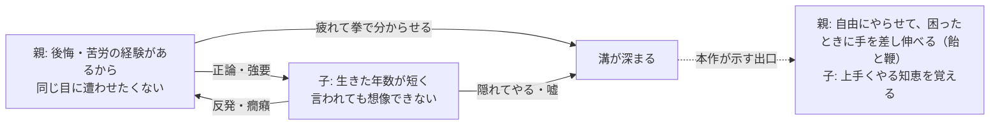
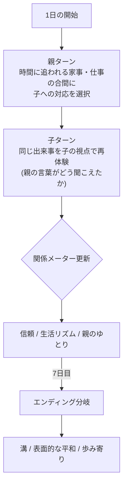
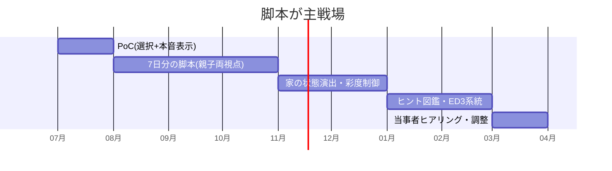

# 🏠 スクリーンタイム（仮題） — ゲーム設計書

シリアスゲーム 視点切替ADV テーマ: ゲーム・スマホ依存と親子の溝

> 🧪 PoC: [poc/17_screen-time-family/index.html](../poc/17_screen-time-family/index.html)（React — 1週間の選択シミュレーションと本音表示の検証）

## 1. コンセプト

**「ゲーム依存症になっても困ることはない」と思っている人の意識を変える**ことを目的に、親と子の両方の視点を体験させる生活シミュレーションADV。

- 作り手の立場: ゲームクリエイターとして、ゲームを断罪せずに依存の構造を描く（**ゲーム自体は悪ではない**、が出発点）
- プレイ場所・時間: 家でじっくり、1〜2時間で完走できるボリューム
- カイヨワ分類: **ミミクリ（親・子・兄の三役を生きる）**

### ターゲット設定

| 項目 | 内容 |
|---|---|
| メインターゲット | **小学生の弟・妹がいる10〜20代のゲーム好き男性** — 親でも子でもない「第三の当事者」で、両者の言い分が最も理解できる立場 |
| 題材となる家庭像 | 小学6年生以下の子を持つ30〜45歳の片親／共働き家庭 |
| 目的 | 「依存しても困らない」と思っている人に、**困るのは成績や健康より先に“関係”**であることを体験させる |

## 2. 背景リサーチ（原案メモの構造化）

### 親側の実情と欲求

- 片親は家事と仕事を一人で回すため**常に時間に追われ、時間に厳しい**。共働きは夫婦間で危機感がズレる（父は子とゲームで遊び、母はそれを見て将来に危機感を抱く）
- 小1未満: 仕事の間スマホで時間を潰してくれるのは**都合がいい**（育児が楽）— 依存の種は親の事情から蒔かれる
- 小1以上: 無断課金・宿題放置・学校からの呼び出し…面倒が増え、取り上げると癇癪と反発。**取り上げは何も解決しない**
- 欲求の本体: 時間を守ってほしい／めりはりをつけてほしい／面倒ごとを起こすな／**ゲーム自体は咎めていない**（自分の金の課金は許容、親の金は不可）／飯・風呂・歯磨き・起床という生活の合図に応じてほしい
- 例: 「お菓子を食うのは自由。だがお菓子で飯が食えないのは許さない（用意した時間と素材が無駄になるから）」

### 子側の欲求

- 遊び方・時間の潰し方を**スマホとゲーム以外に知らない**
- 気持ちに共感してほしい／自分を見てほしい／楽しかったものを親と**共有したい**／頑張りを**褒められたい**
- 嫌いなものを食べたくない、勉強したくない — やりたくないことを強要されたくない
- つまり: 現実的な正論ではなく、まず**肯定してほしい**

### 親子のすれ違いの構造

## 3. 他ゲームとの差別化

| 比較対象 | 共通点 | 本作の差別化 |
|---|---|---|
| 説教系シリアスゲーム | 社会課題テーマ | **誰も悪者にしない**。親の「スマホを与えた都合」も子の「共有したい欲求」も等価に描く |
| Papers, Please等の生活シム | 生活の締め付け | 締め付ける側（親ターン）と締め付けられる側（子ターン）を**交互にプレイ**し、同じ出来事を二度体験する |
| ニーディガールオーバードーズ | 依存の描写 | 依存者本人でなく**家族の視点**が主軸。メーターは「依存度」ではなく「関係の温度」 |
| 教育教材・啓発動画 | 意識変容が目的 | プレイヤーの選択が結果を変える**当事者性**。1〜2時間で完結し、弟妹がいる兄の実生活に持ち帰れる |

> **一言差別化**: 「同じ一週間を親と子の両方で二度生きる、“取り上げない”依存対策ADV」

## 4. コアメカニクス

- 選択肢は常に3系統: **強要（取り上げる）／放任（勝手にしろ）／工夫（飴と鞭・仕組みで解決）**
- 強要も放任も短期メーターは改善するが、隠しパラメータ「本音の距離」が悪化 — エンディングで回収
- 各選択後に**子の本音**（「本当は褒めてほしかった」等）が一拍遅れて表示される演出が本作の心臓部
- 工夫の選択肢は実在の手法（時間の見える化、ごほうび設計、一緒に遊ぶ日）をカタログ化し、クリア後に**「現実で使えるヒント集」**として図鑑化

## 5. レベルデザイン方針（Totten理論の適用）

- **家＝記憶の宮殿（Ch5/Ch12）**: 舞台はワンフロアの自宅のみ。リビング・子供部屋・台所の3空間の「散らかり方」「灯り」が関係メーターの可視化装置（メーターUIを見なくても家の状態で分かる）
- **ナラティブのセット構成（Ch9）**: 「急いで立ち去った痕跡」「生活感」の演出手法で、食べかけの夕飯・置きっぱなしのタブレットが台詞なしで状況を語る
- **ペーシング（Ch9）**: 7日間のドラマティックアーク。4日目に必ず「事件」（無断課金 or 学校からの電話）を置き、以降の選択の重みを変える
- **瞑想的空間（Ch7）**: 各日の終わりに親の一人時間（風呂・ベランダ）を挟み、選択を振り返らせる緩衝地帯を確保

## 6. 配色計画（kotonoha_sai）

メイン: **玉響（たまゆら・時間）** — 家庭の柔らかい時間、揺らぎやすい均衡

| 用途 | 色 | HEX |
|---|---|---|
| 朝・平常時の家 | &nbsp;&nbsp;&nbsp; | `#e6f4fd` |
| 子の部屋 | &nbsp;&nbsp;&nbsp; | `#f1d7e7` |
| 食卓・温かい記憶 | &nbsp;&nbsp;&nbsp; | `#ffefc8` |
| 感情の高ぶり | &nbsp;&nbsp;&nbsp; | `#e9a3c0` |
| 親の時間・夜 | &nbsp;&nbsp;&nbsp; | `#c5d8f0` |
| 画面（スマホの光） | &nbsp;&nbsp;&nbsp; | `#a7dae1` |

> 溝が深まるほど家全体の彩度が下がり、スマホ画面の色 `#a7dae1` だけが冴えていく — 「画面だけが鮮やかな家」を配色で描く（Ch5 コントラスト理論の主題化）。修復ルートでは食卓の `#ffefc8` が戻ってくる。

## 7. 技術的要素の羅列

- 視点切替システム（同一イベントログを親/子ビューで再生する二重スクリプト）
- 関係メーター（表: 信頼・生活リズム・ゆとり／裏: 本音の距離）と遅延反映ロジック
- 分岐管理（7日×選択の累積、エンディング3系統＋詳細バリエーション）
- 本音表示演出（選択確定後のディレイ表示、タイポグラフィ演出）
- 家の状態レンダリング（メーター連動の散らかり・照明・彩度制御）
- ヒント図鑑（工夫選択肢のアンロック式カタログ、クリア後閲覧）
- セーブ／周回（親視点既読スキップ、2周目の子視点差分）
- アクセシビリティ: 文字サイズ・読み上げ対応（保護者層にも触ってもらうため）

## 8. 適した制作環境

| 環境 | 適性 | 評価理由 |
|---|---|---|
| **HTML5 (React/Next.js)** | ◎ | テキスト・UI主体のADVに最適。**URLひとつで親世代にも共有できる**配布性がテーマと合致 |
| Unity | ○ | 家の状態演出をリッチにするなら。ただし配布ハードルが上がる |
| exe (WPF) | △ | UI構成は可能だが共有性で劣る |
| UE / Qt | × | 過剰 |

**推奨: React（PoC）→ Next.js（本実装・Web公開）**。SNSで拡散されてこそ意識変容という目的を果たせる。

## 9. 開発ロードマップ

