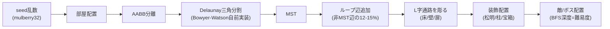

# 🏰 フロアマップ完全自動生成（データ駆動ダンジョン）

「いきなり見た目を作らない」— フロアを**純データ**として定義し、生成ロジック（[floorgen.js](floorgen.js)）と描画（[index.html](index.html)）を完全分離したプロシージャル生成ツール。

## 使い方

```powershell
# ビューア: index.html をブラウザで開く（three.js CDNのため要ネット接続）
#   seed入力 → ⟳生成 / 部屋数スライダー / ヒートマップ・グラフ表示トグル / ドラッグ回転

# テスト（Node・依存なし）
node tests.mjs
```

## データ仕様（generateFloor の戻り値）

| キー | 型 | 内容 |
|---|---|---|
| `seed` | number\|string | 生成シード（同一seed→同一フロア） |
| `rooms` | {id,x,y,w,h,type,depth}[] | type: normal/start/boss/treasure、depth=startからのBFS距離 |
| `edges` | {a,b,isLoop}[] | 部屋グラフ。MST辺＋ループ辺 |
| `grid` | number[][] | タイル: 0=空 1=床 2=壁 3=扉 |
| `props` | {type,x,y}[] | torch/pillar/chest |
| `spawns` | {type,x,y,tier}[] | enemy（tierはdepth連動）/boss |
| `meta` | object | 生成ms・ループ数・最深depth・tileDepth（ヒートマップ用）等 |

## 生成パイプライン



## 描画（WebGPU + TSL）

- **WebGPURenderer**（three r170）を使用。WebGPU非対応環境では自動でWebGL2にフォールバック（画面右下に表示）
- **TSLノードマテリアル**: 松明の炎を `sin(time×9 + worldPos)` のemissiveNodeで明滅（シェーダーを書かずにノードで表現）
- 床はInstancedMeshで一括描画し、ヒートマップはインスタンス色の書換えのみ（生成データのtileDepthを着色に直結＝ロジックと描画の分離の実演）
- グラフ表示: MST辺=水色／ループ辺=桃色／ノード=部屋（start=緑・boss=赤）

## テスト（tests.mjs・全25項目）

| 検証 | 内容 | 実測 |
|---|---|---|
| 接続性 | 全床タイルがflood fillで到達可能 | ✅ 5/5 seed |
| 決定性 | 同一seedでJSON完全一致 | ✅ 5/5 |
| ループ | 辺数 ≥ 部屋数-1+1 かつ isLoop≥1 | ✅ 5/5 |
| ボス深部 | bossDepth ≥ 最深×0.7 | ✅ 5/5（全seedで最深部屋） |
| 速度 | 60部屋 < 500ms | ✅ 1.5〜7.6ms |

## 応用

ゲームのダンジョンに限らず、`rooms/edges/grid` は建築・展示・イベント空間・メタバースのゾーニングデータとしてそのまま流用可能（描画層を差し替えるだけ）。
